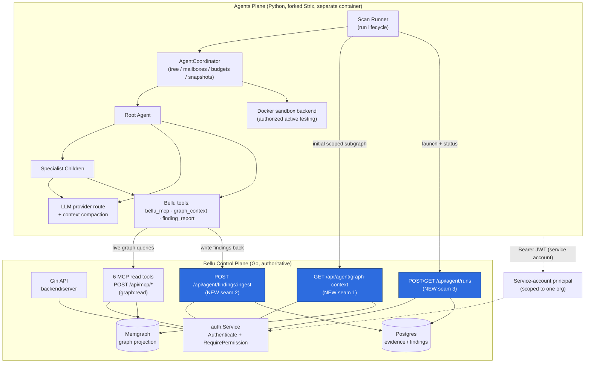
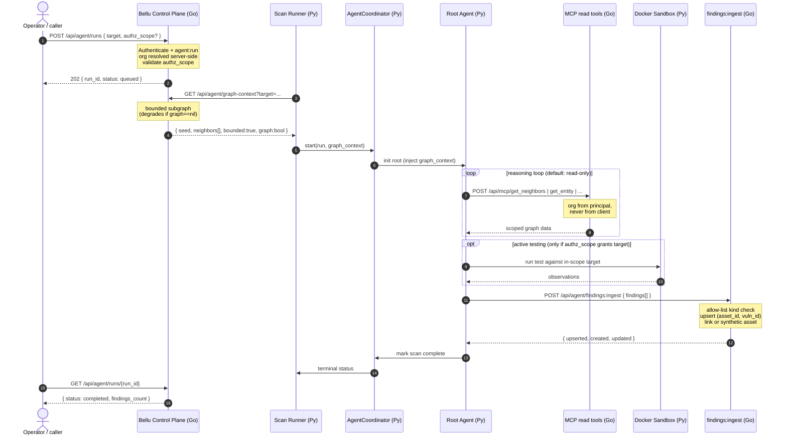
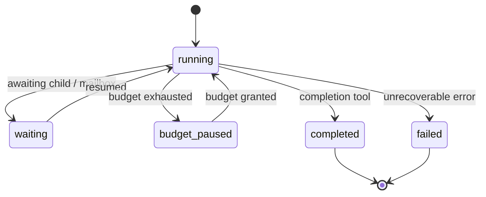
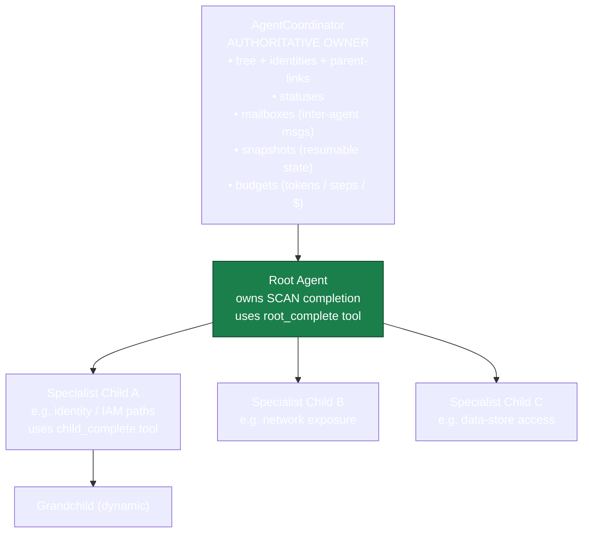

# Design Document: Bellu Agents Plane

## Overview

The **agents plane** is a new, separately deployable subsystem that adds Strix-style
autonomous pentest agents to the Bellu platform. It is a Python process/container built by
**hard-forking the Strix agent engine and editing it in place**, vendored under a new
top-level `agents-plane/` directory. It layers *on top of* Bellu's existing Go backend
without altering the authoritative Go core: the two form two distinct planes connected by
three thin, authenticated seams.

The engine is a full agent system — an `AgentCoordinator` owning a dynamic tree of agents
(a root agent plus specialist children), an agent factory, an LLM loop with context
compaction, agent tools, and a Docker sandbox backend for active testing. Its default and
first slice is **read-only graph reasoning**: the agents explore Bellu's canonical security
graph using the existing six MCP read tools and a scoped initial subgraph. **Active testing**
against real targets (the Docker sandbox exercising a URL/IP) is **opt-in, authorization-gated
per run**, and never reaches a target outside the run's declared scope.

A scan target may be **either** a Bellu-known graph entity (addressed by canonical id
`kind:provider:native-id`) **or** an operator-supplied raw target (URL/IP, Strix-style).
Findings **always** flow back into Bellu's existing finding model via a new write seam:
linked to a graph entity when one applies, or attached to an unlinked/synthetic asset ref
when the target has no graph entity.

> **Hard-fork tradeoff (noted up front):** because Strix is forked and edited in place rather
> than consumed as a dependency, upstream Strix improvements must be **manually merged** later.
> We accept this for the control it gives us to make the engine Bellu-graph-aware.

---

## Architecture

Two planes, thin seams. The Go **control plane** stays authoritative over Postgres (evidence,
findings) and Memgraph (the graph projection). The Python **agents plane** never touches those
stores directly — it reaches everything over authenticated HTTP and MCP.



**What stays unchanged:** `internal/model`, `internal/mcp`, `internal/finding` (producer path),
`internal/graph`, and the existing route groups in `backend/server/server.go`. The new
`/api/agent/*` endpoints follow the existing group-by-permission pattern. The `Server` struct's
nullable `graph` field (nil when Memgraph is down) means the graph-context and live-query paths
must degrade gracefully, mirroring the existing `graph:false` / `ErrProjectionUnavailable`
behavior.

Component responsibilities are summarized in the **Components and Interfaces** section below,
which also holds the detailed coordinator model and the concrete Go/Python interfaces.

---

## Scan Lifecycle (Sequence)



Key points: the control plane returns `202` immediately with a run id; the runner fetches the
bounded graph-context and injects it before the coordinator initializes the root; the live MCP
loop is the **default** activity; the sandbox branch is **opt-in and scope-guarded**; and all
findings route through the single ingest seam.

---

## Data Models

### Graph-context payload (Go → Python, seam 1)

Bounded by construction: a seed entity plus a capped set of neighbors to a shallow depth.

```go
// GraphContext is the initial scoped subgraph handed to a run. It is bounded:
// MaxNodes/MaxDepth are enforced server-side so the payload size cannot grow
// with graph size (correctness: graph-context payload bounded).
type GraphContext struct {
    Target      TargetRef       `json:"target"`             // entity or raw target
    Seed        *GraphNode      `json:"seed,omitempty"`     // nil for raw targets
    Neighbors   []GraphNode     `json:"neighbors"`          // capped at MaxNodes
    Edges       []GraphEdge     `json:"edges"`
    Bounded     bool            `json:"bounded"`            // always true
    GraphOnline bool            `json:"graph"`              // false when Memgraph is nil
    Truncated   bool            `json:"truncated"`          // true if caps clipped the result
}

type TargetRef struct {
    Kind        string `json:"kind"`                        // "entity" | "raw"
    CanonicalID string `json:"canonical_id,omitempty"`      // kind:provider:native-id
    Raw         string `json:"raw,omitempty"`               // URL/IP for raw targets
}

type GraphNode struct {
    CanonicalID string         `json:"canonical_id"`
    Kind        string         `json:"kind"`                // a model.Kind value
    Name        string         `json:"name"`
    Attributes  map[string]any `json:"attributes,omitempty"`
}

type GraphEdge struct {
    Relation string `json:"relation"`                       // a model.Relation value
    Src      string `json:"src"`
    Dst      string `json:"dst"`
}
```

### Findings ingest request (Python → Go, seam 2)

```go
// IngestRequest is a batch of agent-produced findings. Org is NEVER read from
// the body — it is resolved from the authenticated service-account principal.
type IngestRequest struct {
    RunID    string           `json:"run_id"`
    Findings []IngestFinding  `json:"findings"`
}

// IngestFinding is one finding in the agent's vocabulary. The handler maps it
// onto finding.Finding and upserts per (AssetID, VulnID).
type IngestFinding struct {
    // AssetID is a graph canonical_id for a linked asset, OR empty for an
    // operator-supplied raw target with no graph entity (synthetic asset).
    AssetID   string  `json:"asset_id,omitempty"`
    AssetKind string  `json:"asset_kind,omitempty"` // must pass model.ValidKind when AssetID set
    RawTarget string  `json:"raw_target,omitempty"` // set when AssetID is empty
    VulnID    string  `json:"vuln_id"`
    IntelRef  string  `json:"intel_ref,omitempty"`
    RiskScore float64 `json:"risk_score"`           // clamped to [0,100]
    Severity  string  `json:"severity"`
}
```

### Run model (seam 3)

```go
type LaunchRequest struct {
    Target     TargetRef    `json:"target"`
    AuthzScope *AuthzScope  `json:"authz_scope,omitempty"` // omitted => read-only reasoning only
}

// AuthzScope authorizes active testing. Empty/absent => active testing is OFF.
// Targets not matched by the scope are refused by the sandbox.
type AuthzScope struct {
    ActiveTesting bool     `json:"active_testing"`
    AllowTargets  []string `json:"allow_targets"` // exact hosts/IPs/CIDRs the sandbox may hit
}

type RunStatus struct {
    RunID         string `json:"run_id"`
    Status        string `json:"status"`          // queued|running|completed|failed
    FindingsCount int    `json:"findings_count"`
    ActiveTesting bool   `json:"active_testing"`  // whether this run was authorized for it
}
```

---

## Components and Interfaces

This section is the authoritative catalog of every component across both planes. It opens with
the responsibilities index, then specifies the coordinator / agent-tree model and the concrete
Go control-plane and Python agents-plane interfaces for each component.

### Component responsibilities

| Plane | Component | Responsibility |
|-------|-----------|----------------|
| Control (Go) | `graph-context` handler | Build a **bounded** scoped subgraph payload for a target entity and return it. Degrades gracefully when `s.graph == nil`. |
| Control (Go) | `findings:ingest` handler | Accept agent-produced findings; validate asset kind against the model allow-list; upsert per `(asset_id, vuln_id)`; handle linked vs unlinked/synthetic assets. Gated by new `findings:ingest` permission. |
| Control (Go) | `runs` handler | Launch a scan (returns a run id) and report status. Gated by new `agent:run` permission; validates the optional active-testing authorization scope. |
| Control (Go) | `auth` additions | New permissions `agent:run`, `findings:ingest`; a service-account/machine role bound to a single org. |
| Agents (Py) | Scan Runner | Owns a run's lifecycle: fetch + inject graph-context, start the coordinator, drive to terminal state, report status. |
| Agents (Py) | `AgentCoordinator` | **Authoritative** owner of the agent tree: identities, parent-links, statuses, mailboxes, snapshots, budgets. |
| Agents (Py) | Root / specialist agents | Root owns overall scan completion; children own sub-investigations. |
| Agents (Py) | `bellu_mcp` tool | Calls the 6 live MCP read tools at `POST /api/mcp/*`. |
| Agents (Py) | `graph_context` provider | Surfaces the injected initial subgraph to the agent. |
| Agents (Py) | `finding_report` tool | Maps a Strix finding → Bellu finding schema and posts it to `findings:ingest`. |
| Agents (Py) | Docker sandbox backend | Runs active testing **only** against in-scope targets. |

### Agent-Tree / Coordinator Model

The `AgentCoordinator` is the single authoritative owner of everything about the running agent
population. Agents do not own their own identities or statuses — they ask the coordinator.





**Root-completion vs child-completion.** The completion tool is deliberately split so a child
cannot end the whole scan:

- The **root agent** has a `root_complete` tool. Invoking it marks the *entire scan* complete
  and drives the run to a terminal state.
- A **specialist child** has a `child_complete` tool. Invoking it closes *that child's*
  sub-investigation, returns its result to the parent's mailbox, and frees the child's budget —
  it never terminates the scan.

The coordinator enforces this distinction: it rejects `root_complete` from any agent that is not
the root, and treats `child_complete` from the root as a no-op/error.

### Go control-plane seams (Low-Level Design)

All three handlers follow the existing `backend/server` conventions: a bounded request context,
tenant org resolved **only** from the authenticated principal (reusing the `mcpOrg` pattern),
and graceful degradation when `s.graph == nil`.

### Route registration (mirrors existing permission groups)

```go
// registerAgentRoutes mounts /api/agent/* following the server.go group pattern.
// graph-context is a read (agent:run is sufficient to launch; graph:read guards
// the subgraph read). findings:ingest requires the new findings:ingest perm.
func (s *Server) registerAgentRoutes(authed *gin.RouterGroup) {
    ar := authed.Group("")
    ar.Use(s.auth.RequirePermission(auth.PermAgentRun)) // "agent:run"
    {
        ar.POST("/agent/runs", s.handleAgentLaunch)
        ar.GET("/agent/runs/:id", s.handleAgentRunStatus)
        ar.GET("/agent/graph-context", s.handleAgentGraphContext)
    }
    fi := authed.Group("")
    fi.Use(s.auth.RequirePermission(auth.PermFindingsIngest)) // "findings:ingest"
    {
        fi.POST("/agent/findings:ingest", s.handleAgentFindingsIngest)
    }
}
```

### Seam 1 — graph-context handler (bounded + graceful degradation)

```go
const (
    maxContextNodes = 200 // hard cap: payload is bounded regardless of graph size
    maxContextDepth = 2
)

func (s *Server) handleAgentGraphContext(c *gin.Context) {
    org, ok := mcpOrg(c) // org from principal, NEVER from client
    if !ok {
        c.JSON(http.StatusUnauthorized, gin.H{"error": "not authenticated"})
        return
    }
    target, err := parseTargetRef(c.Query("target"))
    if err != nil {
        c.JSON(http.StatusBadRequest, gin.H{"error": "invalid target"})
        return
    }

    // Raw targets have no graph entity: return an empty-but-valid bounded ctx.
    if target.Kind == "raw" {
        c.JSON(http.StatusOK, GraphContext{
            Target: target, Neighbors: []GraphNode{}, Edges: []GraphEdge{},
            Bounded: true, GraphOnline: s.graph != nil,
        })
        return
    }

    // Graceful degradation: mirror graph:false behavior when Memgraph is down.
    if s.graph == nil {
        c.JSON(http.StatusOK, GraphContext{
            Target: target, Neighbors: []GraphNode{}, Edges: []GraphEdge{},
            Bounded: true, GraphOnline: false,
        })
        return
    }

    ctx, cancel := context.WithTimeout(c.Request.Context(), 15*time.Second)
    defer cancel()

    // BuildScopedSubgraph reads via s.graph.Driver(), scoped to org, to
    // maxContextDepth, clipped to maxContextNodes. It sets Truncated when caps
    // clip the result so the payload size never scales with graph size.
    gc, err := buildScopedSubgraph(ctx, s.graph, org, target, maxContextDepth, maxContextNodes)
    if err != nil {
        c.JSON(http.StatusServiceUnavailable, gin.H{"error": "temporarily unavailable"})
        return
    }
    c.JSON(http.StatusOK, gc)
}
```

### Seam 2 — findings:ingest handler (allow-list + upsert + linked/unlinked)

```go
func (s *Server) handleAgentFindingsIngest(c *gin.Context) {
    org, ok := mcpOrg(c) // tenant from principal; body org (if any) ignored
    if !ok {
        c.JSON(http.StatusUnauthorized, gin.H{"error": "not authenticated"})
        return
    }
    var req IngestRequest
    if err := c.ShouldBindJSON(&req); err != nil {
        c.JSON(http.StatusBadRequest, gin.H{"error": "invalid request body"})
        return
    }

    ctx, cancel := context.WithTimeout(c.Request.Context(), 15*time.Second)
    defer cancel()

    var created, updated, rejected int
    for _, in := range req.Findings {
        f, err := mapIngestFinding(org, req.RunID, in)
        if err != nil {
            rejected++ // allow-list / validation failure: skip, do not abort batch
            continue
        }
        // Upsert keyed on (AssetID, VulnID): the findings table UNIQUE constraint
        // makes repeated ingests idempotent except for last_seen (Property:
        // findings:ingest idempotency).
        res, err := s.store.UpsertFinding(ctx, org, f)
        if err != nil {
            c.JSON(http.StatusServiceUnavailable, gin.H{"error": "temporarily unavailable"})
            return
        }
        if res.Created {
            created++
        } else {
            updated++
        }
    }
    c.JSON(http.StatusOK, gin.H{"created": created, "updated": updated, "rejected": rejected})
}

// mapIngestFinding translates an agent finding into a finding.Finding, enforcing
// the allow-list on asset kind and resolving linked vs synthetic assets.
func mapIngestFinding(org int64, runID string, in IngestFinding) (finding.Finding, error) {
    if in.VulnID == "" {
        return finding.Finding{}, errors.New("missing vuln_id")
    }
    f := finding.Finding{
        VulnID:    in.VulnID,
        IntelRef:  in.IntelRef,
        RiskScore: clamp(in.RiskScore, 0, 100), // RiskScore constrained to [0,100]
        Severity:  canonical.Severity(in.Severity),
        Status:    finding.StatusOpen,
    }

    if in.AssetID != "" {
        // Linked asset: kind MUST be in the model allow-list, else reject
        // (correctness: allow-list validation on ingested asset kinds).
        k := model.Kind(in.AssetKind)
        if !model.ValidKind(k) {
            return finding.Finding{}, fmt.Errorf("disallowed asset_kind %q", in.AssetKind)
        }
        f.AssetID = in.AssetID
        f.AssetKind = k
        return f, nil
    }

    // Unlinked: operator-supplied raw target with no graph entity. Attach a
    // synthetic, org-scoped asset ref so the finding is still unique and never
    // collides across orgs or with real canonical ids.
    if in.RawTarget == "" {
        return finding.Finding{}, errors.New("need asset_id or raw_target")
    }
    f.AssetID = syntheticAssetID(org, runID, in.RawTarget) // e.g. "synthetic:<org>:<hash>"
    f.AssetKind = model.KindExternalService
    return f, nil
}
```

### Seam 3 — runs launch + status handler (authz-scope validation)

```go
func (s *Server) handleAgentLaunch(c *gin.Context) {
    org, ok := mcpOrg(c)
    if !ok {
        c.JSON(http.StatusUnauthorized, gin.H{"error": "not authenticated"})
        return
    }
    var req LaunchRequest
    if err := c.ShouldBindJSON(&req); err != nil {
        c.JSON(http.StatusBadRequest, gin.H{"error": "invalid request body"})
        return
    }
    // Active testing is opt-in: a scope with ActiveTesting=true MUST carry a
    // non-empty allow list, else the launch is rejected. Absent scope => the
    // run is read-only graph reasoning only.
    if req.AuthzScope != nil && req.AuthzScope.ActiveTesting && len(req.AuthzScope.AllowTargets) == 0 {
        c.JSON(http.StatusBadRequest, gin.H{"error": "active testing requires allow_targets"})
        return
    }

    ctx, cancel := context.WithTimeout(c.Request.Context(), 10*time.Second)
    defer cancel()
    runID, err := s.store.CreateAgentRun(ctx, org, req) // persists org-scoped run row
    if err != nil {
        c.JSON(http.StatusServiceUnavailable, gin.H{"error": "temporarily unavailable"})
        return
    }
    // Hand off to the agents plane out-of-band (queue/notify); do not block.
    c.JSON(http.StatusAccepted, gin.H{"run_id": runID, "status": "queued"})
}

func (s *Server) handleAgentRunStatus(c *gin.Context) {
    org, ok := mcpOrg(c)
    if !ok {
        c.JSON(http.StatusUnauthorized, gin.H{"error": "not authenticated"})
        return
    }
    ctx, cancel := context.WithTimeout(c.Request.Context(), 10*time.Second)
    defer cancel()
    // GetAgentRun scopes by org: a run from another tenant is a not-found, so a
    // caller cannot read another org's run (tenant isolation).
    st, err := s.store.GetAgentRun(ctx, org, c.Param("id"))
    if err != nil {
        c.JSON(http.StatusNotFound, gin.H{"error": "run not found"})
        return
    }
    c.JSON(http.StatusOK, st)
}
```

### Service-account auth model (Go)

```go
// New permission keys added to internal/auth/model.go.
const (
    PermAgentRun        = "agent:run"        // launch agent runs + read graph-context
    PermFindingsIngest  = "findings:ingest"  // write findings back from the agents plane
)

// New built-in role: a machine/service-account bound to ONE org. The agents
// plane authenticates as this principal; org is resolved from the principal
// server-side (never from request input), so the plane can only read/write
// within its own org (tenant isolation).
var RoleAgentServiceAccount = BuiltinRole{
    Key: "agent_service_account", Name: "Agent Service Account", ScopeLevel: ScopeGlobal,
    Description: "Machine identity for the agents plane, bound to a single org.",
    Permissions: []string{PermGraphRead, PermFindingsRead, PermAgentRun, PermFindingsIngest},
}
```

---

### Python agents-plane Bellu tools (Low-Level Design)

The forked Strix engine gains three Bellu-specific tools. All HTTP calls carry the
service-account bearer token; **none** of them send an org — the control plane resolves it.

### `bellu_mcp` — live graph queries during the scan

```python
class BelluMCP:
    """Thin client over Bellu's 6 read-only MCP tools at POST /api/mcp/*.

    Never sends an org: the control plane resolves the tenant from the
    service-account principal. This tool is READ-ONLY by construction — it maps
    one-to-one onto the six read tools and exposes no write path.
    """

    _TOOLS = {
        "find_entities", "get_entity", "get_neighbors",
        "entity_history", "recent_changes", "describe_schema",
    }

    def __init__(self, base_url: str, token: str):
        self._base = base_url.rstrip("/")
        self._session = httpx.Client(headers={"Authorization": f"Bearer {token}"})

    def call(self, tool: str, args: dict) -> dict:
        if tool not in self._TOOLS:
            raise ValueError(f"unknown MCP tool: {tool}")
        resp = self._session.post(f"{self._base}/api/mcp/{tool}", json=args, timeout=20.0)
        if resp.status_code == 503:            # mirror graph-unavailable degradation
            return {"unavailable": True}
        resp.raise_for_status()
        return resp.json()
```

### `graph_context` — surface the injected initial subgraph

```python
@dataclass(frozen=True)
class GraphContext:
    target: dict
    seed: dict | None
    neighbors: list[dict]
    edges: list[dict]
    bounded: bool          # expected True
    graph_online: bool
    truncated: bool

    @classmethod
    def fetch(cls, mcp_base: str, token: str, target: str) -> "GraphContext":
        resp = httpx.get(
            f"{mcp_base}/api/agent/graph-context",
            params={"target": target},
            headers={"Authorization": f"Bearer {token}"},
            timeout=20.0,
        )
        resp.raise_for_status()
        d = resp.json()
        return cls(
            target=d["target"], seed=d.get("seed"),
            neighbors=d.get("neighbors", []), edges=d.get("edges", []),
            bounded=d.get("bounded", True), graph_online=d.get("graph", False),
            truncated=d.get("truncated", False),
        )

    def as_prompt_block(self) -> str:
        """Render the bounded subgraph for injection into the root agent's
        context. Graph-aware prompting adapted from the Strix prompting guide."""
        ...
```

### `finding_report` — map a Strix finding → Bellu finding schema

```python
def report_findings(bellu_base: str, token: str, run_id: str,
                    strix_findings: list["StrixFinding"]) -> dict:
    """Translate Strix findings into Bellu's ingest schema and POST them to
    /api/agent/findings:ingest. Linked findings carry a graph canonical_id +
    allow-listed kind; raw-target findings omit asset_id and send raw_target so
    the control plane attaches a synthetic asset ref."""
    payload = {"run_id": run_id, "findings": [_to_bellu(f) for f in strix_findings]}
    resp = httpx.post(
        f"{bellu_base}/api/agent/findings:ingest",
        json=payload,
        headers={"Authorization": f"Bearer {token}"},
        timeout=30.0,
    )
    resp.raise_for_status()
    return resp.json()   # {created, updated, rejected}


def _to_bellu(f: "StrixFinding") -> dict:
    out = {
        "vuln_id": f.vuln_id,
        "intel_ref": f.intel_ref or "",
        "risk_score": max(0.0, min(100.0, f.risk_score)),  # clamp to [0,100]
        "severity": f.severity,
    }
    if f.graph_entity_id:                 # linked to a real graph entity
        out["asset_id"] = f.graph_entity_id
        out["asset_kind"] = f.asset_kind  # server re-validates against allow-list
    else:                                  # operator-supplied raw target
        out["raw_target"] = f.raw_target
    return out
```

### Authorization-scope gating for the sandbox active-testing path

```python
class ActiveTestingGate:
    """Enforces per-run authorization scope before any sandbox action.

    Default is read-only reasoning: if the run carries no scope, or scope does
    not enable active testing, the gate refuses every sandbox request. When
    enabled, only targets matched by the allow list are permitted; everything
    else is refused (correctness: no active test outside scope)."""

    def __init__(self, scope: dict | None):
        self._enabled = bool(scope and scope.get("active_testing"))
        self._allow = _compile_targets(scope.get("allow_targets", []) if scope else [])

    def ensure_allowed(self, target: str) -> None:
        if not self._enabled:
            raise PermissionError("active testing not authorized for this run")
        if not _target_matches(target, self._allow):
            raise PermissionError(f"target {target!r} is outside the authorized scope")


class DockerSandbox:
    def __init__(self, gate: ActiveTestingGate):
        self._gate = gate

    def run_active_test(self, target: str, plan: "TestPlan") -> "Observations":
        self._gate.ensure_allowed(target)   # refuses out-of-scope / unauthorized
        # ... spin up the sandbox container and execute only against `target`
```

---

## Correctness Properties

### Property 1: Tenant isolation

For every seam and every MCP call, the org is resolved from the
authenticated principal and never from client input, so the agents plane cannot read or
write across orgs.
*∀ request r: effective_org(r) == principal(r).User.OrgID, and no code path reads org from the request body/query.*
**Validates: Requirements 4.1, 5.3, 5.4, 6.1, 7.1, 7.4, 7.5, 9.5, 9.6**

### Property 2: findings:ingest idempotency

Re-ingesting the same `(asset_id, vuln_id)` for an org
updates the existing row (advancing `last_seen`) rather than creating a duplicate.
*∀ finding f, ∀ n ≥ 1: ingest(f) applied n times ⟹ exactly one row for (org, f.asset_id, f.vuln_id).*
**Validates: Requirements 6.8**

### Property 3: Allow-list validation on ingested asset kinds

A linked finding with an asset kind not in
`model.AllKinds` is rejected and never persisted.
*∀ linked finding f: persisted(f) ⟹ model.ValidKind(f.AssetKind).*
**Validates: Requirements 6.3, 6.4**

### Property 4: Authorization-scope gating

No active test runs against a target the run's scope does not
allow; absent scope ⟹ no active testing at all.
*∀ sandbox action a on target t: executed(a) ⟹ scope.active_testing ∧ t ∈ scope.allow_targets.*
**Validates: Requirements 8.1, 8.3, 8.4, 8.5**

### Property 5: Graceful degradation when Memgraph is nil

graph-context and live-query paths return a
valid, empty-but-well-formed response with `graph:false` rather than erroring, mirroring the
existing projection-unavailable behavior.
*graph == nil ⟹ graph-context returns 200 with Neighbors == [] ∧ GraphOnline == false.*
**Validates: Requirements 4.7, 5.5**

### Property 6: Graph-context payload bounded

The returned subgraph never exceeds `maxContextNodes`
nodes and `maxContextDepth` depth, independent of total graph size; over-size results set
`Truncated = true`.
*∀ graph-context response g: len(g.Neighbors) ≤ maxContextNodes ∧ depth(g) ≤ maxContextDepth.*
**Validates: Requirements 4.3, 4.4**

---

## Error Handling

| Scenario | Condition | Response | Recovery |
|----------|-----------|----------|----------|
| Memgraph down | `s.graph == nil` | graph-context returns 200, `graph:false`, empty neighbors | Agent proceeds with reasoning over whatever context exists; live MCP projection tools report unavailable |
| Disallowed asset kind | `!model.ValidKind` on a linked finding | Finding skipped, `rejected` count incremented; batch continues | Operator reviews rejected count; agent corrects kind mapping |
| Active test out of scope | target ∉ `allow_targets` | `PermissionError` in the plane; no container launched | Agent falls back to read-only reasoning for that target |
| Missing authz scope + active testing attempted | scope absent/disabled | Gate refuses every sandbox action | Run completes as read-only reasoning |
| Cross-org run status read | run belongs to another org | `404 run not found` (no existence disclosure) | None needed; isolation preserved |
| Upstream store error | Postgres/Memgraph read/write fails | `503 temporarily unavailable` (generic, no topology leak) | Caller retries later |

---

## Testing Strategy

### Unit testing
- **Go seams:** table tests for `mapIngestFinding` (linked allow-listed, linked disallowed kind
  rejected, raw-target synthetic asset), `buildScopedSubgraph` bounding (node cap + truncated
  flag), launch authz-scope validation (active testing requires allow list), and org-from-principal
  resolution ignoring body-supplied org.
- **Python tools:** `ActiveTestingGate.ensure_allowed` (disabled refuses all; enabled refuses
  out-of-scope; enabled allows in-scope), `_to_bellu` mapping (linked vs raw, risk clamp),
  `BelluMCP.call` rejects unknown tool names and treats 503 as unavailable.

### Property-based testing
- **Idempotency (Property 2):** generate random finding batches; assert N ingests of the same
  batch yield one row per `(asset_id, vuln_id)` with monotonic `last_seen`.
- **Scope gating (Property 4):** generate random (scope, target) pairs; assert a sandbox action
  is executed **iff** scope enables active testing and the target is in the allow list.
- **Bounding (Property 6):** generate graphs of varying size; assert the graph-context node count
  never exceeds `maxContextNodes`.
- **Suggested libraries:** `gopter` (Go) and `hypothesis` (Python).

### Integration testing
- End-to-end run against a seeded test graph: launch → graph-context → live MCP loop →
  findings ingest → status, asserting findings land in the findings table with correct linkage.
- Graph-down path: start with `s.graph == nil`, assert the run still completes read-only and
  responses carry `graph:false`.
- Cross-org negative test: a service-account principal for org A cannot read org B's run or
  entities.

---

## Security Considerations

- **Tenant isolation is non-negotiable.** Reuse the `mcpOrg` pattern everywhere; no `/api/agent/*`
  input type carries an org field. The service-account role is bound to exactly one org.
- **Active testing is high-impact and opt-in.** Default is read-only graph reasoning. Active
  testing requires an explicit per-run authorization scope with a non-empty allow list; the
  sandbox only ever targets what the scope allows and refuses everything else.
- **The agents plane never touches Postgres/Memgraph directly.** All access is over authenticated
  HTTP/MCP, so the control plane's existing RBAC and tenant resolution remain the single
  enforcement point.
- **Least privilege:** the service account gets `graph:read`, `findings:read`, `agent:run`, and
  `findings:ingest` — no admin, user-management, or policy permissions.
- **No topology leakage:** store/graph errors collapse to generic `temporarily unavailable`;
  cross-tenant reads collapse to not-found, mirroring the existing MCP error discipline.

---

## Dependencies

- **Control plane (Go, existing):** Gin, neo4j-go-driver v5 (Bolt → Memgraph), Postgres, the
  existing `internal/{model,mcp,finding,auth,graph,store}` packages. New: `findings` upsert write
  path (new permission-gated), `agent_runs` persistence.
- **Agents plane (Python, new `agents-plane/`):** a hard fork of the Strix agent engine edited in
  place; `httpx` for the MCP/seam HTTP clients; Docker (sandbox backend); an LLM provider SDK for
  the provider route + context compaction.
- **Hard-fork maintenance:** upstream Strix updates require manual merge into `agents-plane/`.
  Track the fork point so security-relevant upstream fixes can be reviewed and cherry-picked.
