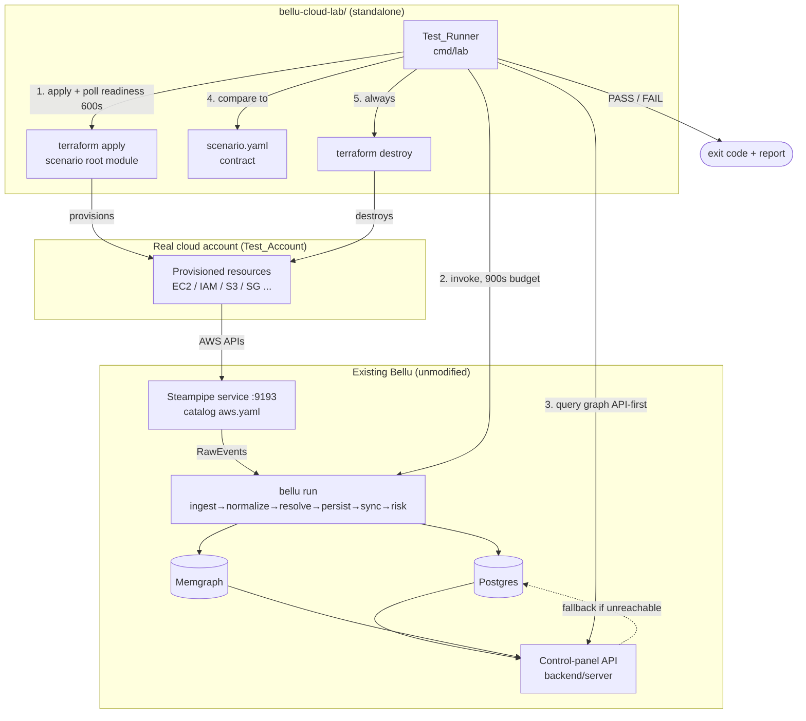

# Design Document

## Overview

The Bellu Cloud Lab is a standalone, disposable integration-test harness that provisions **real** cloud resources with Terraform, lets Bellu's existing collectors discover them, runs the unmodified `bellu run` pipeline, and asserts the resulting graph and risk outcomes against a machine-readable `scenario.yaml` contract — then tears everything down. It lives entirely under `bellu-cloud-lab/` and introduces **no** new Bellu model Kinds, Relations, normalizers, or collector behavior (Requirements 1, 18.3, 10.9, 14).

The Lab's job is intentionally narrow:

1. **Provision** an intentionally-shaped cloud topology for a named scenario (Terraform only, no CloudFormation, no workspaces, independent state per scenario/environment — Requirement 1).
2. **Collect** that topology into Bellu through the existing Steampipe source driven by the existing AWS catalog YAML (`internal/source/steampipe/catalog/aws.yaml`), normalized by the existing `internal/normalize/aws.go` normalizer.
3. **Run** the existing batch pipeline via the `bellu run` command (`cmd/bellu/run.go`): ingest → normalize → resolve → persist Postgres → sync Memgraph → risk.
4. **Assert** the resulting graph (queried API-first via the control-panel HTTP API in `backend/server`, with a Postgres fallback) matches the scenario contract's `expected_nodes`, `expected_edges`, and `expected_attack_paths`.
5. **Destroy** the scenario's resources regardless of outcome (Requirements 10.6, 13.6).

The Lab is a *consumer* of Bellu, never a modifier. Every expectation lives in the scenario contract (Requirement 3.6), and the Test_Runner only reads from Bellu's existing read surfaces. This design is grounded strictly in the interfaces that exist in the repository today; it invents no Bellu APIs.

### Grounding anchors (what the Lab depends on, as it exists today)

| Bellu surface | File | How the Lab uses it |
| --- | --- | --- |
| Node Kinds / Relations allow-lists | `internal/model/model.go` (`AllKinds`, `AllRelations`, `ValidKind`, `ValidRelation`) | Contract loader validates every Kind/Relation before provisioning (Req 3.3–3.8). |
| AWS normalizer behavior | `internal/normalize/aws.go` | Defines the exact nodes/edges each AWS resource produces (Req 4, 5, Decisions D1–D3). |
| Steampipe catalog | `internal/source/steampipe/catalog/aws.yaml`, `catalog.go` | The tables Bellu already collects; new coverage is a YAML addition, no Go (Req 15). |
| Pipeline entry point | `cmd/bellu/run.go`, `internal/pipeline/pipeline.go` | The Lab shells out to `bellu run`; never reimplements it (Req 10.3, 10.9). |
| Risk scoring | `internal/risk/score.go` (`Compute`, `RiskContext.Reachable`, exposure 1.0 vs 0.4) | Attack-path reachability assertion (Req 7.4, Decision D4). |
| Control-panel read API | `backend/server/server.go` (`GET /api/entities`, `/api/stats`, `/api/edges/find`, `/api/graph/attack-paths`, `/api/health`) | API-first graph queries, with Postgres fallback (Req 10.3). |

## Architecture

### Directory tree

```
bellu-cloud-lab/
├── README.md                      # setup, credentials, cost, contract format (Req 20)
├── Makefile.lab                   # lab targets, included from repo Makefile (Req 11)
├── scripts/                       # helper scripts (steampipe up, credential checks) (Req 1.4)
├── compatibility-matrix.md        # Cloud → Bellu node/edge coverage (Req 15)
├── cmd/
│   └── lab/                       # Go Test_Runner command (Req 10)
│       └── main.go
├── internal/                      # Test_Runner internals (contract loader, comparator, runner)
│   ├── contract/                  # scenario.yaml schema + validating loader
│   ├── runner/                    # terraform + bellu run orchestration, timeouts
│   ├── graphquery/                # Bellu API client + Postgres fallback reader
│   └── report/                    # PASS/FAIL result model
├── aws/
│   ├── modules/                   # reusable building blocks (Req 2)
│   │   ├── vpc/ subnets/ route-tables/ igw/
│   │   ├── security-group/ ec2/ iam/ s3/
│   │   └── rds/ eks/ lambda/ cloudwatch-logs/
│   ├── scenarios/
│   │   ├── public-ec2/            # root module + scenario.yaml (Req 4)
│   │   ├── iam-to-s3/             # root module + scenario.yaml (Req 5)
│   │   ├── vulnerable-workload/   # Phase 2 (Req 6)
│   │   ├── attack-path/           # Phase 2 (Req 7)
│   │   ├── eks-identity-chain/    # Phase 3 (Req 8)
│   │   └── ai-agent/              # Phase 4 (Req 9)
│   └── environments/              # per-env backend + tfvars (independent state)
├── gcp/                           # Phase 5 — same shape (Req 16)
│   ├── modules/  scenarios/  environments/
└── azure/                         # Phase 6 — same shape (Req 17)
    ├── modules/  scenarios/  environments/
```

Each provider directory carries `scenarios/`, `modules/`, and `environments/` (Requirement 1.2–1.3). `scripts/` and `README.md` sit at the root (Requirement 1.4). All infrastructure is Terraform (Requirement 1.5); zero CloudFormation (Requirement 1.6).

**State isolation (Requirement 1.7):** Each scenario is a *distinct root Terraform module* with its own state file, and each environment overlays a distinct backend config. Isolation is by state key, **not** Terraform workspaces. Default backend is **local** (`terraform.tfstate` under the scenario dir, keyed by environment), which keeps CI runs hermetic and cheap. A remote backend slots in by dropping an `environments/<env>.backend.hcl` referencing an S3/GCS/azurerm backend and running `terraform init -backend-config=environments/<env>.backend.hcl` — the Lab never hardcodes backend credentials; they come from the ambient cloud auth (Requirement 12).

### Data-flow diagram



### Decoupling (Requirement 18)

- The Lab talks to the **customer** Bellu plane (the default Postgres + Memgraph + control-panel API from `bellu.yaml`) only through `bellu run` and read APIs. It never connects to the Global Intelligence plane (`postgres-intel` on :5433, OpenSearch on :9200) — those are a separate compose project and are out of scope (Requirement 18.2). The Test_Runner's graph queries hit only `backend/server` endpoints or the customer Postgres DSN.
- The Lab provisions only into a dedicated **Test_Account** (Requirement 12.6) and never touches production/customer infrastructure (Requirement 18.1).
- No Bellu source file changes. New collector coverage, when needed, is a **catalog YAML** edit (data-driven; `catalog.go` loads it with no new Go), consistent with the Steampipe source's design (Requirement 15, 18.3).

### Steampipe service & credential wiring (no hardcoded secrets)

Bellu's Steampipe source (`internal/source/steampipe/steampipe.go`) connects to a **running Steampipe service** over its Postgres wire port (`:9193`) using the connection in `bellu.yaml` (`sources.steampipe`). The Lab does not change this. The Lab's responsibility is to ensure:

1. A Steampipe service is up with the `aws` connection configured (brought up by `scripts/steampipe-up.sh`, or the existing compose stack).
2. Steampipe's AWS plugin authenticates using **native, ambient AWS credentials** — an AWS profile, environment variables (`AWS_PROFILE`/`AWS_ACCESS_KEY_ID`...), or an assumed role (Requirement 12.1–12.2). The Lab passes credentials to Steampipe only through the environment / mounted `~/.aws`; it writes **zero** secrets into Terraform files, scenario files, or committed config (Requirement 12.1). The Steampipe service's own Postgres password in `bellu.yaml` is a local dev value, not a cloud secret.

Collector credentials are least-privilege read-only (Requirement 12.5): the Lab documents an IAM policy scoped to the `Describe*`/`List*`/`Get*` actions the catalog tables require, and nothing more.

## Components and Interfaces

### Reusable AWS Terraform modules (Requirement 2)

Each module exposes least-cost defaults (Requirement 2.4, 13.1–13.3) and an output listing the identifiers it created (Requirement 2.5, 13.7). All modules tag every taggable resource with a `bellu-lab` tag set (Requirement 13.5). High-level I/O:

| Module | Key inputs | Key outputs | Cost defaults |
| --- | --- | --- | --- |
| `vpc` | `cidr_block`, `tags` | `vpc_id`, `created_resource_ids` | single VPC, no extras |
| `subnets` | `vpc_id`, `public_cidrs`, `private_cidrs`, `az` | `public_subnet_ids`, `private_subnet_ids`, `created_resource_ids` | 1 AZ |
| `route-tables` | `vpc_id`, `subnet_ids`, `igw_id` | `route_table_ids`, `created_resource_ids` | — |
| `igw` | `vpc_id` | `igw_id`, `created_resource_ids` | no NAT gateway (Req 13.4) |
| `security-group` | `vpc_id`, `ingress_rules`, `name` | `security_group_id`, `created_resource_ids` | — |
| `ec2` | `subnet_id`, `security_group_ids`, `instance_profile`, `instance_type` | `instance_id`, `instance_arn`, `created_resource_ids` | `instance_type` default `t3.micro` |
| `iam` | `role_name`, `assume_role_policy`, `inline_policies`, `instance_profile` | `role_arn`, `user_arn`, `instance_profile_name`, `created_resource_ids` | — |
| `s3` | `bucket_name`, `tags` | `bucket_arn`, `bucket_name`, `created_resource_ids` | no versioning/replication |
| `rds` | `instance_class`, `engine`, `subnet_ids` | `db_arn`, `created_resource_ids` | `instance_class` default `db.t3.micro` |
| `eks` | `cluster_name`, `subnet_ids`, `node_instance_type`, `desired_size` | `cluster_arn`, `oidc_provider_arn`, `created_resource_ids` | smallest node + control plane (Req 8.5, 13.2); no GPU (Req 13.3) |
| `lambda` | `function_name`, `role_arn`, `handler`, `image_uri` | `function_arn`, `created_resource_ids` | minimal memory |
| `cloudwatch-logs` | `log_group_name`, `retention_days` | `log_group_arn`, `created_resource_ids` | short retention |

Modules default instance size/tier to the smallest practical option wherever one is exposed (Requirement 2.4). The `created_resource_ids` output is the uniform convention satisfying Requirements 2.5 and 13.7, and it feeds the readiness poller.

### Scenario layout & resource→collector→node mapping

A scenario is a **root Terraform module** composing building-block modules, plus exactly one `scenario.yaml` (Requirement 3.1). The scenario provisions resources that the **existing** Steampipe catalog already collects and the **existing** `aws.go` normalizer already maps. The table below is the authoritative, repo-grounded mapping (from `aws.yaml` + `aws.go`):

| Terraform resource | Steampipe table (`aws.yaml`) | `aws.go` output | Model Kind / Relation |
| --- | --- | --- | --- |
| `aws_instance` | `aws_ec2_instance` | `awsCompute(..., "ec2")`; `usesEdge` to instance-profile role | `Compute`; `USES` → role (Decision D1) |
| `aws_iam_role` | `aws_iam_role` | `awsIdentity`; `containsEdge`; IAM 2nd-pass | `Identity`; `CONTAINS` from account; `CAN_READ/WRITE/ADMIN` → S3 |
| `aws_iam_user` | `aws_iam_user` | `awsIdentity` | `Identity` |
| `aws_s3_bucket` | `aws_s3_bucket` | `awsDataStore` | `DataStore` |
| `aws_security_group` open to `0.0.0.0/0` | `aws_vpc_security_group` | `sgOpenToWorld` → SG `NetworkEndpoint` + synthetic internet `NetworkEndpoint` + `exposedToEdges` | `NetworkEndpoint` ×2; `EXPOSED_TO` → `0.0.0.0/0` |
| `aws_vpc`, subnets, route tables, IGW | *(no dedicated catalog table / normalizer case)* | **none** | not standalone nodes — see compatibility matrix |
| `aws_lambda_function` | `aws_lambda_function` | `awsCompute(..., "lambda")`; `usesEdge` to `role` | `Compute`; `USES` |
| `aws_ecs_task_definition` | `aws_ecs_task_definition` | `awsWorkload`; `usesEdge`; `runsImageEdge` per digest | `Workload`; `USES`, `RUNS_IMAGE` |
| `aws_eks_cluster` | `aws_eks_cluster` | `awsCluster` | `Cluster` |
| `aws_bedrock_custom_model` / `aws_sagemaker_model` | same | `awsAIService` | `AIService` |

Critically, **VPC/subnet/route-table/IGW produce no graph nodes** today — `aws.go` has no case for them. The Lab does not pretend otherwise; the compatibility matrix flags them as "not collectible" (Requirement 15.3). The security group becomes a `NetworkEndpoint` **only** when it is open to `0.0.0.0/0` (`sgOpenToWorld`); a locked-down SG produces nothing.

#### Scenario: `aws/public-ec2` (Requirement 4)

Composes `vpc` + `subnets` + `igw` + `route-tables` + `security-group` (ingress `0.0.0.0/0`) + `ec2` (with instance profile) + `iam` (role + instance profile + S3-read inline policy) + `s3`. Expected graph:

- `Compute` (the EC2 instance), `Identity` (the role), `DataStore` (the bucket), `NetworkEndpoint` (the SG + synthetic internet) — Requirement 4.2.
- `USES` edge `Compute → Identity` via instance profile (Requirement 4.3, Decision D1 — **not** `AUTHENTICATES_AS`).
- `CAN_READ` edge `Identity → DataStore` from the approximate IAM evaluator (Requirement 4.4, Decision D3), confidence 0.7.
- `EXPOSED_TO` edge from the SG `NetworkEndpoint` to `0.0.0.0/0` (Requirement 4.5).

The runner matches the `CAN_READ` edge on relation + endpoints only (Requirement 4.6, 3-tolerant per D3).

#### Scenario: `aws/iam-to-s3` (Requirement 5)

Composes `iam` (role or user + attached S3 policy) + `s3`. Expected graph: `Identity`, `DataStore` (Requirement 5.2); a permission edge `CAN_READ|CAN_WRITE|CAN_ADMIN` `Identity → DataStore` consistent with the policy (Requirement 5.3). The runner accepts the edge at confidence 0.7 (Requirement 5.4, Decision D3).

### The Test_Runner

A new Go command living **inside the Lab** at `bellu-cloud-lab/cmd/lab` (never in Bellu internals). It shells out to `terraform` and to the repo's `bellu` binary (`bellu run`), and reads the resulting graph. Design decisions:

- **Query strategy — API-first, DB fallback (Requirement 10.3):** The runner first queries the control-panel API (`GET /api/entities?kind=...`, `GET /api/edges/find?relation=...&like=...`, `GET /api/stats`, `GET /api/graph/attack-paths`) using a `graphquery.APIClient`. If `GET /api/health` is unreachable, it falls back to a `graphquery.PostgresReader` against the customer Postgres DSN (the normalized `entities`/`edges` tables persisted by `PersistNormalized`). It never queries Memgraph directly and never touches the intel plane.
- **Orchestration & timeouts:** `internal/runner` runs `terraform apply`, polls readiness up to **600s** (Requirement 10.1), invokes `bellu run` with a **900s** budget (Requirement 10.4), compares, and **always** runs `terraform destroy` (Requirement 10.6).
- **No Bellu modification (Requirement 10.9):** The runner reuses `bellu run` as a subprocess and introduces no model Kinds, Relations, or normalizers.

Interface sketch (Lab-local Go):

```go
// bellu-cloud-lab/internal/runner
type Runner struct {
    TerraformBin string
    BelluBin     string           // path to the built `bellu` binary
    Graph        graphquery.Client // API-first, Postgres fallback
    ReadinessTimeout time.Duration // 600s
    PipelineTimeout  time.Duration // 900s
}

func (r *Runner) Run(ctx context.Context, sc contract.Scenario) report.Result
```

### scenario.yaml schema & validating loader

`bellu-cloud-lab/internal/contract` defines the schema and a loader that validates **before** provisioning (Requirement 3.7). Validation uses Bellu's own allow-lists via `model.ValidKind` / `model.ValidRelation` (importing `internal/model` read-only):

```go
// bellu-cloud-lab/internal/contract
type Scenario struct {
    Name                 string          `yaml:"name"`
    ExpectedNodes        []NodeExpect    `yaml:"expected_nodes"`
    ExpectedEdges        []EdgeExpect    `yaml:"expected_edges"`
    ExpectedAttackPaths  []AttackPath    `yaml:"expected_attack_paths"`
}
type NodeExpect struct { Kind, Name string; Attributes map[string]any }
type EdgeExpect struct { Relation, From, To string; MinConfidence float64 }
type AttackPath struct { Nodes []string; Edges []EdgeExpect; RiskOutcome *RiskExpect }
type RiskExpect struct { ReachableMultiplier float64; Clamp [2]float64 }

func Load(path string) (Scenario, error) // decodes YAML, then Validate()
func (s Scenario) Validate() error        // sections present + Kind/Relation allow-list
```

`Validate` enforces: all three sections present (Requirement 3.2, 3.9 → report missing section); every `expected_nodes` Kind in `model.AllKinds` (Requirement 3.3); every `expected_edges` Relation in `model.AllRelations` (Requirement 3.4); every attack-path node Kind and edge Relation in the allow-lists (Requirement 3.5). On any unknown Kind/Relation, `Validate` fails, reports each unknown token with the referencing entry, and marks the whole contract invalid (Requirement 3.8) — no partial acceptance.

### Steampipe catalog usage & new-table policy

The Lab relies on the **existing** `aws.yaml` catalog. If a future scenario needs a table not yet present, the fix is a **catalog YAML addition** (data-driven, loaded by `catalog.go`, no Go changes — Requirement 15) plus, if the normalizer has no case for it, a compatibility-matrix "not collectible" flag (Requirement 15.3). The Lab never adds a normalizer case to make a resource collectible (that would modify Bellu, violating Requirement 18.3).

## Data Models

### scenario.yaml contract

`public-ec2` example:

```yaml
name: aws/public-ec2
expected_nodes:
  - { kind: Compute,         name: public-ec2 }
  - { kind: Identity,        name: public-ec2-role }
  - { kind: DataStore,       name: public-ec2-bucket }
  - { kind: NetworkEndpoint, name: "0.0.0.0/0" }
expected_edges:
  - { relation: USES,       from: Compute,  to: Identity }      # Decision D1
  - { relation: CAN_READ,   from: Identity, to: DataStore, min_confidence: 0.7 }  # Decision D3
  - { relation: EXPOSED_TO, from: NetworkEndpoint, to: "0.0.0.0/0" }
expected_attack_paths: []
```

`iam-to-s3` example:

```yaml
name: aws/iam-to-s3
expected_nodes:
  - { kind: Identity,  name: lab-reader }
  - { kind: DataStore, name: iam-to-s3-bucket }
expected_edges:
  - { relation: CAN_READ, from: Identity, to: DataStore, min_confidence: 0.7 }  # Decision D3
expected_attack_paths: []
```

`attack-path` risk outcome (Requirement 7.4, Decision D4):

```yaml
expected_attack_paths:
  - nodes: [NetworkEndpoint, Compute, Identity, DataStore]
    edges:
      - { relation: EXPOSED_TO, from: NetworkEndpoint, to: Compute }
      - { relation: USES,       from: Compute,  to: Identity }
      - { relation: CAN_READ,   from: Identity, to: DataStore, min_confidence: 0.7 }
    risk_outcome: { reachable_multiplier: 2.5, clamp: [0, 100] }
```

### Test_Runner result model

```go
// bellu-cloud-lab/internal/report
type Result struct {
    Scenario      string
    Status        Status            // PASS | FAIL
    MissingNodes  []NodeExpect
    MissingEdges  []EdgeExpect
    MissingPaths  []AttackPathDiag  // which node/edge of the chain was absent (Req 7.5, 10.5)
    RiskCheck     *RiskDiag         // observed vs expected reachable multiplier
    Phase         string            // apply | ready | pipeline | compare | destroy
    FailureReason string            // apply/timeout/pipeline/destroy/sbom/contract
    Timings       map[string]time.Duration // apply, ready, pipeline, compare, destroy
    ResourcesMayRemain bool         // true when destroy failed (Req 10.8)
}
type Status string // "PASS" | "FAIL"
```

### Cloud→Bellu compatibility matrix

`compatibility-matrix.md` has columns: Cloud resource, Terraform resource, Bellu node, Bellu edge, Tested status (Requirement 15.1). Phase 1 AWS rows reflect **actual** `aws.go` coverage:

| Cloud resource | Terraform | Bellu node | Bellu edge | Tested |
| --- | --- | --- | --- | --- |
| EC2 instance | `aws_instance` | `Compute` | `USES`→role | ✅ public-ec2 |
| IAM role | `aws_iam_role` | `Identity` | `CONTAINS`, `CAN_READ/WRITE/ADMIN`→S3 | ✅ public-ec2, iam-to-s3 |
| IAM user | `aws_iam_user` | `Identity` | `CAN_*`→S3 | ✅ iam-to-s3 |
| S3 bucket | `aws_s3_bucket` | `DataStore` | — | ✅ public-ec2, iam-to-s3 |
| Security group (open 0.0.0.0/0) | `aws_security_group` | `NetworkEndpoint` (+ synthetic internet) | `EXPOSED_TO` | ✅ public-ec2 |
| Security group (locked down) | `aws_security_group` | — (no node) | — | ⚠️ not collectible |
| VPC | `aws_vpc` | — | — | ⚠️ not collectible |
| Subnet / route table / IGW | `aws_subnet` / `aws_route_table` / `aws_internet_gateway` | — | — | ⚠️ not collectible |
| Lambda | `aws_lambda_function` | `Compute` | `USES` | ⬜ later |
| ECS task def | `aws_ecs_task_definition` | `Workload` | `USES`, `RUNS_IMAGE` | ⬜ vulnerable-workload |
| EKS cluster | `aws_eks_cluster` | `Cluster` | — | ⬜ eks-identity-chain |
| Bedrock/SageMaker model | `aws_bedrock_custom_model`/`aws_sagemaker_model` | `AIService` | `CONTAINS` | ⬜ ai-agent |

The "not collectible" rows satisfy Requirement 15.3 by documenting the real gap rather than hiding it.

## Error Handling

| Condition | Handling | Requirement |
| --- | --- | --- |
| `terraform apply` fails | Report apply failure, Result=FAIL, run `terraform destroy` | 10.7 |
| Readiness not reached in 600s | Report provisioning-timeout, FAIL, run `terraform destroy` | 10.1, 10.2 |
| `bellu run` exceeds 900s or exits non-zero | Report pipeline failure, FAIL, run `terraform destroy` | 10.4 |
| Comparison finds missing/mismatched element | FAIL; `MissingNodes/Edges/Paths` name what was absent | 10.5, 7.5 |
| Comparison succeeds | PASS; still run `terraform destroy` | 10.5, 10.6 |
| `terraform destroy` fails | Report destroy failure, set `ResourcesMayRemain`, exit non-zero | 10.8 |
| SBOM absent / invalid CycloneDX / missing pinned package | Scenario fails, error states SBOM could not be ingested, no partial correlation | 6.4 |
| Contract references unknown Kind/Relation | Loader fails pre-provision, reports each unknown token + entry, whole contract invalid | 3.8 |
| Contract missing a required section | Loader fails pre-provision, reports the missing section | 3.9 |
| Bellu API unreachable | Fall back to Postgres reader; only fail if both are unreachable | 10.3 |

Teardown is **unconditional**: destroy runs on apply failure, readiness timeout, pipeline failure, comparison PASS, and comparison FAIL. The only non-zero-with-resources-remaining exit is a destroy failure (Requirement 10.8, 13.6).

## Correctness Properties

*A property is a characteristic or behavior that should hold true across all valid executions of a system — essentially, a formal statement about what the system should do. Properties serve as the bridge between human-readable specifications and machine-verifiable correctness guarantees.*

PBT applies to the Lab's **pure logic**: the contract loader/validator, the graph comparator, and the risk-outcome relationship (which reuses `risk.Compute`, a pure function). PBT does **not** apply to the Terraform provisioning, Steampipe collection, or `bellu run` orchestration — those are real-cloud integration behaviors validated by integration tests, not universal properties over generated inputs.

### Property 1: Contract loader rejects unknown Kinds and Relations

*For any* generated scenario contract containing at least one Kind absent from `model.AllKinds` or one Relation absent from `model.AllRelations`, `contract.Scenario.Validate` returns an error, names each unknown token with its referencing entry, and accepts none of the contract's entries.

**Validates: Requirements 3.3, 3.4, 3.5, 3.8**

### Property 2: PASS implies full contract satisfaction

*For any* scenario contract and any queried graph, if the comparator returns PASS then every node in `expected_nodes`, every edge in `expected_edges`, and every chain in `expected_attack_paths` is present in the queried graph with matching relation and endpoints (edges tolerant to confidence ≥ `min_confidence`); conversely, if any declared element is absent the comparator returns FAIL and lists it.

**Validates: Requirements 10.5, 7.5**

### Property 3: Teardown is always invoked

*For any* scenario run outcome (apply failure, readiness timeout, pipeline failure, PASS, or FAIL), the runner invokes `terraform destroy` exactly once, and a repeated destroy on already-destroyed state is a no-op (idempotent teardown).

**Validates: Requirements 10.2, 10.4, 10.6, 10.7, 13.6**

### Property 4: Reachability drives the risk-score multiplier

*For any* `RiskContext` with fixed CVSS, EPSS, KnownExploited, and AICriticality, the score computed with `Reachable = true` equals 2.5× the score computed with `Reachable = false` before clamping, and after clamping to [0,100] the observed ratio is within ±0.5 of 2.5 (reflecting `risk.Compute`'s exposure factor of 1.0 vs 0.4).

**Validates: Requirements 7.4**

### Property 5: Scenario name ↔ single contract bijection

*For any* provider scenarios directory, each scenario name maps to exactly one scenario directory containing exactly one `scenario.yaml`, and that contract's `name` equals `<provider>/<dir>`.

**Validates: Requirements 3.1, 3.6**

### Property 6: Contract Kind/Relation closure under valid inputs

*For any* scenario contract composed solely of Kinds from `model.AllKinds` and Relations from `model.AllRelations` with all three sections present, `Validate` succeeds — i.e. the validator accepts exactly the contracts expressible in the live Bellu model.

**Validates: Requirements 3.2, 3.7**

## Testing Strategy

### Dual approach

- **Property-based tests** cover the pure logic (Properties 1–6) using a Go PBT library (`pgregory.net/rapid`, idiomatic for this Go repo). Each property test runs a **minimum of 100 iterations** and is tagged with a comment referencing its design property, e.g.:
  `// Feature: bellu-cloud-lab, Property 1: contract loader rejects any Kind/Relation not in model.AllKinds/AllRelations`.
  Generators draw Kinds/Relations from `model.AllKinds`/`AllRelations` plus deliberately-invalid tokens (P1/P6), random graph/contract pairs (P2), random run outcomes with a mock terraform executor (P3), and random `RiskContext` values feeding the real `risk.Compute` (P4).
- **Example-based unit tests** cover concrete cases: a hand-written `public-ec2` contract loads and validates; a contract missing `expected_edges` reports that exact section (Req 3.9); the comparator's PASS/FAIL on fixed fixtures.
- **Real-cloud integration tests** cover what PBT cannot: `terraform apply` against the Test_Account, Steampipe collection, `bellu run`, API-first/Postgres-fallback queries, and unconditional destroy. These run with 1–3 representative executions per scenario (not 100 iterations — real cloud calls are high-cost), gated behind a build tag consistent with the repo's existing `-tags=integration` convention (`make test-integration`).

### Emulators are not the primary path (Requirement 14)

Primary integration scenarios provision **real** cloud resources through provider APIs (Requirement 14.1). LocalStack/Moto/fake-GCP/Azurite appear in **zero** primary scenarios (Requirement 14.2). The only sanctioned emulator/mock usage is optional fast unit tests of the Lab's own pure logic — the contract loader and result comparator — using in-memory mock graph readers, never a fake cloud (Requirement 14.3).

### Phased delivery test strategy (Requirement 19)

- **Phase 1** gates everything: `aws/public-ec2` and `aws/iam-to-s3` must pass end-to-end against real AWS (apply → `bellu run` → compare → destroy) before any later phase (Requirement 19.1). Phase 1 also delivers the reusable AWS modules, the contract loader, the Test_Runner, the make targets, and the Phase 1 compatibility-matrix rows.
- **Phase 2** (`vulnerable-workload`, `attack-path`) adds SBOM-ingestion wiring (Decision D2) and the reachability risk assertion (Property 4) only after Phase 1 is green (Requirement 19.2).
- **Phase 3** (`eks-identity-chain`), **Phase 4** (`ai-agent`), **Phase 5** (GCP), **Phase 6** (Azure) follow in order, each reusing the same runner, loader, and result model, and extending the compatibility matrix for the new provider (Requirements 19.3–19.6, 16, 17).

Later phases reuse the identical Test_Runner and contract schema; GCP/Azure scenarios are structured comparably to AWS (Requirements 16.3, 17.3) and express expectations with the same `model.AllKinds`/`AllRelations` vocabulary (Requirements 16.4, 17.4).
