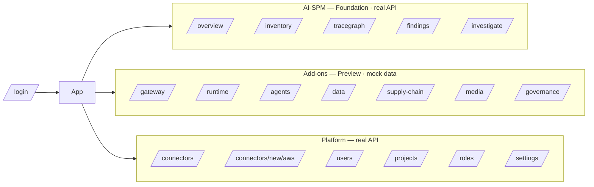

# 03 — Information Architecture

Routes, navigation, permissions, and role → page visibility for the Bellu suite. Reflects
what is implemented in `src/App.tsx` and `src/config/nav.ts`.

---

## 1. Top-level structure

Three nav sections, plus the bare `/login` route. All authenticated routes are wrapped in
`AppShell` by the `RequireAuth` guard; nav items auto-hide when the principal lacks the
item's permission.

---

## 2. Route table

| Route | Page | Permission | Source | Data |
|---|---|---|---|---|
| `/login` | Login | — (public) | `features/ai-spm/Login` | real |
| `/` | → redirect `/overview` | — | — | — |
| `/overview` | Security Overview | `graph:read` | `features/ai-spm/SecurityOverview` | real |
| `/inventory` | AI Inventory | `graph:read` | `features/ai-spm/AiInventory` | real |
| `/tracegraph` | TraceGraph | `graph:read` | `features/ai-spm/TraceGraphPage` | real |
| `/findings` | Findings | `findings:read` | `features/ai-spm/Findings` | real |
| `/investigate` | Investigate | `investigate` | `features/ai-spm/Investigate` | real |
| `/gateway` | AI Gateway | `gateway:read` *(proposed)* | `features/gateway/Gateway` | mock |
| `/runtime` | Runtime Defense | `runtime:read` *(proposed)* | `features/runtime/Runtime` | mock |
| `/agents` | Agent Security | `agents:read` *(proposed)* | `features/agents/Agents` | mock |
| `/data` | AI Data Security | `data:read` *(proposed)* | `features/data/DataSecurity` | mock |
| `/supply-chain` | AI Supply Chain | `supplychain:read` *(proposed)* | `features/supply-chain/SupplyChain` | mock |
| `/media` | Media Authenticity | `media:read` *(proposed)* | `features/media/Media` | mock |
| `/governance` | Governance & Compliance | `governance:read` *(proposed)* | `features/governance/Governance` | mock |
| `/connectors` | Cloud Connectors | `projects:read` | `features/platform/Connectors` | real |
| `/connectors/new/aws` | AWS connector wizard | `integrations:manage` | `features/platform/ConnectAws` | real |
| `/users` | Users | `users:read` | `features/platform/Users` | real |
| `/projects` | Projects | `projects:read` | `features/platform/Projects` | real |
| `/roles` | Roles | `users:read` | `features/platform/Roles` | real |
| `/settings` | Settings (placeholder) | `projects:read` | `ModulePlaceholder` | — |
| `/entities` | → `/inventory` | — | legacy redirect | — |
| `/attack-paths` | → `/tracegraph` | — | legacy redirect | — |
| `/explain` | → `/investigate` | — | legacy redirect | — |
| `*` | → `/overview` | — | catch-all | — |

---

## 3. Permissions

### 3.1 Real backend permissions (10)

`graph:read`, `findings:read`, `investigate`, `users:read`, `users:manage`,
`roles:manage`, `projects:read`, `projects:manage`, `policies:manage`,
`integrations:manage`.

### 3.2 Proposed "Preview" permissions (7) — for a future backend

`gateway:read`, `runtime:read`, `agents:read`, `data:read`, `supplychain:read`,
`media:read`, `governance:read`.

These gate the add-on nav/routes. They do **not** exist in the backend yet. In dev the auth
layer grants them to any authenticated user (gated by `import.meta.env.DEV`) so the Preview
modules are reachable; in a production build they are omitted, so add-ons stay hidden until a
backend grants them. See `07-api-contracts.md` for the proposed role mappings.

---

## 4. Role → page visibility (real permissions)

Based on the backend's six built-in roles. ✓ = visible/accessible; blank = hidden (nav item
filtered out, route shows 403 if reached directly). Add-on columns reflect the **proposed**
Preview permissions (not yet granted by the backend).

| Page (perm) | global_admin | global_reader | project_admin | security_analyst | developer | viewer |
|---|:--:|:--:|:--:|:--:|:--:|:--:|
| Overview (`graph:read`) | ✓ | ✓ | ✓ | ✓ | ✓ | ✓ |
| Inventory (`graph:read`) | ✓ | ✓ | ✓ | ✓ | ✓ | ✓ |
| TraceGraph (`graph:read`) | ✓ | ✓ | ✓ | ✓ | ✓ | ✓ |
| Findings (`findings:read`) | ✓ | ✓ | ✓ | ✓ | ✓ | |
| Investigate (`investigate`) | ✓ | | ✓ | ✓ | | |
| Connectors (`projects:read`) | ✓ | ✓ | ✓ | ✓ | ✓ | ✓ |
| AWS wizard (`integrations:manage`) | ✓ | | | | | |
| Users (`users:read`) | ✓ | ✓ | ✓ | | | |
| Projects (`projects:read`) | ✓ | ✓ | ✓ | ✓ | ✓ | ✓ |
| Roles (`users:read`) | ✓ | ✓ | ✓ | | | |

Notes:
- `users:manage` / `roles:manage` / `projects:manage` gate *actions within* a page (create
  user, create role, create project), not page visibility.
- `global_reader` has `users:read` so it sees Users/Roles read-only.
- Per-project scoping: non-global roles only see data for their assigned projects
  (enforced backend-side via `CanAccessProject`).

---

## 5. Navigation behavior

- Config-driven from `navConfig` (`src/config/nav.ts`): `NavGroup { section, preview?, items }`.
- `AppShell` filters each group's items by `can(permission)` and hides empty groups.
- Preview sections render a small "Preview" badge next to the section heading.
- Desktop: fixed left sidebar (`.cg-sidebar`). Mobile: hamburger opens the same nav in a
  Sheet.
- Active route is highlighted via `NavLink` `isActive`.
