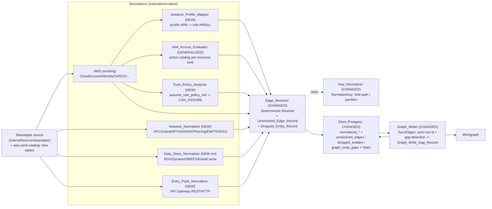

# Design Document

## Overview

This feature closes two gaps in Bellu's discovery pipeline (Steampipe → RawEvent → Normalizer → EntityResolver → GraphWriter → Memgraph): **silent edge loss** and **incomplete relationship coverage** for AWS. It does so entirely inside the existing architecture — no new transport, no second graph store, no parallel type system — by extending the components that already exist and adding a small number of new normalizers/analyzers that emit the same generic `model.Entity`/`model.Edge` values every other normalizer already produces.

The work splits into three themes:

1. **Visibility (Requirements 1–2).** The resolver (`internal/resolve`) and the graph writer (`internal/graph`) each have an independent silent-drop point. This feature does not make them stop dropping — a genuinely unresolvable edge *should* be excluded — it makes every drop **queryable**. The resolver records `Unresolved_Edge_Record` and `Dropped_Entity_Record` rows; the graph writer records `Graph_Write_Gap_Record` rows when Memgraph creates fewer relationships than were submitted. All three follow the existing `resolution_conflicts` persistence pattern (`internal/store/migrations/00003_resolution.sql`) and surface as counts on `store.Stats`.

2. **Fidelity (Requirement 3).** `Key_Normalizer` (`internal/resolve/aliases.go` `NormalizeKey`) learns AWS ARN variants — IAM path stripping and partition normalization — so edges stop dropping on superficial key mismatches, while case-sensitive segments (bucket names, IAM role/user names) keep exact matching. A new `Instance_Profile_Mapper` resolves instance-profile ARNs to the roles they contain using collected data, with a confidence-tagged fallback to today's name-substitution heuristic.

3. **Coverage (Requirements 4–8).** New analyzers/normalizers add identity trust chains (`Trust_Policy_Analyzer` → `CAN_ASSUME`), a generalized `IAM_Access_Evaluator` (S3-only `policy.go` becomes a data-driven, per-resource-kind action-catalog design), AWS network topology (`Network_Normalizer` → `Network` entities with `CONTAINS`/`ATTACHED_TO`/`ROUTES_TO`/`PEERS_WITH`/`MEMBER_OF`), additional data stores (`Data_Store_Normalizer` → RDS/DynamoDB/EFS/ElastiCache), and internet entry points (`Entry_Point_Normalizer` → API Gateway `EntryPoint` entities).

A fourth, cross-cutting theme — **provider-agnostic extensibility (Requirement 9)** — governs how every addition above is shaped: new `Kind`/`Relation` values go in the shared provider-neutral allow-lists in `internal/model/model.go`, the action catalog is data separated from evaluator code, `CAN_ASSUME` reuses the generic edge shape, and the `network_subtype` vocabulary is documented as open-ended.

### Scope reference

The *categories* of AWS entities and relationships targeted here — identity trust chains, generalized IAM access evaluation, network topology, data-store coverage, and internet-facing entry points — follow the publicly documented coverage of the [Cartography project](https://github.com/cartography-cncf/cartography) (Apache License 2.0), used strictly as a reference for **which** cloud entities and relationships matter for attack-path analysis. Cartography is a Python project with its own model; Bellu's pipeline is Go, with its own entity model, resolver, and graph writer. This feature is an independent reimplementation of equivalent modeling concepts inside Bellu's existing architecture, not a port or derivative of Cartography's code or structure. *Content was rephrased for compliance with licensing restrictions.*

### Scope boundaries (from requirements)

- **AWS only.** Every resource-specific component (Requirements 4–8) is implemented for AWS. GCP/Azure analyzers are explicitly deferred (Requirement 9.5); the model-schema additions are provider-neutral so later phases extend, not fork.
- **Approximate stays labeled approximate.** Every IAM-derived or trust-derived edge that ignores SCPs, permission boundaries, session policies, or conditions keeps `effective: "approx"` and `confidence: 0.7`, matching the existing S3 convention (`internal/normalize/cloudaccess.go`, `internal/normalize/aws.go`).
- **Visibility, not auto-repair.** Recording a drop/gap never forces a resolution or fabricates an endpoint. The resolver still excludes genuinely unresolvable edges; it just leaves a trace.

---

## Architecture

### Data flow

The feature plugs into the existing flow without changing its shape. New and changed components are highlighted.



Key architectural facts the design relies on:

- **Normalizers emit generic values.** Every normalizer returns a `normalize.Result{Entities, Edges}` of `model.Entity`/`model.Edge`. Analyzers (`Trust_Policy_Analyzer`, `IAM_Access_Evaluator`, `Instance_Profile_Mapper`) are not new interfaces — they are helper components invoked **inside** the AWS normalizer's second pass, exactly as today's S3 IAM evaluator is invoked inside `AWS.Normalize`. This keeps the pipeline registration (`internal/pipeline/process.go`) unchanged except for registering the new standalone normalizers.
- **The resolver is the single choke point** where keys become canonical IDs and where edges are kept or dropped. All unresolved-edge/dropped-entity recording lives there (Requirement 1), reusing the `Deterministic.Aliases`/`Conflicts` capture-then-persist pattern already in `Deterministic` and `Processor.persistResolution`.
- **The graph writer is the single choke point** for Memgraph writes. Gap detection (Requirement 2) lives in `SyncEdges`, using the row count the Cypher query already returns.

### Package layout

```
internal/model/model.go                      # + Kind: Network, EntryPoint (DataStore exists)
                                              # + Relation: CAN_ASSUME, ROUTES_TO, PEERS_WITH,
                                              #   MEMBER_OF, ATTACHED_TO
internal/resolve/aliases.go                   # NormalizeKey: IAM path strip, partition canon
internal/resolve/deterministic.go             # unresolved-edge + dropped-entity recording
internal/resolve/iam/aws/policy.go            # generalized: evaluate(doc, targetARN, catalog)
internal/resolve/iam/aws/catalog.go           # NEW: data-only action catalogs per resource kind
internal/resolve/iam/aws/trust.go             # NEW: Trust_Policy_Analyzer
internal/resolve/iam/aws/instanceprofile.go   # NEW: Instance_Profile_Mapper
internal/normalize/aws.go                     # wire new analyzers into the existing second pass
internal/normalize/awsnetwork.go              # NEW: Network_Normalizer (AWS topology)
internal/normalize/awsdatastore.go            # NEW: Data_Store_Normalizer extension helpers
internal/normalize/awsentrypoint.go           # NEW: Entry_Point_Normalizer
internal/graph/graph.go                       # SyncEdges: sync-run id + gap detection
internal/store/migrations/00012_graph_visibility.sql  # NEW tables
internal/store/visibility.go                  # NEW: Save/Query for the three record types
internal/store/api.go                         # Stats: new counts
internal/source/steampipe/catalog/aws.yaml    # new table entries
internal/connector/capability/capability.go   # + network capability (if needed)
internal/pipeline/process.go                  # register new normalizers; persist new records
```

> **Naming note (collision avoidance).** `internal/normalize/network.go` already defines a `Network` *normalizer type* for Zeek flow data (unrelated to AWS topology). The new AWS topology normalizer is therefore named **`AWSNetwork`** (type), while the new **node Kind** is `Network`. The two are deliberately distinct: `AWSNetwork` is a normalizer struct consuming `provider == "aws"` Steampipe events; `KindNetwork` is the canonical label those events map to.

---

## Components and Interfaces

Each subsection maps to one requirement. Requirement numbers are cited as (RX.Y).

### 1. Edge_Resolver changes — unresolved-edge / dropped-entity recording (R1)

`Deterministic.Resolve` already captures side outputs (`Aliases`, `Conflicts`) on the resolver struct and the `Processor` persists them afterward. We extend the same pattern with two new captured slices:

```go
// internal/resolve/deterministic.go
type UnresolvedEdge struct {
    Relation      string // model.Relation as string
    SrcKey        string
    DstKey        string
    UnmatchedSide string // "src" | "dst" | "both"
    EvidenceID    string // first evidence raw_event_id (empty if none)
    RunID         string
}

type DroppedEntity struct {
    Kind       string
    Provider   string
    EvidenceID string
    RunID      string
}

type Deterministic struct {
    RepoImageMappings map[string]string
    Aliases          []Alias
    Conflicts        []Conflict
    Unresolved       []UnresolvedEdge // NEW
    Dropped          []DroppedEntity  // NEW
}
```

Behavior changes, all inside `Resolve`:

- **Empty-key entities (R1.4).** The existing `if ent.Key == "" { continue }` loop body gains a recording step *before* the `continue`: append a `DroppedEntity{Kind, Provider, EvidenceID}`. The entity is still excluded from indexing (visibility, not repair).
- **Unresolved edges (R1.1–R1.3).** The edge-rewrite loop currently does `if !okS || !okD { continue }`. It becomes:

  ```go
  srcID, okS := d.resolveEndpointIP(...)
  dstID, okD := d.resolveEndpointIP(...)
  if !okS || !okD {
      side := "both"
      switch {
      case okS && !okD: side = "dst"
      case !okS && okD: side = "src"
      case !okS && !okD: side = "both" // src fails => "src" per R1.1 includes both-fail as "both"
      }
      d.Unresolved = append(d.Unresolved, UnresolvedEdge{
          Relation: string(edge.Relation), SrcKey: edge.SrcKey, DstKey: edge.DstKey,
          UnmatchedSide: side, EvidenceID: firstEvidenceID(edge.Evidence),
      })
      continue // still excluded from resolved output (R1.3)
  }
  ```

  Side semantics follow R1.1/R1.2 precisely: `src` fails (dst ok) → `src`; both fail → `both`; `dst` fails and `src` ok → `dst`.

- **Persistence (R1.5–R1.6).** `Processor.persistResolution` gains two calls — `st.SaveUnresolvedEdges(...)` and `st.SaveDroppedEntities(...)` — mirroring `SaveConflicts`. The `RunID` is stamped by the persistence layer from the run context the same way other normalized rows are tagged.
- **Stats (R1.7).** `store.Stats` gains `UnresolvedEdges int64` and `DroppedEntities int64`, each a `SELECT count(*)` in `GetStats`.

This component **does not** attempt to repair the edge (R scope boundary: visibility, not auto-repair) and **does not** change the drop semantics — it only records.

### 2. Graph_Writer changes — sync-run id and gap recording (R2)

`SyncEdges` groups edges by relation and runs one `UNWIND ... MATCH ... MATCH ... MERGE` per batch. The `MATCH...MATCH` silently creates no relationship when either endpoint node is absent in Memgraph. We make that observable:

- **Sync-run identifier (R2.1).** `SyncEdges` generates one UUID (`syncRunID`) per invocation. All gap records from that call carry it.
- **Count comparison (R2.1–R2.2).** The Cypher is extended to return how many relationships it actually created or matched, so the writer can compare against the submitted batch size:

  ```cypher
  UNWIND $rows AS row
  MATCH (a:Entity {canonical_id: row.src})
  MATCH (b:Entity {canonical_id: row.dst})
  MERGE (a)-[r:REL]->(b)
  ... SET ...
  RETURN count(r) AS written
  ```

  `written` counts rows where **both** `MATCH`es succeeded (rows with a missing endpoint produce no binding and are not counted). If `written < len(chunk)`, the writer records one `Graph_Write_Gap_Record{Relation, SyncRunID, BatchSize, Observed}` for that batch (R2.2).

- **Non-fatal, continue (R2.4–R2.5).** A gap is **not** an error. The batch loop records the gap and proceeds to the next batch within the same sync run. A gap never short-circuits `SyncEdges`. (True driver/transport errors are still returned as before.)
- **Persistence (R2.3, R2.6).** The writer accumulates gap records and the caller (`Processor.Sync`) persists them via `st.SaveGraphWriteGaps(...)`. `store.Stats` gains `GraphWriteGaps int64` as a total count across sync runs.

Because `Writer` currently has no `*store.Store` reference, gaps are returned from `SyncEdges` (new return value or an accumulator field on `Writer`) and persisted by `Processor.Sync`, keeping the graph package free of a Postgres dependency — consistent with the existing separation where the writer returns counts and the pipeline persists.

```go
// internal/graph/graph.go
type WriteGap struct {
    Relation   string
    SyncRunID  string
    BatchSize  int
    Observed   int
}
// SyncEdges now returns (total int, gaps []WriteGap, err error)
```

### 3. Key_Normalizer changes — robust AWS key normalization (R3)

`NormalizeKey(kind, provider, key)` is the single normalization point used by `Deterministic.Resolve` for both entity keys and (via `resolveEndpoint`) edge endpoints. We add an AWS branch that normalizes ARNs while **preserving case-sensitive segments** (R3.6).

```go
// internal/resolve/aliases.go
func NormalizeKey(kind model.Kind, provider, key string) string {
    switch kind {
    case model.KindContainerImage: return normalizeImageKey(key)
    case model.KindRepository:     return NormalizeRepoURL(key)
    }
    if provider == "aws" && strings.HasPrefix(key, "arn:") {
        return normalizeAWSARN(key)
    }
    if provider == "azure" { return strings.ToLower(key) }
    return key
}
```

`normalizeAWSARN` rules:

- **Partition canonicalization (R3.2).** Parse `arn:<partition>:<service>:<region>:<account>:<resource>`. Rewrite the partition segment to the canonical token `aws` regardless of whether it was `aws`, `aws-cn`, or `aws-us-gov`, so two ARNs that differ only in partition compare equal. (Account id and resource id are the discriminators; partition is representational.)
- **IAM path stripping (R3.1).** For IAM ARNs (`service == "iam"`, resource begins `role/` or `user/`), drop any path segments between the resource-type separator and the resource name: `role/some/path/MyRole` → `role/MyRole`. The comparison key becomes partition-canonical + account id + resource-type + bare resource name, so two IAM ARNs differing only in IAM path match.
- **Case-sensitive segments (R3.6).** The resource-name segment (S3 bucket name, IAM role/user name) is compared with exact, case-sensitive equality. `normalizeAWSARN` lowercases **nothing** in the resource name and applies **no** wildcard/case-folding. (Contrast: the Azure branch lowercases whole IDs because Azure resource IDs are case-insensitive; AWS is not.)

Idempotence is a design requirement: `normalizeAWSARN(normalizeAWSARN(x)) == normalizeAWSARN(x)` (see Correctness Properties).

Because both the raw key and the normalized key are indexed in `keyIndex` today, these changes widen the match set without changing the resolver's control flow.

### 4. Instance_Profile_Mapper — profile ARN → role ARN(s) (R3.3–R3.5)

Today `instanceProfileRole` in `aws.go` does a crude string substitution (`:instance-profile/` → `:role/`). This component replaces that with data-driven resolution.

- **Input data (R3.4).** The Steampipe catalog adds `aws_iam_instance_profile`, which exposes each profile's contained roles. The AWS normalizer builds a map `profileARN -> []roleARN` from these events in its first pass.
- **Resolution (R3.3).** When an `aws_ec2_instance` has `iam_instance_profile_arn`:
  - exactly one contained role → one `USES` edge (compute → role ARN), `confidence 1.0`;
  - more than one contained role → one `USES` edge per contained role, each `confidence 1.0`.
- **Fallback (R3.5).** If the profile ARN resolves to no role from collected data, fall back to the existing name-substitution heuristic and emit the `USES` edge with `confidence 0.7` (vs `1.0` for mapping-derived), plus an attribute recording the fallback method (`"method": "name_substitution"`).

```go
// internal/resolve/iam/aws/instanceprofile.go
type InstanceProfileMapper struct {
    profiles map[string][]string // normalized profile ARN -> role ARNs
}
func (m *InstanceProfileMapper) Resolve(profileARN string) (roles []string, confidence float64, fallback bool)
```

The mapper uses `Key_Normalizer`-style ARN normalization so a profile ARN with a different partition/path still matches collected data.

### 5. Trust_Policy_Analyzer — CAN_ASSUME edges (R4)

Parses an IAM role's `assume_role_policy_std` and derives `CAN_ASSUME` edges (principal identity → role). It reuses the existing `ParsePolicy`/`Statement` types from `policy.go` (which already model `Effect`, `Action`, `Resource`, `stringOrSlice`), adding `Principal` parsing.

Per-case behavior (one case per R4 clause):

| Trust-policy case | Edge | Confidence | Attribute | Clause |
|---|---|---|---|---|
| Allow + `sts:AssumeRole*` + Principal is IAM user/role ARN | `Principal → role` (per named principal) | 1.0 | — | R4.1 |
| Principal is account root ARN or bare 12-digit account id | `CloudAccount(account) → role` | 0.7 | `account_grant: true` | R4.2 |
| Principal is a service principal (`*.amazonaws.com`) | *none* (excluded) | — | — | R4.3 |
| Principal is wildcard `*` | `synthetic "any identity" → role` | 0.7 | `unscoped: true` | R4.4 |
| Deny for a principal | principal excluded even if another Allow matches | — | — | R4.5 |
| Principal in a different account than the role | edge still created | per case | — | R4.6 |
| Principal ARN not yet discovered | edge emitted keyed to that ARN; Requirement 1 makes the unresolved reference visible | per case | — | R4.7 |

Supported assume actions: `sts:AssumeRole`, `sts:AssumeRoleWithSAML`, `sts:AssumeRoleWithWebIdentity` (R4.1).

Deny precedence (R4.5) is computed first: collect the set of principals denied `sts:AssumeRole*`, then generate Allow-derived edges only for principals not in the deny set — mirroring the explicit-deny-overrides-allow logic already in `EvaluateS3`.

The analyzer runs inside `AWS.Normalize`'s role-handling branch (every `aws_iam_role` event already parses its policies). `CAN_ASSUME` edges use the generic `model.Edge` shape (R9.3); the `account_grant`/`unscoped` attributes are provider-neutral identity-trust concepts (any provider's trust model can set them).

The synthetic "any identity" principal (R4.4) is emitted as a stable key (e.g. `aws:any-identity`) so the edge resolves; it is the trust analog of the existing synthetic internet `NetworkEndpoint` (`0.0.0.0/0`).

### 6. IAM_Access_Evaluator — generalized, data-driven (R5, R9.2)

`policy.go` becomes resource-kind-agnostic. The S3-specific pieces (`isS3Action`, `expandS3Action`, `classify`, S3 catalog) move into **data** — a per-resource-kind action catalog — leaving the matching/classification *logic* generic.

```go
// internal/resolve/iam/aws/catalog.go  (DATA, no evaluator logic)
type ActionCatalog struct {
    Service        string            // "s3", "dynamodb", "rds", ...
    ResourceForms  func(arn string) []string // e.g. bucket + bucket/* ; table ; db:name
    Representative []string          // representative concrete actions for wildcard expansion
    Classify       map[string]Access // concrete action (lower) -> read|write|admin
    AdminMarkers   []string          // substrings that force admin (putbucketpolicy, deletetable, ...)
    WriteMarkers   []string          // substrings that force write (put/delete/create/write/...)
}

// Catalogs is the registry. Adding a resource kind = adding one entry here (R9.2).
var Catalogs = map[string]ActionCatalog{
    "s3":       { ... existing S3 behavior, unchanged ... },
    "dynamodb": { ... },
    "rds":      { ... },
    "efs":      { ... },
    "elasticache": { ... },
}
```

```go
// internal/resolve/iam/aws/policy.go  (LOGIC, resource-kind-agnostic)
func Evaluate(doc *PolicyDocument, targetARN string, cat ActionCatalog) (Access, []string)
```

`Evaluate` applies the *same* rules the S3 evaluator already implements — Allow/Deny with explicit-deny-override (R5.5), wildcard-resource matching via `resourceMatchesAny`/`globMatch`, wildcard-action expansion via the catalog's `Representative` list, and admin-over-write-over-read precedence via `AdminMarkers`/`WriteMarkers`/`Classify` (R5.2). `EvaluateS3` becomes a thin shim calling `Evaluate(doc, arn, Catalogs["s3"])`, preserving existing behavior and tests.

Behavioral guarantees:

- **Any kind with an ARN + catalog (R5.1).** The AWS normalizer's second pass iterates every target resource that has a catalog entry (S3 buckets today; RDS/DynamoDB/EFS/ElastiCache after R7), not just S3.
- **Edge emission (R5.3–R5.4).** Non-empty allowed set → one `CAN_READ`/`CAN_WRITE`/`CAN_ADMIN` edge with the existing S3 shape, `confidence 0.7`, `effective: "approx"`. Empty allowed set → no edge.
- **Parse resilience (R5.6).** An unparseable policy document is skipped; other documents for the identity are still evaluated (today's `continue`-on-parse-error loop is preserved).
- **New data store = new catalog entry (R5.7).** Adding RDS/DynamoDB/etc. requires only a `Catalogs` entry, no new evaluator (this is the R9.2 extensibility guarantee realized).
- **No catalog = no edge (R5.8).** A discovered resource kind absent from `Catalogs` produces no CAN_* edge.

### 7. Network_Normalizer (AWSNetwork) — AWS topology (R6)

A new standalone normalizer (`internal/normalize/awsnetwork.go`, type `AWSNetwork`) consuming `provider == "aws"` Steampipe events for the networking tables. It emits one `Network` entity per construct and the topology edges.

- **Nine subtypes (R6.1).** Each of VPC, Subnet, RouteTable, InternetGateway, NatGateway, PeeringConnection, NetworkInterface, TransitGateway, SecurityGroup maps to a `Network` entity with a distinct `network_subtype` attribute value. The nine values are enumerated in one place (see Data Models) and documented as open-ended (R9.4).
- **Edges:**
  - Subnet in VPC → `CONTAINS` (VPC → Subnet) (R6.2)
  - RouteTable associated with Subnet → `ATTACHED_TO` (Subnet → RouteTable) (R6.3)
  - RouteTable entry targeting IGW/NAT/Peering/TGW attachment → `ROUTES_TO` (RouteTable → target) (R6.4)
  - Active VPC Peering → exactly one `PEERS_WITH` (requester VPC → accepter VPC) per connection (R6.5)
  - ENI attached (state is attached, excluding unattached/detaching/pending) → `ATTACHED_TO` (ENI → Compute) (R6.6)
  - Compute/ENI member of SG → `MEMBER_OF` (Compute/ENI → SG) (R6.7)
- **Security Group as a node (R6.8).** The SG is a first-class `Network` entity (`network_subtype: security_group`), not merely a `SrcKey` string as in today's `exposedToEdges`. This lets the SG participate in both `MEMBER_OF` and the existing `EXPOSED_TO`. The existing EXPOSED_TO behavior in `aws.go` is adjusted to point at this SG `Network` entity so the two models reconcile.
- **Catalog (R6.9).** Adds `aws_vpc`, `aws_subnet`, `aws_vpc_route_table`, `aws_vpc_internet_gateway`, `aws_vpc_nat_gateway`, `aws_vpc_peering_connection`, `aws_ec2_network_interface`, `aws_ec2_transit_gateway` (SG already present).

ENI/Compute and ENI/DataStore attachment edges are keyed by the attached resource's ARN/ID so the resolver links them to the Compute/DataStore nodes the AWS normalizer already emits. Where an endpoint is not yet discovered, Requirement 1 makes it visible rather than silently dropping.

### 8. Data_Store_Normalizer — RDS/DynamoDB/EFS/ElastiCache (R7)

An extension (helpers in `internal/normalize/awsdatastore.go`, invoked from `AWS.Normalize`) mapping additional data stores to the existing `DataStore` kind.

- **Mappings (R7.1–R7.5).** RDS instance, RDS cluster, DynamoDB table, EFS file system, ElastiCache cluster → one `DataStore` entity each, with a `datastore_subtype` attribute to distinguish them (parallel to `compute_subtype` already used for EC2/Lambda).
- **CONTAINS (R7.6).** CloudAccount → each DataStore, reusing the existing `containsEdge` builder. An RDS instance that is a member of an RDS cluster gets its **own** CONTAINS edge independent of the cluster's CONTAINS edge (both entities exist; both link to the account).
- **Network attachment/membership (R7.8–R7.9).** When an ENI is attached to one of these DataStores, `Network_Normalizer` emits `ATTACHED_TO` (ENI → DataStore) using the *same* edge shape as R6.6. When a DataStore is a member of a SG, `Network_Normalizer` emits `MEMBER_OF` (DataStore → SG) using the same shape as R6.7. (These edges are produced by the network normalizer because it owns ENI/SG membership extraction; the data-store normalizer owns the DataStore nodes.)
- **IAM access (R5.7).** Because these are `DataStore` entities with ARNs, the generalized `IAM_Access_Evaluator` evaluates identity access against them once a catalog entry exists for the kind.
- **Catalog (R7.7).** Adds `aws_rds_db_instance`, `aws_rds_db_cluster`, `aws_dynamodb_table`, `aws_efs_file_system`, `aws_elasticache_cluster`.

### 9. Entry_Point_Normalizer — API Gateway (R8)

A new standalone normalizer (`internal/normalize/awsentrypoint.go`) mapping API Gateway to the new `EntryPoint` kind.

- **One EntryPoint per API (R8.1).** Each `aws_api_gateway_rest_api` and `aws_api_gatewayv2_api` → exactly one `EntryPoint` entity, regardless of stage/resource/route/method count.
- **Internet exposure:**
  - REST API not restricted to a VPC-only (private) endpoint → `EXPOSED_TO` (EntryPoint → synthetic internet `NetworkEndpoint` `0.0.0.0/0`) (R8.2), reusing the existing synthetic internet node.
  - REST API restricted to PRIVATE endpoint → omit the internet EXPOSED_TO edge (R8.4).
  - HTTP API → always `EXPOSED_TO` internet (no private option exists) (R8.5).
- **Backend integrations (R8.3).** API with Lambda-target integrations → one `CALLS` edge (EntryPoint → each distinct target Lambda `Compute`). Distinctness is per target Lambda function ARN.
- **CONTAINS (R8.6).** CloudAccount → each EntryPoint, reusing `containsEdge`.
- **Catalog (R8.7).** Adds `aws_api_gateway_rest_api` and `aws_api_gatewayv2_api`.

### 10. Model/schema additions (R9.1)

See Data Models. New `Kind` values `Network`, `EntryPoint` (`DataStore` already exists) and new `Relation` values `CAN_ASSUME`, `ROUTES_TO`, `PEERS_WITH`, `MEMBER_OF`, `ATTACHED_TO`, all added to `AllKinds`/`AllRelations` with provider-neutral constant names and string values.

### 11. Persistence / migration (R1.5–R1.7, R2.3, R2.6)

See Data Models for the migration. New store methods in `internal/store/visibility.go`: `SaveUnresolvedEdges`, `SaveDroppedEntities`, `SaveGraphWriteGaps`, and query helpers filtered by relation / key / run / sync-run. `GetStats` extended with the three counts.

### 12. Steampipe catalog additions (R6.9, R7.7, R8.7, R3.4)

See Data Models for the full table list, each with `id_column`/`scope_column`/`region_column`/`capability` per existing conventions.

### 13. Provider-agnostic extensibility (R9)

- **R9.1** — new Kinds/Relations go in the shared `AllKinds`/`AllRelations`, provider-neutral names (no `Network_AWS` / `AWS_ROUTES_TO`).
- **R9.2** — `ActionCatalog` is pure data in `catalog.go`; `Evaluate` logic never references a specific service. Adding a GCP/Azure resource kind = one `Catalogs` map entry, zero logic change.
- **R9.3** — `CAN_ASSUME` uses the generic `model.Edge`; `account_grant`/`unscoped` are provider-neutral trust concepts.
- **R9.4** — the `network_subtype` enumeration carries a doc comment stating it is open-ended: adding a GCP/Azure subtype is additive and requires no change to `KindNetwork` or `AllKinds`.
- **R9.5** — only AWS normalizers/analyzers are implemented; no GCP/Azure analyzer or catalog is added by this feature.

---

## Data Models

### Model additions (`internal/model/model.go`)

```go
// New Kinds (provider-neutral; DataStore already exists)
const (
    KindNetwork    Kind = "Network"
    KindEntryPoint Kind = "EntryPoint"
)
// appended to AllKinds

// New Relations (provider-neutral)
const (
    RelCanAssume  Relation = "CAN_ASSUME"
    RelRoutesTo   Relation = "ROUTES_TO"
    RelPeersWith  Relation = "PEERS_WITH"
    RelMemberOf   Relation = "MEMBER_OF"
    RelAttachedTo Relation = "ATTACHED_TO"
)
// appended to AllRelations
```

### Network subtype vocabulary (open-ended — R9.4)

Declared once (in `awsnetwork.go`) with a doc comment making the open-ended contract explicit:

```go
// networkSubtype values classify a Network entity. This vocabulary is OPEN-ENDED:
// adding a new value (e.g. for a GCP or Azure networking construct) is an additive
// change and MUST NOT require modifying KindNetwork or the AllKinds allow-list.
const (
    subVPC              = "vpc"
    subSubnet           = "subnet"
    subRouteTable       = "route_table"
    subInternetGateway  = "internet_gateway"
    subNatGateway       = "nat_gateway"
    subPeeringConnection= "peering_connection"
    subNetworkInterface = "network_interface"
    subTransitGateway   = "transit_gateway"
    subSecurityGroup    = "security_group"
)
```

Each of the nine is distinct, so any two `Network` entities of different resource types differ by `network_subtype` alone (R6.1).

### Migration `00012_graph_visibility.sql`

Follows the `00003_resolution.sql` pattern (BIGSERIAL id, created_at default, indexes for the required query dimensions).

```sql
-- +goose Up
-- unresolved_edges: edges the resolver declined to resolve (R1.1-R1.3, R1.5).
CREATE TABLE unresolved_edges (
    id             BIGSERIAL PRIMARY KEY,
    relation       TEXT NOT NULL,
    src_key        TEXT NOT NULL,
    dst_key        TEXT NOT NULL,
    unmatched_side TEXT NOT NULL,                 -- 'src' | 'dst' | 'both'
    evidence_id    TEXT NOT NULL DEFAULT '',
    run_id         TEXT NOT NULL DEFAULT '',
    created_at     TIMESTAMPTZ NOT NULL DEFAULT now()
);
CREATE INDEX unresolved_edges_relation_idx ON unresolved_edges (relation);
CREATE INDEX unresolved_edges_src_idx      ON unresolved_edges (src_key);
CREATE INDEX unresolved_edges_dst_idx      ON unresolved_edges (dst_key);
CREATE INDEX unresolved_edges_run_idx      ON unresolved_edges (run_id);

-- dropped_entities: entities a normalizer emitted with an empty Key (R1.4, R1.6).
CREATE TABLE dropped_entities (
    id          BIGSERIAL PRIMARY KEY,
    kind        TEXT NOT NULL,
    provider    TEXT NOT NULL,
    evidence_id TEXT NOT NULL DEFAULT '',
    run_id      TEXT NOT NULL DEFAULT '',
    created_at  TIMESTAMPTZ NOT NULL DEFAULT now()
);
CREATE INDEX dropped_entities_kind_idx     ON dropped_entities (kind);
CREATE INDEX dropped_entities_provider_idx ON dropped_entities (provider);
CREATE INDEX dropped_entities_run_idx      ON dropped_entities (run_id);

-- graph_write_gaps: batches where Memgraph created fewer rels than submitted (R2.2-R2.3, R2.6).
CREATE TABLE graph_write_gaps (
    id           BIGSERIAL PRIMARY KEY,
    relation     TEXT NOT NULL,
    sync_run_id  TEXT NOT NULL,
    batch_size   INTEGER NOT NULL,
    observed     INTEGER NOT NULL,
    created_at   TIMESTAMPTZ NOT NULL DEFAULT now()
);
CREATE INDEX graph_write_gaps_relation_idx ON graph_write_gaps (relation);
CREATE INDEX graph_write_gaps_sync_idx     ON graph_write_gaps (sync_run_id);

-- +goose Down
DROP TABLE graph_write_gaps;
DROP TABLE dropped_entities;
DROP TABLE unresolved_edges;
```

### Stats extension (`internal/store/api.go`)

```go
type Stats struct {
    // ... existing fields ...
    UnresolvedEdges int64 `json:"unresolved_edges"` // R1.7
    DroppedEntities int64 `json:"dropped_entities"` // R1.7
    GraphWriteGaps  int64 `json:"graph_write_gaps"` // R2.6
}
```

Three additional `SELECT count(*)` reads in `GetStats`.

### Steampipe catalog additions (`internal/source/steampipe/catalog/aws.yaml`)

| Table | id_column | scope_column | region_column | capability | Req |
|---|---|---|---|---|---|
| `aws_iam_instance_profile` | arn | account_id | — | core | R3.4 |
| `aws_vpc` | vpc_id | account_id | region | network* | R6.9 |
| `aws_subnet` | subnet_id | account_id | region | network* | R6.9 |
| `aws_vpc_route_table` | route_table_id | account_id | region | network* | R6.9 |
| `aws_vpc_internet_gateway` | internet_gateway_id | account_id | region | network* | R6.9 |
| `aws_vpc_nat_gateway` | nat_gateway_id | account_id | region | network* | R6.9 |
| `aws_vpc_peering_connection` | id | account_id | region | network* | R6.9 |
| `aws_ec2_network_interface` | network_interface_id | account_id | region | network* | R6.9 |
| `aws_ec2_transit_gateway` | transit_gateway_id | account_id | region | network* | R6.9 |
| `aws_rds_db_instance` | arn | account_id | region | dspm | R7.7 |
| `aws_rds_db_cluster` | arn | account_id | region | dspm | R7.7 |
| `aws_dynamodb_table` | arn | account_id | region | dspm | R7.7 |
| `aws_efs_file_system` | arn | account_id | region | dspm | R7.7 |
| `aws_elasticache_cluster` | arn | account_id | region | dspm | R7.7 |
| `aws_api_gateway_rest_api` | api_id | account_id | region | workload | R8.7 |
| `aws_api_gatewayv2_api` | api_id | account_id | region | workload | R8.7 |

> **Capability note.** `aws_iam_instance_profile` fits under `core` (IAM `List*`/`Get*` already granted). VPC/EC2 network tables are read by `ec2:Describe*`, already in `core`; they are marked `network*` above to signal a design decision: either (a) place them under `core` since the permission is already granted, or (b) introduce a new least-privilege `network` capability in `capability.go` for selectable gating. The recommendation is **(a)** — reuse `core` — because `ec2:Describe*` is already in the Core bundle, so no new IAM permission is required and no capability change is needed. RDS/DynamoDB tables map to `dspm` (whose bundle already lists `rds:Describe*`, `dynamodb:ListTables`/`DescribeTable`); EFS/ElastiCache/API Gateway require adding their read-only `Describe*`/`Get*` actions to the relevant capability definition (`dspm` for EFS/ElastiCache data stores, `workload` for API Gateway), consistent with how each capability already enumerates the exact Steampipe-required actions.

### Edge-shape consistency

All new edges use the generic `model.Edge{Relation, SrcKey, DstKey, Attributes, Confidence, Evidence}`. Approximate edges (CAN_READ/WRITE/ADMIN, account-level and wildcard CAN_ASSUME, fallback USES) carry `confidence 0.7`; deterministic edges (CONTAINS, ATTACHED_TO, ROUTES_TO, PEERS_WITH, MEMBER_OF, named-principal CAN_ASSUME, mapping-derived USES) carry `confidence 1.0`. The `effective: "approx"` attribute is set on every IAM/trust-derived approximate edge.

---

## Correctness Properties

*A property is a characteristic or behavior that should hold true across all valid executions of a system — essentially, a formal statement about what the system should do. Properties serve as the bridge between human-readable specifications and machine-verifiable correctness guarantees.*

These properties are derived from the acceptance-criteria prework and consolidated to remove redundancy (e.g. the three visibility clauses R1.1–R1.3 collapse into one no-silent-loss property; the gap-accounting clauses R2.1/R2.2/R2.5 collapse into one gap-accounting property; attachment/membership over Compute and DataStore are generalized over endpoint kind). Each property is implemented by a single property-based test running a minimum of 100 iterations.

### Property 1: Resolver loses no edge silently

*For any* set of entities and *any* set of edges, after `Deterministic.Resolve`, every input edge is either present in the resolved output (both endpoints resolved) or recorded as exactly one `Unresolved_Edge_Record`, never both and never neither; and each recorded edge's `UnmatchedSide` is `src` when only the source failed, `dst` when only the destination failed (source resolved), and `both` when both failed.

**Validates: Requirements 1.1, 1.2, 1.3**

### Property 2: Empty-key entities are accounted for, not silently skipped

*For any* set of entities, the number of `Dropped_Entity_Record`s produced equals the number of entities with an empty `Key`, each record preserves that entity's Kind and Provider, and no empty-key entity appears in the resolved output.

**Validates: Requirements 1.4**

### Property 3: Visibility records survive a persistence round trip

*For any* set of `Unresolved_Edge_Record`s, `Dropped_Entity_Record`s, or `Graph_Write_Gap_Record`s, saving them and then querying by any supported dimension (relation, `SrcKey`/`DstKey`, run, Kind, Provider, or sync-run id) returns exactly the subset of records matching that dimension.

**Validates: Requirements 1.5, 1.6, 2.3**

### Property 4: Graph-write gaps are accounted for and non-fatal

*For any* sequence of edge batches where each batch reports an observed created/matched count no greater than its submitted size, the Graph_Writer produces one `Graph_Write_Gap_Record` for exactly those batches whose observed count is strictly less than the submitted size — carrying that batch's relation type, the invocation's sync-run id, the submitted size, and the observed count — processes every batch in the sequence, and returns no error caused by a gap.

**Validates: Requirements 2.1, 2.2, 2.4, 2.5**

### Property 5: IAM/partition-insensitive ARNs normalize to the same key

*For any* AWS account id and IAM resource name, two IAM role or user ARNs that differ only in IAM path segments and/or in partition (`aws`, `aws-cn`, `aws-us-gov`) normalize to the same key under `Key_Normalizer`.

**Validates: Requirements 3.1, 3.2**

### Property 6: ARN normalization is idempotent

*For any* AWS ARN, normalizing it twice yields the same result as normalizing it once.

**Validates: Requirements 3.1, 3.2**

### Property 7: Case-sensitive segments are never folded or wildcarded

*For any* AWS ARN whose resource-name segment is a case-sensitive type (S3 bucket name, IAM role/user name), normalization preserves the resource name's exact casing, and two ARNs that differ only in the case of that segment do not normalize to the same key.

**Validates: Requirements 3.6**

### Property 8: Instance-profile mapping yields one USES edge per contained role

*For any* instance profile containing a set of roles found in collected data, the Instance_Profile_Mapper produces exactly one `USES` edge per contained role, each targeting one of the contained role ARNs, with confidence 1.0.

**Validates: Requirements 3.3**

### Property 9: Instance-profile fallback is confidence-tagged

*For any* instance-profile ARN that resolves to no role from collected data, the Instance_Profile_Mapper produces a `USES` edge whose destination is the name-substitution-derived role and whose confidence is 0.7 (not 1.0).

**Validates: Requirements 3.5**

### Property 10: Named-principal trust grants produce CAN_ASSUME edges regardless of account or discovery

*For any* trust policy with Allow statements naming IAM user/role principals under an assume action (`sts:AssumeRole`, `sts:AssumeRoleWithSAML`, `sts:AssumeRoleWithWebIdentity`) and not denied, the Trust_Policy_Analyzer emits exactly one `CAN_ASSUME` edge per distinct named principal (keyed to that principal's ARN) toward the role with confidence 1.0 — including when the principal is in a different account than the role and including when the principal has not been discovered by any normalizer.

**Validates: Requirements 4.1, 4.6, 4.7**

### Property 11: Account-principal trust grants are account-scoped and labeled

*For any* trust policy whose assume Principal is an account root ARN or a bare 12-digit account id (and not denied), the Trust_Policy_Analyzer emits a `CAN_ASSUME` edge from that account's CloudAccount toward the role with confidence 0.7 and an attribute recording that the grant applies to the account's identities broadly.

**Validates: Requirements 4.2**

### Property 12: Service principals never produce CAN_ASSUME edges

*For any* trust policy whose assume Principal is an AWS service principal (e.g. `ec2.amazonaws.com`), the Trust_Policy_Analyzer produces no `CAN_ASSUME` edge for that statement.

**Validates: Requirements 4.3**

### Property 13: Wildcard principal produces one unscoped synthetic edge

*For any* trust policy whose assume Principal is the wildcard `*` (and not denied), the Trust_Policy_Analyzer emits exactly one `CAN_ASSUME` edge from the synthetic "any identity" principal key toward the role with confidence 0.7 and an attribute recording that the grant is unscoped.

**Validates: Requirements 4.4**

### Property 14: Explicit trust Deny overrides Allow for the same principal

*For any* trust policy in which a principal is both allowed and denied an assume action, the Trust_Policy_Analyzer produces no `CAN_ASSUME` edge for that principal, regardless of statement order.

**Validates: Requirements 4.5**

### Property 15: Generalized evaluator reproduces S3 behavior (model-based)

*For any* IAM policy document and S3 bucket ARN, the generalized `Evaluate(doc, arn, Catalogs["s3"])` returns the same access level and allowed-action classification as the original `EvaluateS3(doc, arn)`.

**Validates: Requirements 5.1**

### Property 16: Access classification obeys admin-over-write-over-read precedence

*For any* set of allowed, non-denied actions spanning more than one classification tier, the IAM_Access_Evaluator classifies the result as the highest tier present (admin if any admin action, else write if any write action, else read).

**Validates: Requirements 5.2**

### Property 17: Access edges appear exactly when access is granted

*For any* identity policy set and target resource with a defined action catalog, the IAM_Access_Evaluator produces exactly one `CAN_READ`/`CAN_WRITE`/`CAN_ADMIN` edge (matching the classification, confidence 0.7, `effective: "approx"`) when the allowed non-denied action set is non-empty, and produces no such edge when that set is empty.

**Validates: Requirements 5.3, 5.4**

### Property 18: Explicit resource Deny removes the denied action

*For any* identity policy set where an action on the target resource is both allowed and explicitly denied, the IAM_Access_Evaluator excludes that action from the allowed-action set.

**Validates: Requirements 5.5**

### Property 19: An unparseable policy document does not affect the others

*For any* set of valid policy documents, inserting an additional unparseable document yields the same access result as evaluating the valid documents alone.

**Validates: Requirements 5.6**

### Property 20: A resource kind with no action catalog produces no access edge

*For any* target resource whose kind has no entry in the action catalog, the IAM_Access_Evaluator produces no `CAN_READ`/`CAN_WRITE`/`CAN_ADMIN` edge.

**Validates: Requirements 5.8**

### Property 21: Each network construct maps to one Network entity with a distinct subtype

*For any* discovered AWS networking resource among the nine construct types, the Network_Normalizer emits exactly one `Network` entity whose `network_subtype` is the distinct value for that type, such that any two Network entities of different construct types differ by `network_subtype` alone.

**Validates: Requirements 6.1, 6.8**

### Property 22: Subnet-in-VPC yields a CONTAINS edge

*For any* subnet that belongs to a VPC, the Network_Normalizer emits a `CONTAINS` edge from that VPC's Network entity to the subnet's Network entity.

**Validates: Requirements 6.2**

### Property 23: Route-table entries route only to supported targets

*For any* route-table entry, the Network_Normalizer emits a `ROUTES_TO` edge from the route table to the target's Network entity if and only if the target is an Internet Gateway, NAT Gateway, VPC Peering Connection, or Transit Gateway attachment.

**Validates: Requirements 6.4**

### Property 24: Active peering yields exactly one PEERS_WITH per connection

*For any* VPC Peering Connection, the Network_Normalizer emits exactly one `PEERS_WITH` edge from the requester VPC to the accepter VPC when the connection is active, and no `PEERS_WITH` edge when it is not active.

**Validates: Requirements 6.5**

### Property 25: Attachment edges track attachment state over Compute and DataStore endpoints

*For any* Network Interface, the Network_Normalizer emits an `ATTACHED_TO` edge from the ENI's Network entity to the attached resource's entity if and only if the attachment state indicates currently-attached (excluding unattached, detaching, and pending-attachment), and the edge shape is identical whether the attached resource is a Compute entity or a DataStore entity.

**Validates: Requirements 6.6, 7.8**

### Property 26: Security-group membership yields a MEMBER_OF edge over Compute and DataStore members

*For any* Compute, Network Interface, or DataStore that is a member of a security group, the Network_Normalizer emits a `MEMBER_OF` edge from that member's entity to the security group's Network entity, with an identical edge shape across member kinds.

**Validates: Requirements 6.7, 7.9**

### Property 27: Each supported data store maps to one DataStore entity with a distinct subtype

*For any* discovered AWS RDS instance, RDS cluster, DynamoDB table, EFS file system, or ElastiCache cluster, the Data_Store_Normalizer emits exactly one `DataStore` entity carrying the `datastore_subtype` value for that resource type.

**Validates: Requirements 7.1, 7.2, 7.3, 7.4, 7.5**

### Property 28: Each DataStore gets an independent account CONTAINS edge

*For any* set of discovered data stores, the Data_Store_Normalizer emits one `CONTAINS` edge from the owning CloudAccount to each DataStore entity, and an RDS instance that is a member of an RDS cluster receives its own `CONTAINS` edge independently of the `CONTAINS` edge created for that cluster's DataStore entity.

**Validates: Requirements 7.6**

### Property 29: Each API maps to exactly one EntryPoint

*For any* discovered API Gateway REST API or HTTP API, the Entry_Point_Normalizer emits exactly one `EntryPoint` entity regardless of the number of stages, resources, routes, or methods defined within that API, and emits one `CONTAINS` edge from the owning CloudAccount to that EntryPoint.

**Validates: Requirements 8.1, 8.6**

### Property 30: Internet exposure follows the endpoint configuration

*For any* API Gateway API, the Entry_Point_Normalizer emits an `EXPOSED_TO` edge to the synthetic internet NetworkEndpoint (`0.0.0.0/0`) exactly when the API is reachable from outside the VPC boundary: a REST API emits it when its endpoint configuration is not VPC-only (private) and omits it when it is private; an HTTP API always emits it.

**Validates: Requirements 8.2, 8.4, 8.5**

### Property 31: Lambda-backed APIs produce one CALLS edge per distinct target

*For any* API Gateway API with Lambda-target integrations, the Entry_Point_Normalizer emits exactly one `CALLS` edge from the API's EntryPoint entity to each distinct target Lambda function's Compute entity (duplicate targets collapse to one edge).

**Validates: Requirements 8.3**

---

## Error Handling

The guiding principle, from the requirements, is **visibility, not auto-repair**. Error handling is organized by failure class:

### Resolution failures (unresolved edges, dropped entities)

- An edge with an unresolvable endpoint is **expected**, not exceptional. The resolver records an `Unresolved_Edge_Record` and excludes the edge. It never guesses an endpoint, never force-creates a node, and never fails the run.
- An entity with an empty `Key` is recorded as a `Dropped_Entity_Record` and excluded. Normalizers are not expected to be bug-free; the record makes a normalizer that emits empty keys diagnosable.
- Persisting visibility records follows the batch-insert pattern of `SaveConflicts`. A persistence error on these records is a real error and is returned (the records are diagnostic, so losing them silently would defeat their purpose), consistent with how `persistResolution` returns `SaveConflicts` errors.

### Graph-write gaps

- A gap (Memgraph matched fewer rows than submitted) is **non-fatal** (R2.4): recorded and skipped. The batch loop continues (R2.5).
- A genuine driver/transport/Cypher error (connection loss, syntax error) is still returned as a fatal error exactly as today — gaps are distinguished from errors by the returned row count vs an actual error value.
- Gap persistence happens in `Processor.Sync` after `SyncEdges` returns; a persistence failure there is returned like any other store error.

### Policy and trust parsing

- An unparseable identity policy document is skipped; evaluation continues over the identity's other documents (R5.6), preserving the existing `continue`-on-error loop in `EvaluateS3`.
- An unparseable `assume_role_policy_std` yields no `CAN_ASSUME` edges for that role; it is not fatal. (Trust parsing reuses `ParsePolicy`, which already tolerates string-or-object encodings.)
- A trust statement referencing an undiscovered principal is **not** an error (R4.7): the edge is emitted keyed to the principal ARN and Requirement 1 surfaces the unresolved reference.

### Catalog / data gaps

- A resource kind without an action catalog yields no access edge (R5.8) — this is a defined outcome, not an error.
- A Steampipe table that returns no rows (capability not granted, region unsupported) simply contributes no entities; the normalizers handle empty input by emitting nothing, consistent with the existing per-table skip behavior described in `aws.yaml`.
- Attachment/membership edges to not-yet-discovered endpoints are emitted and left to Requirement 1 for visibility rather than dropped at the normalizer.

### Model-safety invariants (unchanged)

- The graph writer still refuses any `Kind`/`Relation` not in the allow-list (`ValidKind`/`ValidRelation`) before interpolating it into Cypher. The new Kinds/Relations are added to the allow-lists so they pass this check; nothing else interpolates raw input.

---

## Testing Strategy

### Dual approach

- **Unit tests** cover concrete examples, edge cases, and error conditions: specific trust-policy fixtures, a VPC-private REST API, an unparseable policy among valid ones, catalog-presence assertions, and the Stats-count examples (R1.7, R2.6).
- **Property tests** cover the universal properties above across randomized inputs. They are the primary correctness mechanism; unit tests fill in specific scenarios and integration points rather than duplicating property coverage.

### Property-based testing

PBT **is** appropriate for this feature: the core components (`Key_Normalizer`, `IAM_Access_Evaluator`, `Trust_Policy_Analyzer`, `Instance_Profile_Mapper`, the resolver's keep/record logic, the gap-accounting function, and each normalizer's pure event→entity/edge mapping) are pure functions with clear input/output behavior and large input spaces (ARN strings, policy documents, entity/edge sets, batch-count sequences). The parsing-adjacent components (policy/trust parsing, ARN normalization) especially benefit — ARN normalization is a canonicalization function, so idempotence is tested directly (Property 6).

Requirements and conventions:

- **Library.** Use the established Go property-based library for this repo (`pgregory.net/rapid`, matching existing test style). Do not hand-roll a property harness.
- **Iterations.** Each property test runs a minimum of 100 iterations.
- **One test per property.** Each of Properties 1–31 is implemented by a single property-based test.
- **Tagging.** Each property test carries a comment tag in the form:
  `// Feature: cloud-attack-path-graph, Property {number}: {property text}`
- **Generators.** Build reusable generators for: AWS ARNs (parameterized by partition, service, account, path, resource name — so path/partition/case variants are easy to produce for Properties 5–7); IAM policy documents (Allow/Deny statements with wildcard and concrete actions/resources, including a malformed-document generator for Property 19); trust policies (named/account/service/wildcard principals, with overlapping Allow/Deny for Property 14); entity/edge sets with controllable key-match rates (for Properties 1–2); batch observed-count sequences (for Property 4); and per-table Steampipe event fixtures for each normalizer.

### Where property tests live

| Property | Package under test |
|---|---|
| 1, 2 | `internal/resolve` (resolver no-silent-loss, dropped accounting) |
| 3 | `internal/store` (persistence round trip; DB-backed) |
| 4 | `internal/graph` (gap-accounting via a mock-count writer, no live Memgraph) |
| 5, 6, 7 | `internal/resolve` (`NormalizeKey` / `normalizeAWSARN`) |
| 8, 9 | `internal/resolve/iam/aws` (Instance_Profile_Mapper) |
| 10–14 | `internal/resolve/iam/aws` (Trust_Policy_Analyzer) |
| 15–20 | `internal/resolve/iam/aws` (IAM_Access_Evaluator / catalog) |
| 21–26 | `internal/normalize` (AWSNetwork) |
| 27, 28 | `internal/normalize` (Data_Store_Normalizer) |
| 29–31 | `internal/normalize` (Entry_Point_Normalizer) |

### Integration and example tests

- **Graph-write gap, end to end (optional, R2):** against a test Memgraph, submit a batch whose destination node is absent and assert a gap record with `observed < batch_size` and a non-fatal return. The accounting logic itself is covered by Property 4 without Memgraph.
- **Catalog presence (R3.4, R6.9, R7.7, R8.7):** parse `aws.yaml` and assert each new table entry exists with the expected `id_column`/`scope_column`/`capability` (classified EXAMPLE in prework).
- **Stats counts (R1.7, R2.6):** insert known numbers of visibility records and assert the three Stats fields equal the row counts (classified EXAMPLE).
- **Model allow-list (R9.1):** assert `ValidKind`/`ValidRelation` accept the new values and that their string values carry no provider prefix/suffix.
- **Extensibility example (R5.7, R9.2):** add a non-S3 (e.g. DynamoDB) catalog entry and assert `Evaluate` classifies a known DynamoDB policy with no change to evaluator logic.

### Non-testable / review-only items

Several acceptance criteria are organizational or documentation requirements verified by review rather than execution (prework classified these SMOKE): the open-ended `network_subtype` doc comment (R9.4), the generic `CAN_ASSUME` edge shape and provider-neutral attribute naming (R9.3), the data/logic separation of the action catalog (R9.2), and the scope boundary that no GCP/Azure analyzer is implemented (R9.5). These are confirmed during code review against the design, not by a property or unit test.
