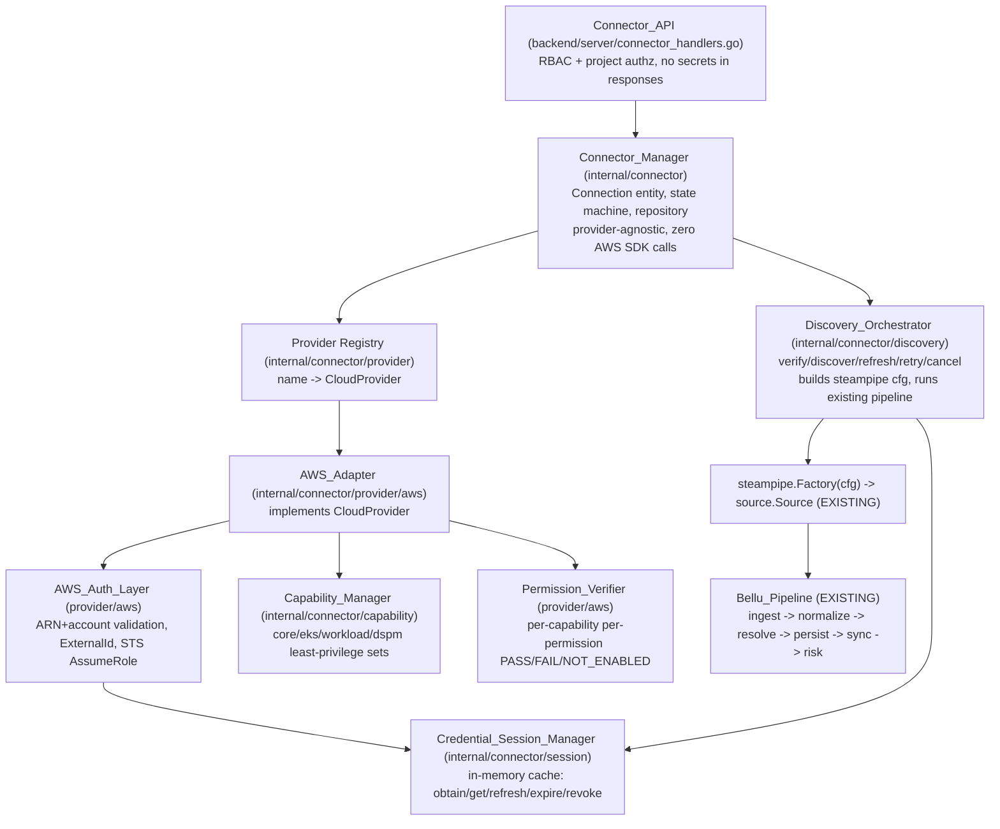
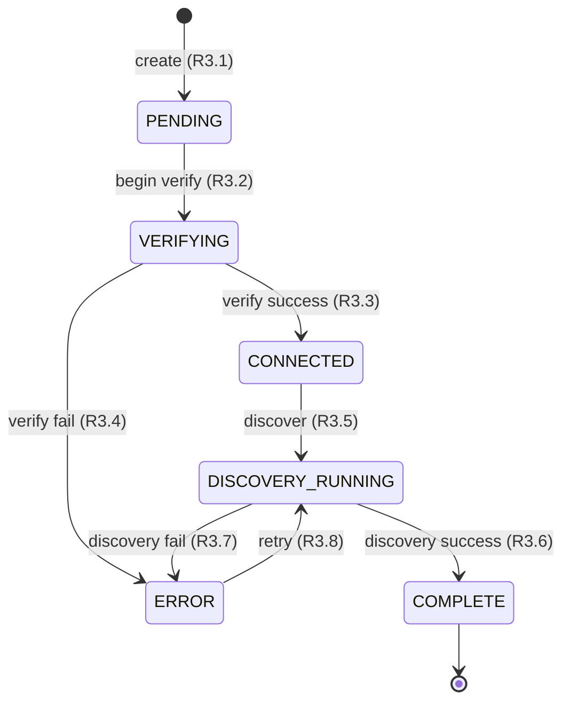

# Design Document

## Overview

The Bellu Cloud Connector is a **runtime subsystem** that onboards customer cloud accounts (AWS first) and hands the resulting access to Bellu's **existing** collection pipeline. It owns connection lifecycle, provider abstraction, cross-account authentication, temporary-credential sessions, modular capabilities, permission verification, and discovery orchestration — and stops exactly at the point where it configures and invokes the existing `internal/source/steampipe` source and lets the established flow (Steampipe → RawEvent → Normalizer → EntityResolver → GraphWriter → risk) take over.

The subsystem introduces **no** new model Kinds, Relations, or normalizers (R1.5, R1.6, R10.6, R14.4), reimplements **no** collection (R10.5), and persists **no** cloud secrets anywhere (R6.7, R7.2). It operates exclusively in the Customer Plane (R7.3, R14.3). Its code lives under `internal/connector` with HTTP handlers in `backend/server` and a single new goose migration under `internal/store/migrations` (R1.1–R1.4, Decision D7).

### How It Maps to the Layered Architecture

A request flows top-down through provider-agnostic layers, with only the AWS adapter and its sub-layers knowing anything about AWS:



The dependency rule is strict: the Connector_Manager depends only on the `CloudProvider` interface and the capability model; it contains zero AWS SDK calls (R2.6). All AWS specifics (STS, ARN validation, policy generation, permission probing) live under `internal/connector/provider/aws`. New providers register into the registry with zero manager changes (R4.3, R4.4, R15.2).

### Connection State Machine

The Connector_Manager owns a single state machine per Connection. Transitions are explicitly enumerated; any transition not in the table is rejected and leaves status unchanged (R3.9).



| From | Event | To | Requirement |
|------|-------|----|-------------|
| PENDING | begin verification | VERIFYING | R3.2 |
| VERIFYING | verification succeeds | CONNECTED | R3.3 |
| VERIFYING | verification fails | ERROR | R3.4 |
| CONNECTED | discover | DISCOVERY_RUNNING | R3.5 |
| DISCOVERY_RUNNING | discovery completes | COMPLETE | R3.6 |
| DISCOVERY_RUNNING | discovery fails | ERROR | R3.7 |
| ERROR | retry | DISCOVERY_RUNNING | R3.8 |

Any other `(from, event)` pair is invalid: the manager returns an error and does not mutate the stored status (R3.9).

---

## Architecture

### Package Layout (Decision D7)

```
internal/connector/
  connection.go          # Connection struct, Status enum, StatusTransition table
  manager.go             # Connector_Manager: lifecycle, state machine, delegation to provider
  repository.go          # Repository over *store.Store pool (non-secret persistence only)
  errors.go              # ErrUnsupportedProvider, ErrInvalidTransition, ErrNotFound ...
  provider/
    provider.go          # CloudProvider interface + Registry
    registry.go          # name -> CloudProvider, Register/Resolve
    aws/
      adapter.go         # AWS_Adapter implements CloudProvider
      auth.go            # AWS_Auth_Layer: ARN/account validation, ExternalId, STS AssumeRole
      setup.go           # Setup_Instructions, trust policy, least-privilege permission policy
      verify.go          # Permission_Verifier calls (read-only probes per capability)
      policy.go          # IAM policy document types + render
  session/
    session.go           # Credential_Session_Manager (in-memory): obtain/get/refresh/expire/revoke
  capability/
    capability.go        # Capability enum, definitions, required-permission sets
  discovery/
    orchestrator.go      # Discovery_Orchestrator: verify/discover/refresh/retry/cancel
    session.go           # Discovery_Session tracking + cancel funcs
backend/server/
  connector_handlers.go  # registerConnectorRoutes + handlers (mirrors registerAdminRoutes)
internal/store/migrations/
  00007_connector.sql    # next sequential goose migration
```

### Server Wiring

Following the existing nil-safe `graph` precedent, `Server`/`Options` gain a `connector *connector.Manager` field. When nil (connector disabled), connector routes respond `503` the way `handleAttackPaths` does for a nil graph.

```go
// backend/server/server.go (extended, not shown in full)
type Server struct {
    store       *store.Store
    graph       *graph.Writer
    auth        *auth.Service
    connector   *connector.Manager // may be nil if the connector is disabled
    allowOrigin string
}

type Options struct {
    Store       *store.Store
    Graph       *graph.Writer
    Auth        *auth.Service
    Connector   *connector.Manager
    AllowOrigin string
}
```

Inside `Handler()`, within the existing `authed` group, add `s.registerConnectorRoutes(authed)` next to `s.registerAdminRoutes(authed)`.

`backend/cmd/bellu-api/main.go` constructs the manager after the store is open and passes it into `Options`. The AWS adapter is registered into the provider registry at construction (R15.1 — AWS is the only registered provider in phase one).

---

## Components and Interfaces

### Connection entity (R2.1)

```go
package connector

import "time"

type Status string

const (
    StatusPending          Status = "PENDING"
    StatusVerifying        Status = "VERIFYING"
    StatusConnected        Status = "CONNECTED"
    StatusDiscoveryRunning Status = "DISCOVERY_RUNNING"
    StatusComplete         Status = "COMPLETE"
    StatusError            Status = "ERROR"
)

// Connection is the single entity owned by the Connector_Manager (R2.1).
// It carries only non-secret metadata (R7.1, R7.2).
type Connection struct {
    ID             int64      `json:"id"`
    OrgID          int64      `json:"-"`            // Tenant (Decision D6); never serialized to clients
    ProjectID      int64      `json:"project_id"`   // Project scope (Decision D6)
    Provider       string     `json:"provider"`     // "aws" | "gcp" (future) | "azure" (future)
    AccountID      string     `json:"account_id"`   // AWS 12-digit account id
    RoleARN        string     `json:"role_arn"`
    ExternalID     string     `json:"external_id"`
    Region         string     `json:"region"`
    Capabilities   []string   `json:"capabilities"` // enabled capability names
    Status         Status     `json:"status"`
    CreatedAt      time.Time  `json:"created_at"`
    LastVerifiedAt *time.Time `json:"last_verified_at,omitempty"`
}
```

`OrgID` carries `json:"-"` so tenant identifiers never cross the API boundary, while role ARN, account id, external id, id, and status are returned (R12.7). No credential field exists on this struct, by construction (R7.2).

### State transition table (R3.9)

```go
type transition struct {
    from  Status
    event Event
}

type Event string

const (
    EventBeginVerify     Event = "begin_verify"
    EventVerifySucceeded Event = "verify_succeeded"
    EventVerifyFailed    Event = "verify_failed"
    EventDiscover        Event = "discover"
    EventDiscoverDone    Event = "discover_done"
    EventDiscoverFailed  Event = "discover_failed"
    EventRetry           Event = "retry"
)

// allowedTransitions is the authoritative map (R3.1-R3.8).
var allowedTransitions = map[transition]Status{
    {StatusPending, EventBeginVerify}:               StatusVerifying,
    {StatusVerifying, EventVerifySucceeded}:          StatusConnected,
    {StatusVerifying, EventVerifyFailed}:             StatusError,
    {StatusConnected, EventDiscover}:                 StatusDiscoveryRunning,
    {StatusDiscoveryRunning, EventDiscoverDone}:      StatusComplete,
    {StatusDiscoveryRunning, EventDiscoverFailed}:    StatusError,
    {StatusError, EventRetry}:                        StatusDiscoveryRunning,
}

// Next returns the resulting status or ErrInvalidTransition, leaving the
// caller's status untouched on error (R3.9).
func (s Status) Next(e Event) (Status, error) {
    if to, ok := allowedTransitions[transition{s, e}]; ok {
        return to, nil
    }
    return s, ErrInvalidTransition
}
```

### Connector_Manager (R2.5, R2.6, R4.3, R4.5)

```go
// Manager owns Connection lifecycle and the state machine. It is provider-
// agnostic: it depends on the provider.Registry and contains zero AWS SDK
// calls (R2.6).
type Manager struct {
    repo     *Repository
    registry *provider.Registry
    caps     *capability.Manager
    disc     *discovery.Orchestrator
}

func (m *Manager) Create(ctx context.Context, in CreateInput) (*Connection, error)   // R2.1-R2.3, R3.1, R8.6
func (m *Manager) GenerateSetup(ctx context.Context, id int64) (*provider.Setup, error) // R3.2, R11
func (m *Manager) Verify(ctx context.Context, id int64) (*provider.VerifyResult, error) // R3.3/R3.4, R9
func (m *Manager) Discover(ctx context.Context, id int64) (*discovery.Session, error)   // R3.5, R10.2
func (m *Manager) Retry(ctx context.Context, id int64) (*discovery.Session, error)      // R3.8, R10.8
func (m *Manager) Cancel(ctx context.Context, id int64) error                           // R10.7
func (m *Manager) Status(ctx context.Context, id int64) (*StatusView, error)            // R10.9
func (m *Manager) Get(ctx context.Context, id int64) (*Connection, error)
func (m *Manager) Delete(ctx context.Context, id int64) error

// resolveProvider centralizes R4.3/R4.5: unknown provider -> ErrUnsupportedProvider.
func (m *Manager) resolveProvider(name string) (provider.CloudProvider, error) {
    p, ok := m.registry.Resolve(name)
    if !ok {
        return nil, fmt.Errorf("%w: %s", ErrUnsupportedProvider, name)
    }
    return p, nil
}
```

`Create` defaults the capability set to `["core"]` when none is supplied (R8.6) and sets `CreatedAt` and `Status=PENDING` (R2.3, R3.1).

### CloudProvider interface and registry (R4.1, R4.3, R4.4, R15.2)

```go
package provider

// CloudProvider is the common provider-adapter interface. New providers are
// added by implementing this and registering; the Connector_Manager never
// branches on provider type (R4.1, R4.3, R4.4, R15.2).
type CloudProvider interface {
    Name() string

    // CreateSetup returns onboarding artifacts (role ARN template, External_Id,
    // trust/permission policies, human steps) for the enabled capabilities.
    CreateSetup(ctx context.Context, in SetupInput) (*Setup, error)

    // VerifyConnection authenticates and checks required permissions.
    VerifyConnection(ctx context.Context, conn Target) (*VerifyResult, error)

    // Authenticate obtains fresh Temporary_Credentials for the connection.
    Authenticate(ctx context.Context, conn Target) (*Credentials, error)

    // GetCredentials returns usable credentials, using the session cache.
    GetCredentials(ctx context.Context, conn Target) (*Credentials, error)

    // CheckPermissions runs read-only probes per enabled capability.
    CheckPermissions(ctx context.Context, conn Target, caps []string) (*VerifyResult, error)

    // Discover builds the collection config for the existing Steampipe source.
    Discover(ctx context.Context, conn Target, creds *Credentials) (DiscoveryPlan, error)
}

// Target is the provider-agnostic, non-secret view of a Connection the adapter
// needs. It carries no credentials.
type Target struct {
    ConnectionID int64
    AccountID    string
    RoleARN      string
    ExternalID   string
    Region       string
    Capabilities []string
}

// Credentials are short-lived, in-memory only, never persisted (R6, R7.2).
type Credentials struct {
    AccessKeyID     string
    SecretAccessKey string
    SessionToken    string
    Expiry          time.Time
}

// DiscoveryPlan is what the orchestrator feeds to steampipe.Factory. It carries
// the config map and the catalog/connection selector; credentials are handed to
// Steampipe out-of-band (Decision D4), not written into the map persisted
// anywhere.
type DiscoveryPlan struct {
    SteampipeConfig map[string]any // host, port, user, password, database, connection/catalog
    CredentialEnv   map[string]string // AWS_* env for the session only (never logged/stored)
}

type Registry struct { byName map[string]CloudProvider }

func (r *Registry) Register(p CloudProvider)                 // R4.4, R15.2
func (r *Registry) Resolve(name string) (CloudProvider, bool) // R4.3, R4.5
```

### AWS_Adapter (R4.2, R5, R11)

```go
package aws

type Adapter struct {
    auth     *AuthLayer
    sessions *session.Manager
    caps     *capability.Manager
    sts      STSAPI // narrow interface over sts.Client for testing
    region   string
    belluPrincipalARN string // Bellu's assuming principal, from config
}

func New(opts Options) *Adapter
func (a *Adapter) Name() string { return "aws" }
// ... implements provider.CloudProvider
```

`STSAPI` is a narrow interface (mirroring the `s3API` pattern in `global-intel/raw/s3store.go`) so the adapter is unit-testable with a fake:

```go
type STSAPI interface {
    AssumeRole(ctx context.Context, in *sts.AssumeRoleInput, opts ...func(*sts.Options)) (*sts.AssumeRoleOutput, error)
}
```

### AWS_Auth_Layer (R5)

```go
package aws

type AuthLayer struct {
    sts STSAPI
}

var (
    // IAM role ARN: arn:aws:iam::<12-digit>:role/<name> (R5.4).
    roleARNRe   = regexp.MustCompile(`^arn:aws(?:-[a-z-]+)?:iam::\d{12}:role/.+$`)
    // 12-digit account id (R5.5).
    accountIDRe = regexp.MustCompile(`^\d{12}$`)
)

// Authenticate validates ARN+account, then calls STS AssumeRole with the
// stored ExternalId. On any validation failure it reports the invalid value
// and makes zero STS calls (R5.4-R5.6). It never uses long-lived keys (R5.7).
func (l *AuthLayer) Authenticate(ctx context.Context, t provider.Target) (*provider.Credentials, error) {
    if !roleARNRe.MatchString(t.RoleARN) {
        return nil, fmt.Errorf("%w: role_arn", ErrInvalidValue)
    }
    if !accountIDRe.MatchString(t.AccountID) {
        return nil, fmt.Errorf("%w: account_id", ErrInvalidValue)
    }
    out, err := l.sts.AssumeRole(ctx, &sts.AssumeRoleInput{
        RoleArn:         aws.String(t.RoleARN),
        RoleSessionName: aws.String(fmt.Sprintf("bellu-connector-%d", t.ConnectionID)),
        ExternalId:      aws.String(t.ExternalID),
    })
    if err != nil {
        return nil, fmt.Errorf("sts assume role: %w", err) // R5.8: zero creds returned
    }
    c := out.Credentials
    return &provider.Credentials{
        AccessKeyID:     aws.ToString(c.AccessKeyId),
        SecretAccessKey: aws.ToString(c.SecretAccessKey),
        SessionToken:    aws.ToString(c.SessionToken),
        Expiry:          aws.ToTime(c.Expiration),
    }, nil
}
```

`External_Id` is generated at connection creation for the AWS provider (R5.1) using a cryptographically random value (e.g. `crypto/rand` → base32), stored on the Connection (R7.1, R11.5), and included both in the generated trust policy condition and every AssumeRole request (R5.2, R11.5). The AWS SDK dependencies added are `github.com/aws/aws-sdk-go-v2/service/sts` and `github.com/aws/aws-sdk-go-v2/credentials/stscreds`, from the SDK family already in `go.mod` (Decision D3) — no second AWS SDK.

### Credential_Session_Manager (R6)

```go
package session

// Manager caches Temporary_Credentials in process memory only. It writes to
// zero database rows, zero log entries, zero API responses (R6.7).
type Manager struct {
    mu    sync.Mutex
    cache map[int64]*entry // keyed by ConnectionID
    now   func() time.Time // injectable for tests
}

type entry struct {
    creds  *provider.Credentials
    expiry time.Time
}

// Obtain returns cached unexpired creds, else calls refreshFn and caches the
// result (R6.1, R6.2). Expired entries are discarded and refreshed (R6.3).
func (m *Manager) Obtain(ctx context.Context, connID int64, refreshFn func(context.Context) (*provider.Credentials, error)) (*provider.Credentials, error)

func (m *Manager) Get(connID int64) (*provider.Credentials, bool) // R6.2
func (m *Manager) Refresh(ctx context.Context, connID int64, refreshFn func(context.Context) (*provider.Credentials, error)) (*provider.Credentials, error) // R6.4
func (m *Manager) Revoke(connID int64) // R6.5, R6.6
```

Expiry is honored against `now()`; the manager returns cached credentials while unexpired (R6.2) and transparently re-obtains after expiry (R6.3). `Refresh` replaces the cached entry (R6.4). `Revoke` deletes the entry and is called both on explicit revocation (R6.5) and at the end of a Discovery_Session (R6.6).

### Capability_Manager (R8)

```go
package capability

type Capability string

const (
    Core     Capability = "core"
    EKS      Capability = "eks"
    Workload Capability = "workload"
    DSPM     Capability = "dspm"
)

// Definition is a named, modular, least-privilege read-oriented permission
// bundle (R8.1, R8.4). No definition grants AdministratorAccess or wildcard
// full access (R8.5).
type Definition struct {
    Name        Capability
    Description string
    // Permissions are IAM actions, least privilege, read-only (R8.4).
    Permissions []string
    // VerifyProbes map each capability to a concrete read-only API probe used
    // by the Permission_Verifier (R9.1, R9.6).
    VerifyProbes []Probe
}

// Catalog is the authoritative capability set (R8.1).
var Catalog = map[Capability]Definition{
    Core: {
        Name: Core,
        Description: "Account, regions, EC2, VPC, IAM, S3 read (R8.2)",
        Permissions: []string{
            "sts:GetCallerIdentity",
            "account:ListRegions",
            "ec2:DescribeInstances", "ec2:DescribeVpcs", "ec2:DescribeSecurityGroups",
            "iam:GetAccountSummary", "iam:ListRoles", "iam:ListUsers", "iam:ListPolicies",
            "s3:ListAllMyBuckets", "s3:GetBucketPolicyStatus",
        },
    },
    EKS:      {Name: EKS, Permissions: []string{"eks:ListClusters", "eks:DescribeCluster"}},
    Workload: {Name: Workload, Permissions: []string{"ecs:ListClusters", "lambda:ListFunctions"}},
    DSPM:     {Name: DSPM, Permissions: []string{"s3:GetBucketTagging", "rds:DescribeDBInstances"}},
}
```

`core` is enabled by default when no capability is selected (R8.6). Capabilities are enabled independently so permission can be granted progressively (R8.3). Every permission list is read-oriented and least privilege (R8.4); no definition grants `AdministratorAccess` or `*:*` (R8.5).

### Permission_Verifier (R9)

The verifier runs the read-only probes for each **enabled** capability using the connection's temporary credentials, producing a structured per-permission result.

```go
package aws

type CheckOutcome string

const (
    OutcomePass       CheckOutcome = "PASS"
    OutcomeFail       CheckOutcome = "FAIL"
    OutcomeNotEnabled CheckOutcome = "NOT_ENABLED"
)

type PermissionResult struct {
    Permission string       `json:"permission"`
    Outcome    CheckOutcome `json:"outcome"` // PASS | FAIL (R9.2)
    Detail     string       `json:"detail,omitempty"`
}

type CapabilityResult struct {
    Capability string             `json:"capability"`
    Outcome    CheckOutcome       `json:"outcome"` // PASS | FAIL | NOT_ENABLED (R9.3)
    Checks     []PermissionResult `json:"checks,omitempty"`
}

type VerifyResult struct {
    OK           bool               `json:"ok"`          // true iff all enabled checks PASS (R9.4)
    Capabilities []CapabilityResult `json:"capabilities"`
    Failures     []PermissionResult `json:"failures,omitempty"` // each failing permission (R9.5)
}
```

Behavior: for each enabled capability, run its probes with the session credentials (R9.1); report each probe `PASS`/`FAIL` (R9.2); capabilities not enabled on the connection are reported `NOT_ENABLED` (R9.3). Overall `OK=true` iff every checked permission is `PASS` (R9.4); otherwise `OK=false` with every failing permission listed in `Failures` (R9.5). Probes are read-only API calls only — no write/modify/delete is ever issued (R9.6).

### Discovery_Orchestrator (R10)

```go
package discovery

type SessionStatus string

const (
    SessRunning   SessionStatus = "running"
    SessComplete  SessionStatus = "complete"
    SessFailed    SessionStatus = "failed"
    SessCancelled SessionStatus = "cancelled"
)

type Session struct {
    ID           string        `json:"id"`
    ConnectionID int64         `json:"connection_id"`
    Status       SessionStatus `json:"status"`
    StartedAt    time.Time     `json:"started_at"`
    EndedAt      *time.Time    `json:"ended_at,omitempty"`
    Error        string        `json:"error,omitempty"`
    cancel       context.CancelFunc // not serialized
}

type Orchestrator struct {
    mu       sync.Mutex
    latest   map[int64]*Session // most-recent session per connection (R10.9)
    creds    *session.Manager   // Credential_Session_Manager
    runPipe  PipelineRunner     // injectable: wraps the existing bellu pipeline
}

func (o *Orchestrator) Verify(ctx, conn, provider) (*provider.VerifyResult, error)  // R10.1
func (o *Orchestrator) Discover(ctx, conn, provider) (*Session, error)              // R10.1, R10.2
func (o *Orchestrator) Refresh(ctx, conn, provider) error                           // R10.1
func (o *Orchestrator) Retry(ctx, conn, provider) (*Session, error)                 // R10.1, R10.8
func (o *Orchestrator) Cancel(connID int64) error                                   // R10.1, R10.7
func (o *Orchestrator) Latest(connID int64) (*Session, bool)                        // R10.9
```

Discovery flow (R10.2–R10.7):

1. On `Discover` for a `CONNECTED` connection, create a `Session` with a unique id and status `running` (R10.2).
2. Obtain credentials from the session manager (via the provider), materialized **for this session only** (Decision D4, R6.6).
3. Ask the provider to build a `DiscoveryPlan`: the `SteampipeConfig` map (`host`, `port`, `user`, `password`, `database`, and the provider `connection`/`catalog` selector) and the `CredentialEnv` holding the assumed-role `AWS_*` values. The orchestrator contains **zero** provider-specific resource queries (R10.5).
4. Create a cancellable context, store its `cancel` on the session, and run:
   ```go
   src, err := steampipe.Factory(plan.SteampipeConfig) // EXISTING source (R10.3)
   // Steampipe reads the session AWS_* credentials via its configured mechanism (D4, R10.4)
   runCtx, cancel := context.WithCancel(ctx)
   sess.cancel = cancel
   err = o.runPipe.Run(runCtx, src, runID) // EXISTING pipeline wiring (R10.3)
   ```
5. The pipeline is the existing `internal/pipeline` wiring used by `bellu run` (ingest → normalize → resolve → persist → sync → risk). The orchestrator reuses it rather than reimplementing it (R10.3, R10.5, R10.6). `PipelineRunner` abstracts the `ingestOne`-equivalent so discovery can be unit-tested with a fake source and so no collection logic is duplicated.
6. On success, status `complete` (R3.6); on error, status `failed` (R3.7); on `Cancel`, invoke the stored `cancel()` to stop `Source.Collect` promptly and record status `cancelled` (R10.7).
7. On session end (any terminal state), the session credentials are revoked from the session manager (R6.6).
8. `Retry` for an `ERROR` connection starts a new session (R10.8). `Status`/`Latest` returns the connection status plus the most-recent session status (R10.9).

`steampipe.Factory` is called exactly as its contract specifies (verified in `internal/source/steampipe/steampipe.go`): the config map provides connection parameters and a `connection`/`catalog` selector; the running Steampipe service (deploy/docker-compose.yml `collectors` profile, host `:9193`, db `steampipe`) consumes AWS creds through its own configuration, so the Connector supplies the short-lived assumed-role credentials via `CredentialEnv` for the session only and discards them at session end (D4). No credential is placed in a persisted structure.

---

## Data Models

### Migration `00007_connector.sql`

The connector adds its tables as the next sequential goose migration after `00006_findings.sql`, picked up automatically by the embedded `//go:embed migrations/*.sql` mechanism (R1.4, R7.4). All tables live in the Customer Plane (R7.3, R14.3). The schema stores **only** non-secret metadata and includes an explicit documented NO-SECRETS constraint (R7.1, R7.2).

```sql
-- +goose Up
-- Cloud Connector operational state. Customer Plane only. NO SECRETS:
-- this schema stores role ARN, account id, external id, and non-secret
-- metadata only. AWS access key ids, secret access keys and STS session
-- tokens are NEVER written here (R7.1, R7.2) -- they live in process memory
-- (internal/connector/session) for the lifetime of a session and are then
-- discarded. There is no column for any credential by design.

CREATE TABLE connector_connections (
    id               BIGSERIAL PRIMARY KEY,
    org_id           BIGINT      NOT NULL REFERENCES organizations(id),  -- Tenant (D6, R2.2, R14.2)
    project_id       BIGINT      NOT NULL REFERENCES projects(id),   -- Project (D6, R2.2)
    provider         TEXT        NOT NULL,                           -- 'aws' (phase 1)
    account_id       TEXT        NOT NULL,                           -- AWS 12-digit (R7.1)
    role_arn         TEXT        NOT NULL,                           -- assumed role (R7.1)
    external_id      TEXT        NOT NULL,                           -- per-connection (R5.1, R7.1, R11.5)
    region           TEXT        NOT NULL DEFAULT '',
    capabilities     TEXT[]      NOT NULL DEFAULT ARRAY['core'],     -- enabled caps (R8.3, R8.6)
    status           TEXT        NOT NULL DEFAULT 'PENDING',         -- state machine (R3)
    created_at       TIMESTAMPTZ NOT NULL DEFAULT now(),             -- (R2.3)
    last_verified_at TIMESTAMPTZ,                                    -- (R2.4)
    CONSTRAINT connector_connections_provider_account_uniq
        UNIQUE (org_id, provider, account_id)
);
CREATE INDEX connector_connections_org_idx     ON connector_connections (org_id);
CREATE INDEX connector_connections_project_idx ON connector_connections (project_id);

-- Per-connection capability enablement + latest verification outcome.
CREATE TABLE connector_capabilities (
    connection_id BIGINT NOT NULL REFERENCES connector_connections(id) ON DELETE CASCADE,
    capability    TEXT   NOT NULL,                 -- core|eks|workload|dspm
    enabled       BOOLEAN NOT NULL DEFAULT true,   -- (R8.3)
    PRIMARY KEY (connection_id, capability)
);

-- Verification results (non-secret: permission names + PASS/FAIL only) (R9).
CREATE TABLE connector_verification_results (
    id            BIGSERIAL PRIMARY KEY,
    connection_id BIGINT NOT NULL REFERENCES connector_connections(id) ON DELETE CASCADE,
    capability    TEXT   NOT NULL,
    permission    TEXT   NOT NULL,
    outcome       TEXT   NOT NULL,                 -- PASS|FAIL|NOT_ENABLED
    checked_at    TIMESTAMPTZ NOT NULL DEFAULT now()
);
CREATE INDEX connector_verification_conn_idx ON connector_verification_results (connection_id);

-- Discovery sessions: tracked unit of a single discovery execution (R10.2, R10.9).
CREATE TABLE connector_discovery_sessions (
    id            TEXT PRIMARY KEY,                -- unique session id
    connection_id BIGINT NOT NULL REFERENCES connector_connections(id) ON DELETE CASCADE,
    run_id        TEXT   NOT NULL,                 -- bellu pipeline run id
    status        TEXT   NOT NULL DEFAULT 'running', -- running|complete|failed|cancelled
    started_at    TIMESTAMPTZ NOT NULL DEFAULT now(),
    ended_at      TIMESTAMPTZ,
    error         TEXT NOT NULL DEFAULT ''
);
CREATE INDEX connector_discovery_conn_idx ON connector_discovery_sessions (connection_id, started_at DESC);

-- +goose Down
DROP TABLE connector_discovery_sessions;
DROP TABLE connector_verification_results;
DROP TABLE connector_capabilities;
DROP TABLE connector_connections;
```

Scoping: every query carries `WHERE org_id = $tenant` (R14.2) and additionally filters by `project_id` for principal authorization (R14.1). FKs reference the existing `organizations` and `projects` tables (D6). There is deliberately no credential column anywhere (R7.2).

### Repository

```go
package connector

type Repository struct { pool *pgxpool.Pool } // uses store.Store.Pool() (R7.4)

func NewRepository(s *store.Store) *Repository { return &Repository{pool: s.Pool()} }

// All reads are tenant-scoped (R14.1, R14.2).
func (r *Repository) Insert(ctx, c *Connection) (int64, error)
func (r *Repository) Get(ctx, orgID, id int64) (*Connection, error)
func (r *Repository) ListByOrg(ctx, orgID int64) ([]Connection, error)
func (r *Repository) UpdateStatus(ctx, orgID, id int64, s Status) error
func (r *Repository) SetVerified(ctx, orgID, id int64, t time.Time) error // R2.4
func (r *Repository) Delete(ctx, orgID, id int64) error
func (r *Repository) SaveVerification(ctx, connID int64, res *aws.VerifyResult) error
func (r *Repository) RecordSession(ctx, s *discovery.Session, runID string) error
```

---

## API Design

All routes register inside the existing `authed` group so `auth.Authenticate` applies (R12.2), mirroring `registerAdminRoutes`. Handlers use `context.WithTimeout(c.Request.Context(), ...)`, `c.JSON`, `500` on store errors, `400` on bad input, `404` when missing, and `503` when the connector dependency is nil (the `handleAttackPaths` precedent).

```go
// backend/server/connector_handlers.go
func (s *Server) registerConnectorRoutes(g *gin.RouterGroup) {
    conns := g.Group("/connectors")

    // Mutations behind integrations:manage (R12.3).
    conns.POST("",                 s.auth.RequirePermission(auth.PermIntegrations), s.handleCreateConnection)
    conns.POST("/:id/setup",       s.auth.RequirePermission(auth.PermIntegrations), s.handleGenerateSetup)
    conns.POST("/:id/verify",      s.auth.RequirePermission(auth.PermIntegrations), s.handleVerifyConnection)
    conns.POST("/:id/discover",    s.auth.RequirePermission(auth.PermIntegrations), s.handleDiscover)
    conns.POST("/:id/cancel",      s.auth.RequirePermission(auth.PermIntegrations), s.handleCancelDiscovery)
    conns.DELETE("/:id",           s.auth.RequirePermission(auth.PermIntegrations), s.handleDeleteConnection)

    // Reads behind projects:read (R12.4).
    conns.GET("/:id",              s.auth.RequirePermission(auth.PermProjectsRead), s.handleGetConnection)
    conns.GET("/:id/status",       s.auth.RequirePermission(auth.PermProjectsRead), s.handleConnectionStatus)
}
```

Routes required by R12.1: create, generate setup, get, verify, discover, status, delete/disable — all present above. `retry` is served by `POST /:id/discover` on an `ERROR` connection (the manager routes it to `Retry`), consistent with the state machine.

### Per-request project authorization (R12.5, R12.6, R14.1)

Every connection-targeting handler loads the connection scoped to the principal's org, then checks `Principal.CanAccessProject`:

```go
func (s *Server) connectionForRequest(c *gin.Context) (*connector.Connection, bool) {
    if s.connector == nil {
        c.JSON(http.StatusServiceUnavailable, gin.H{"error": "connector not available"})
        return nil, false
    }
    p, _ := auth.PrincipalFrom(c)
    id := pathInt64(c, "id")
    conn, err := s.connector.Get(c.Request.Context(), p.User.OrgID, id) // tenant-scoped (R14.2)
    if err != nil {
        c.JSON(http.StatusNotFound, gin.H{"error": "connection not found"})
        return nil, false
    }
    if !p.CanAccessProject(conn.ProjectID) { // R12.5
        // Deny and return zero connection data (R12.6).
        c.JSON(http.StatusForbidden, gin.H{"error": "forbidden"})
        return nil, false
    }
    return conn, true
}
```

A principal lacking project access receives `403` with no connection body (R12.6). Cross-tenant reads are impossible because `Get` filters by `org_id` (R14.2).

### Request / response shapes

Create (`POST /api/connectors`):
```jsonc
// request
{ "project_id": 7, "provider": "aws", "account_id": "123456789012",
  "role_arn": "arn:aws:iam::123456789012:role/BelluConnectorRole",
  "region": "us-east-1", "capabilities": ["core"] }     // capabilities optional -> ["core"] (R8.6)
// response 201
{ "id": 42, "project_id": 7, "provider": "aws", "account_id": "123456789012",
  "role_arn": "arn:aws:iam::123456789012:role/BelluConnectorRole",
  "external_id": "BELLU-7f3a...", "region": "us-east-1",
  "capabilities": ["core"], "status": "PENDING", "created_at": "..." }
```

Generate setup (`POST /api/connectors/42/setup`) → sets `VERIFYING` (R3.2), returns setup artifacts (R11):
```jsonc
{ "role_name": "BelluConnectorRole", "role_arn_template": "arn:aws:iam::<ACCOUNT_ID>:role/BelluConnectorRole",
  "external_id": "BELLU-7f3a...",
  "trust_policy": { /* STS AssumeRole trust with ExternalId condition (R11.2) */ },
  "permission_policy": { /* least-privilege core read-only (R11.3, R11.4) */ },
  "instructions": ["1. Create an IAM role named BelluConnectorRole ...", "..."] }
```

Verify (`POST /api/connectors/42/verify`) → `CONNECTED` or `ERROR` (R3.3/R3.4), returns the verifier result (R9):
```jsonc
{ "ok": false,
  "capabilities": [
    { "capability": "core", "outcome": "FAIL",
      "checks": [ { "permission": "iam:ListRoles", "outcome": "PASS" },
                  { "permission": "s3:ListAllMyBuckets", "outcome": "FAIL", "detail": "AccessDenied" } ] },
    { "capability": "eks", "outcome": "NOT_ENABLED" } ],
  "failures": [ { "permission": "s3:ListAllMyBuckets", "outcome": "FAIL" } ] }
```

Discover (`POST /api/connectors/42/discover`) → `DISCOVERY_RUNNING`:
```jsonc
{ "session": { "id": "disc-20240110T...", "connection_id": 42, "status": "running", "started_at": "..." } }
```

Status (`GET /api/connectors/42/status`) (R10.9):
```jsonc
{ "connection_id": 42, "status": "COMPLETE",
  "latest_session": { "id": "disc-...", "status": "complete", "started_at": "...", "ended_at": "..." } }
```

No response ever includes an access key id, secret access key, or session token (R12.7) — the only fields serialized are those on `Connection` (minus `OrgID`), the setup artifacts, verification results, and session status.

---

## AWS Setup Generation (R11)

### Generated trust policy (R11.2, R11.5)

```json
{
  "Version": "2012-10-17",
  "Statement": [{
    "Effect": "Allow",
    "Principal": { "AWS": "<BELLU_PRINCIPAL_ARN>" },
    "Action": "sts:AssumeRole",
    "Condition": { "StringEquals": { "sts:ExternalId": "BELLU-7f3a..." } }
  }]
}
```

The `sts:ExternalId` value is the per-connection `External_Id`; it is stored on the Connection record and included in every AssumeRole request, and the two always match (R11.5, R5.2).

### Generated Core least-privilege permission policy (R11.3, R11.4, R8.4, R8.5)

```json
{
  "Version": "2012-10-17",
  "Statement": [{
    "Sid": "BelluCoreReadOnly",
    "Effect": "Allow",
    "Action": [
      "sts:GetCallerIdentity", "account:ListRegions",
      "ec2:Describe*", "iam:Get*", "iam:List*",
      "s3:ListAllMyBuckets", "s3:GetBucketPolicyStatus"
    ],
    "Resource": "*"
  }]
}
```

The generator asserts, by construction and by test, that no statement is `"Action": "*"` on `"Resource": "*"` and that `AdministratorAccess` is never referenced (R11.4, R8.5). Resource-level `"*"` is acceptable for read-only `Describe/List/Get` actions, but the action set is explicitly enumerated and read-oriented. Additional enabled capabilities (`eks`/`workload`/`dspm`) append their own least-privilege statements (R11.3).

---

## Security Model

- **No long-lived keys.** All AWS access is obtained via STS AssumeRole with a per-connection External_Id (R5.1, R5.7). Bellu never stores or accepts customer access keys.
- **External id per connection.** Generated with `crypto/rand`, stored as non-secret metadata, bound into both the trust policy and the AssumeRole call (R5.1, R5.2, R11.5).
- **Credentials in memory only.** Temporary_Credentials live solely in the `session.Manager` map, for the session lifetime, and are discarded on expiry, revoke, and session end (R6.1–R6.6). They are written to zero DB rows, zero logs, zero API responses (R6.7, R7.2, R12.7). The `Credentials` struct is never a field of `Connection` and never a column in the schema.
- **Customer plane only.** The repository uses the existing `store.Store` pool (customer Postgres `bellu`); it opens zero connections to `postgres-intel`/OpenSearch (R7.3, R14.3).
- **Tenant + project isolation.** Every query is `org_id`-scoped (R14.2) and every connection-targeting request is authorized against `Principal.CanAccessProject` (R12.5, R14.1), returning no data on denial (R12.6).
- **Read-only against the customer account.** Verification probes and discovery (Steampipe) issue only read/describe/list calls (R9.6).

---

## Error Handling

| Condition | Behavior | Requirement |
|-----------|----------|-------------|
| Invalid status transition requested | `ErrInvalidTransition`; status unchanged | R3.9 |
| Unregistered provider | `ErrUnsupportedProvider`; operation rejected, reports unsupported | R4.5, R15.4 |
| Invalid role ARN or account id | `ErrInvalidValue` naming the field; zero STS calls | R5.4–R5.6 |
| STS AssumeRole error | authentication failure reported; zero credentials returned | R5.8 |
| Any verifier probe FAIL | overall `ok=false`; failing permissions listed | R9.5 |
| Discovery source/pipeline error | session `failed`; connection → `ERROR` | R3.7 |
| Cancel on running session | context cancelled, `Source.Collect` stops; session `cancelled` | R10.7 |
| Connector dependency nil | handler returns `503` (graph precedent) | — |
| Store errors / bad input / not found | `500` / `400` / `404` per existing handler conventions | R12 |
| Principal lacks project access | `403`, zero connection data | R12.6 |

Errors are sentinel values in `internal/connector/errors.go` so handlers can map them to HTTP status codes. No error path logs or returns credentials.

---

## Testing Strategy

The connector is predominantly pure, provider-agnostic logic (state machine, capability model, session cache, verifier result shaping, policy generation) with a thin AWS edge and an existing-pipeline handoff. Testing is example/table-driven for the deterministic logic plus integration tests behind the existing `integration` build tag for the migration/repository. Property-based testing is **not** adopted as a primary strategy here: the subsystem is dominated by a finite state machine, fixed capability catalogs, IAM policy JSON generation, and I/O against external services (STS, Steampipe, Postgres) — these are best covered by table-driven unit tests and integration tests rather than universally-quantified properties. The one place a property-style assertion adds value (round-trip-ish invariants) is folded into table tests below.

### Unit tests (no external services)

- **State machine (table-driven).** Every `(from, event)` pair in `allowedTransitions` asserts the resulting status; every pair *not* in the table asserts `ErrInvalidTransition` and unchanged status (R3.1–R3.9).
- **Capability model.** Assert the catalog contains `core/eks/workload/dspm` (R8.1); assert `core` covers account/regions/EC2/VPC/IAM/S3 reads (R8.2); assert no definition contains `AdministratorAccess` or `*` action/`*` resource (R8.5); assert default selection yields `["core"]` (R8.6).
- **AWS ARN / account id validation (table-driven).** Valid and invalid ARNs and account ids; assert invalid inputs are rejected, name the offending field, and make zero STS calls using a counting fake STS (R5.4–R5.6).
- **Fake STS.** A fake implementing `STSAPI` returns credentials on success and an error on failure; assert success returns in-memory credentials and failure returns zero credentials and an auth-failure error (R5.3, R5.8). Assert the `ExternalId` passed to the fake equals the stored connection External_Id (R5.2, R11.5).
- **Credential_Session_Manager (injected clock).** Assert cached unexpired creds are returned without re-authenticating (R6.2); expired creds are discarded and refreshed (R6.3); `Refresh` replaces the cache (R6.4); `Revoke` clears it (R6.5, R6.6); a spy confirms zero writes to DB/logs/responses (R6.7).
- **Permission_Verifier result shaping.** Given a fake probe runner, assert per-capability per-permission `PASS/FAIL`, `NOT_ENABLED` for disabled capabilities, `ok` true iff all PASS, and `Failures` lists every failing permission (R9.2–R9.5).
- **Setup generation.** Assert the trust policy conditions on the generated External_Id (R11.2) and that External_Id in the policy equals the stored value (R11.5); assert the permission policy excludes `AdministratorAccess` and wildcard full access (R11.4, R8.5).
- **Fake CloudProvider.** A fake provider lets the Connector_Manager be tested end-to-end for lifecycle, default capability, unsupported-provider rejection (R4.5), and provider-agnostic resolution (R4.3) with zero AWS SDK involvement (R2.6).
- **Discovery orchestrator (fake `source.Source`).** Using a fake `source.Source` and a fake `PipelineRunner`, assert: a session with a unique id and `running` status is created (R10.2); credentials are supplied for the session and revoked at end (R6.6, R10.4); `Cancel` cancels the context passed to `Collect` and marks the session `cancelled` (R10.7); success/failure map to `complete`/`failed` and drive the connection to `COMPLETE`/`ERROR` (R3.6, R3.7); `Retry` from `ERROR` starts a new session (R10.8); the orchestrator issues no provider-specific queries (R10.5).

### Integration tests (build tag `integration`, testcontainers Postgres)

Consistent with `internal/store/store_integration_test.go` and the global-intel database integration tests, these use `//go:build integration` with `testcontainers-go` Postgres `postgres:16-alpine`, `store.Open` + `Store.Migrate`:

- **Migration applies.** `Migrate` runs `00007_connector.sql` cleanly on top of `00001`–`00006`; tables exist with expected columns and FKs (R1.4, R7.4).
- **Repository round-trips.** Insert → Get → ListByOrg → UpdateStatus → SetVerified → Delete, asserting non-secret fields persist and `last_verified_at` is set on verification (R2.1–R2.4, R7.1).
- **Tenant scoping.** A connection created under org A is never returned to a query scoped to org B (R14.2).
- **No-secrets guarantee.** A schema introspection test asserts no column name in any `connector_*` table matches credential patterns (`secret`, `access_key`, `session_token`) (R7.2).

### Steampipe handoff

The real Steampipe path is exercised by the existing `internal/source/steampipe/steampipe_integration_test.go`; the connector reuses `steampipe.Factory`/`Source.Collect` unchanged, so connector tests use a fake source and assert only that the correct config map and cancellable context are produced (R10.3, R10.4, R10.7).

---

## Extensibility (R15)

- **AWS only in phase one.** The registry registers exactly one provider, `aws` (R15.1).
- **Zero-change provider addition.** GCP and Azure adapters implement `provider.CloudProvider` and call `Registry.Register`; the Connector_Manager, state machine, API, and schema are unchanged (R4.4, R15.2). The `provider` column already accommodates new values.
- **Future work.** GCP and Azure are explicitly out of scope for phase one and documented as future (R15.3). Requesting a provider with no registered adapter yields `ErrUnsupportedProvider` → "provider not yet supported" (R4.5, R15.4). The frontend marks GCP/Azure onboarding as future (R13.5).

Frontend boundary (R13) is satisfied by the API contract: the UI consumes only connection id, role ARN, setup instructions, verification status, and discovery status over the RBAC-gated API (R13.2, R13.4), and never handles credentials because none are ever returned (R13.3, R12.7).

---

## Requirements Mapping

| Requirement | Design elements |
|-------------|-----------------|
| R1 Package placement | Package Layout; `internal/connector/*`; `backend/server/connector_handlers.go`; `00007_connector.sql`; zero Kinds/Relations/normalizers (Overview) |
| R2 Connection entity & ownership | `Connection` struct; `Create` (CreatedAt, PENDING, org+project); `SetVerified` (R2.4); Manager is AWS-free (R2.6) |
| R3 State machine | State Machine diagram + `allowedTransitions` + `Status.Next` (R3.1–R3.9) |
| R4 Provider interface | `CloudProvider`; `Registry`; `resolveProvider` (unsupported → error) |
| R5 AWS auth via STS | `AuthLayer`: ARN/account regex, ExternalId, `STSAPI.AssumeRole`, no long-lived keys, error → zero creds |
| R6 Credential sessions | `session.Manager` obtain/get/refresh/expire/revoke; discarded at session end; zero DB/log/response |
| R7 Non-secret persistence | `00007_connector.sql` NO-SECRETS comment + absence of credential columns; `store.Pool()`; customer plane |
| R8 Capabilities | `capability.Catalog` core/eks/workload/dspm, least privilege, no AdministratorAccess, core default |
| R9 Permission verification | `VerifyResult`/`CapabilityResult`/`PermissionResult`; PASS/FAIL/NOT_ENABLED; read-only probes |
| R10 Discovery orchestration | `Orchestrator` verify/discover/refresh/retry/cancel; `steampipe.Factory` + existing pipeline; cancellable ctx; no new model |
| R11 AWS setup generation | Setup section: role template, trust policy w/ ExternalId, Core least-privilege policy, no wildcard/Admin, ExternalId match |
| R12 RBAC-gated API | `registerConnectorRoutes` (integrations:manage mutations, projects:read reads); `connectionForRequest` CanAccessProject; no secrets in responses |
| R13 Frontend boundary | Extensibility section: API returns only non-secret ids/status; GCP/Azure marked future |
| R14 Tenant & plane isolation | org_id scoping on all queries; customer-plane-only repository; existing model/pipeline unchanged |
| R15 GCP/Azure extensibility | Registry; AWS-only phase one; zero-change registration; unsupported-provider reporting |
