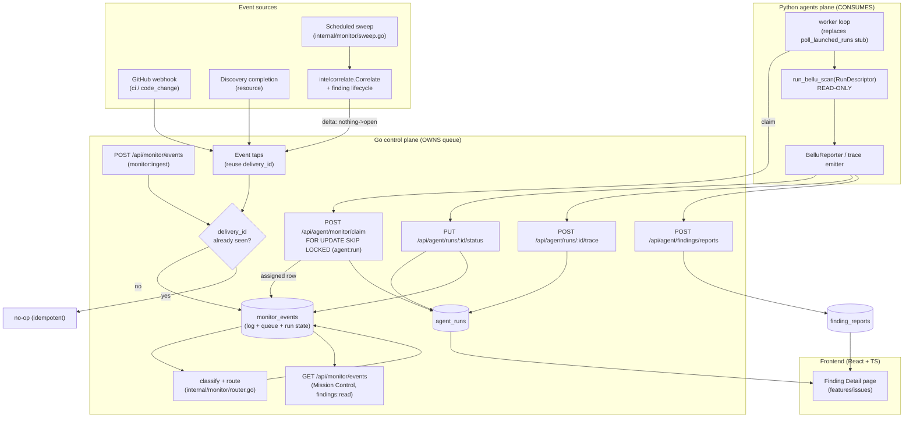
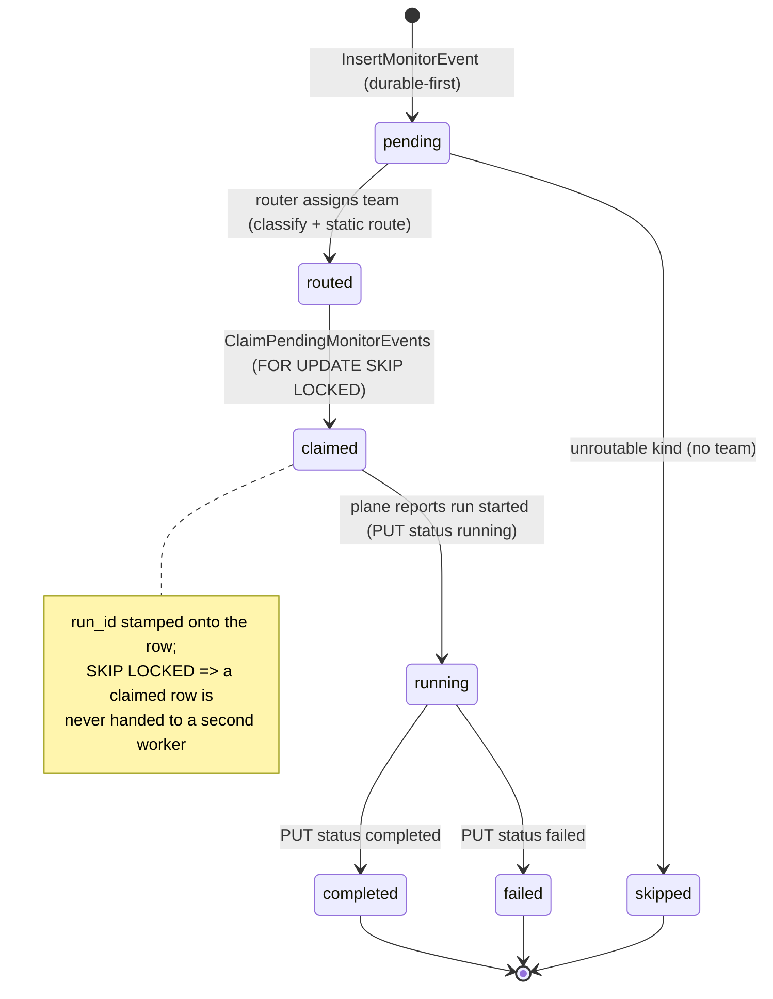
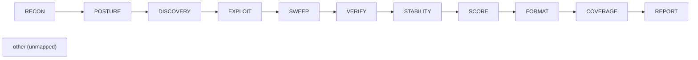
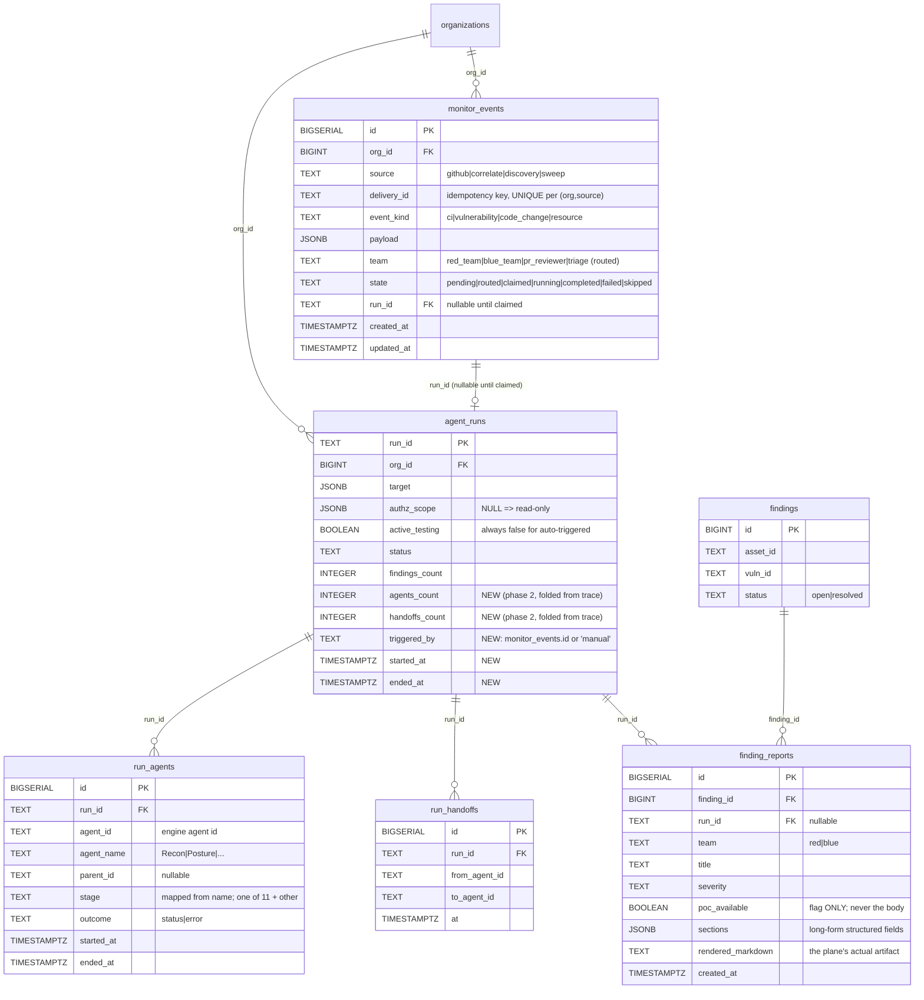

# Design Document: continuous-monitoring-agents

## Overview

This feature adds **continuous, event-triggered monitoring** to the Bellu AI Cyber
platform: incoming signals (CI results, newly-opened vulnerabilities, code
changes, discovered resources) are durably captured, classified, routed to an
agent team, and executed as **read-only** agent runs whose trace and generated
report flow back to the control plane and surface in the UI.

The work extends existing seams rather than inventing a parallel plane. The **Go
control plane owns** the durable queue, ingest, classify/route, claim API, and
all status/trace/report write-back. The **Python agents plane consumes**: it
claims assigned work, builds a read-only `RunDescriptor`, awaits
`run_bellu_scan`, and reports status/trace/report back. This maps directly onto
the documented gaps in `agents-plane/strix/core/bellu_runner.py`
(`STATUS_WRITE_BACK`, `poll_launched_runs()` stub) and fills the write-back
endpoints the runner already references but that do not yet exist.

The design is delivered in three phases:

- **Phase 1 — Monitoring triggers:** `monitor_events` as both event log and work
  queue (durable-first inbox), classify + static route, four event taps, a
  scheduled re-correlation sweep, a `FOR UPDATE SKIP LOCKED` claim endpoint,
  status write-back, and the Python worker loop that replaces the polling stub.
- **Phase 2 — Run trace/timeline:** `run_agents` + `run_handoffs`, a fixed
  11-stage pipeline vocabulary with an agent-name→stage mapper, trace
  write-back, and run detail/timeline read APIs.
- **Phase 3 — Finding/remediation detail:** `finding_reports` (structured
  columns + JSONB long-form + the plane's rendered markdown), report write-back,
  an extended `GET /api/findings/:id`, and the committed frontend Finding Detail
  page.

Two safety invariants hold across every new seam: **tenant isolation** (org is
always resolved from the authenticated principal, cross-org reads are 404 with
no existence disclosure, mirroring `store.GetAgentRun`) and **PoC redaction**
(the weaponized `poc_script_code` body is never transported, stored, or served,
mirroring the existing SARIF rule in `agents-plane/strix/report/sarif.py`).

---

## Architecture

This section anchors the High-Level Design material: the end-to-end system
flowchart, the `monitor_events` run-lifecycle state machine, component
responsibilities per phase, the fixed stage-flow pipeline, and the
Go-owns-queue / Python-consumes seam mapping. (The ER data model and schema
definitions referenced by this architecture now live under **Data Models**.)

### End-to-end system flowchart



### `monitor_events` run-lifecycle state machine

`monitor_events` is **both** the durable event log and the work queue; the agent
assignment and run state live on the same row (this backs the Mission Control
grid). Every incoming event is persisted **before** processing, so nothing is
lost on crash.



A duplicate `delivery_id` never creates a second row: the insert hits the unique
constraint and returns a duplicate sentinel the caller treats as a no-op
(mirrors `ErrDuplicateDelivery` in `internal/connector/github_webhook_store.go`).

### Component responsibilities per phase

| Phase | Component | Location | Responsibility |
|-------|-----------|----------|----------------|
| 1 | `monitor_events` migration | `internal/store/migrations/00020_monitor_events.sql` | Durable log + queue + run state on one row |
| 1 | monitor store | `internal/store/monitor_events.go` | `InsertMonitorEvent` (dup sentinel), `ClaimPendingMonitorEvents` (SKIP LOCKED), `UpdateMonitorEventRun/Status` |
| 1 | classify + route | `internal/monitor/router.go` | Static built-in routing table kind→team |
| 1 | ingest handler | `backend/server/monitor_handlers.go` | `POST /api/monitor/events` + `monitor:ingest`; `GET /api/monitor/events` + `findings:read` |
| 1 | event taps | `internal/connector/github_webhook.go`, discovery completion, newly-open finding delta | Persist events reusing `delivery_id`; vulnerability fires on delta only |
| 1 | scheduled sweep | `internal/monitor/sweep.go` | Re-run `Correlate` per org; relies on finding delta so no re-trigger storms |
| 1 | claim + status | `backend/server/monitor_handlers.go` / `agent_runs_handlers.go` | `POST /api/agent/monitor/claim`, `PUT /api/agent/runs/:id/status` |
| 1 | worker loop | `agents-plane/strix/core/bellu_runner.py` | Replace `poll_launched_runs` stub: claim → build read-only descriptor → `run_bellu_scan` → report → backoff |
| 2 | trace tables | `internal/store/migrations/00021_run_trace.sql` | `run_agents`, `run_handoffs` |
| 2 | stage vocabulary + mapper | `internal/monitor/stages.go` | Fixed 11-stage pipeline + name→stage mapper + `other` bucket |
| 2 | trace write-back | `backend/server/agent_runs_handlers.go` | `POST /api/agent/runs/:id/trace` folds counts onto run |
| 2 | run detail/timeline | `backend/server/agent_runs_handlers.go` | `GET /api/agent/runs/:id/detail`, `GET /api/agent/runs/:id/timeline` |
| 2 | plane trace emitter | `agents-plane/strix/core/bellu_runner.py` | Emit trace from coordinator register/set_status + handoffs, best-effort |
| 3 | finding_reports table | `internal/store/migrations/00022_finding_reports.sql` | Structured + JSONB + rendered markdown |
| 3 | report write-back | `backend/server/agent_findings_handlers.go` | `POST /api/agent/findings/reports` + `findings:ingest` |
| 3 | extended finding read | `backend/server/findings_handlers.go` | `GET /api/findings/:id` adds report + run linkage; degrades gracefully |
| 3 | plane report sender | `agents-plane/strix/tools/finding_report.py` | Strip `poc_script_code`, include rendered markdown, classify team |
| 3 | Finding Detail page | `frontend/src/features/issues/` | Red/blue + remediation + Unvalidated + cited intel + update history; never PoC body |

### Fixed stage-flow pipeline

The run trace uses a **fixed 11-stage vocabulary**. A **leg** = one agent
instance in a stage (agent-level granularity). Empty stages render "0 legs".
Tool/LLM-level detail stays in `run.json` for now (upgrade path noted).



### How Go-owns-queue / Python-consumes maps onto existing seams

| Existing seam (today) | What this feature adds |
|-----------------------|------------------------|
| `POST /api/agent/runs` → 202 `{run_id,queued}` | Auto-launched by router from a routed `monitor_events` row (read-only scope) |
| `GET /api/agent/runs/:id` (read-only status) | Joined by `+detail` / `+timeline` views (phase 2) |
| `STATUS_WRITE_BACK = {PUT, /api/agent/runs/{id}/status}` (referenced, not built) | **Built** as `PUT /api/agent/runs/:id/status` |
| `poll_launched_runs()` stub returns `[]` | **Replaced** by a claim-driven worker loop |
| `report_status()` only logs | Wired to the new status endpoint |
| `POST /api/agent/findings:ingest` (thin fields) | Complemented by `POST /api/agent/findings/reports` (full artifact) |
| `GET /api/findings/:id` (finding + intel + evidence) | **Extended** with `finding_reports` + run linkage/`triggered_by` |
| `ActiveTestingGate` (only path to active testing) | **Untouched**; auto-triggered runs never carry scope |

---

## Components and Interfaces

This section enumerates each component and its interface. The authoritative
signatures, routes, and code bodies live in the phase-by-phase subsections of
**Data Models** below (the Low-Level Design material); this heading organizes
them by component under the required top-level section. Nothing here replaces
those definitions — it maps each component to its interface and its home.

### Go monitor store (`internal/store/monitor_events.go`)

**Interface** (full signatures in *Phase 1 — Go store signatures* and *Phase 1 —
The idempotent insert and the SKIP LOCKED claim*):

- `InsertMonitorEvent(ctx, org, in) (int64, error)` — durable-first insert in
  `pending`; returns `ErrDuplicateMonitorEvent` on a duplicate
  `(org, source, delivery_id)` (idempotent no-op).
- `SetMonitorEventRoute(ctx, org, id, team)` — `pending → routed` (or `skipped`
  when `team == ""`), stamping the routed team.
- `ClaimPendingMonitorEvents(ctx, org, limit) ([]MonitorEvent, error)` — atomic
  `SELECT … FOR UPDATE SKIP LOCKED` claim; a claimed row is never handed to a
  second worker.
- `UpdateMonitorEventRun(ctx, org, id, runID)` / `UpdateMonitorEventStatus(ctx,
  org, runID, status)` — link a claimed event to its run and fold status
  transitions onto the row.
- `ListMonitorEvents(ctx, org, limit) ([]MonitorEvent, error)` — org-scoped,
  newest-first read backing the Mission Control grid.

### HTTP handlers, routes, and the `monitor:ingest` permission

**Interface** (full signatures + route wiring in *Phase 1 — handler signatures,
routes, permissions* and *Phase 2 — store signatures + trace write-back*):

- `POST /api/monitor/events` → `handleMonitorIngest` — permission `monitor:ingest`
  (the new service-account ingest permission, `auth.PermMonitorIngest`).
- `GET /api/monitor/events` → `handleMonitorEventsList` — permission `findings:read`.
- `POST /api/agent/monitor/claim` → `handleMonitorClaim` — permission `agent:run`;
  launches read-only runs (never active-testing scope).
- `PUT /api/agent/runs/:id/status` → `handleAgentRunStatusWrite` — permission
  `agent:run`; status write-back.
- `POST /api/agent/runs/:id/trace` → `handleAgentRunTrace` — permission `agent:run`;
  folds `agents_count`/`handoffs_count` onto the run.
- `GET /api/agent/runs/:id/detail` → `handleAgentRunDetail` and
  `GET /api/agent/runs/:id/timeline` → `handleAgentRunTimeline` — permission
  `findings:read`.
- `POST /api/agent/findings/reports` → `handleAgentFindingReportIngest` —
  permission `findings:ingest`.
- `GET /api/findings/:id` → extended `handleFinding` — adds report + run linkage,
  degrades gracefully when no report exists.

Routes are wired per-permission via `registerMonitorRoutes` (mirrors
`registerAgentRoutes`); see *Phase 1 — handler signatures, routes, permissions*.

### Classify + route (`internal/monitor/router.go`)

**Interface** (full code in *Phase 1 — classify + route*):

- `Classify(source, payload) (kind, error)` — the only reader of source-specific
  payload shapes; derives the canonical `event_kind`.
- `Route(eventKind) Team` — static built-in routing table
  (`ci → red_team`, `vulnerability → blue_team`, `code_change → pr_reviewer`,
  `resource → triage`); unknown kinds route to `""` (`skipped`).

### Name→stage mapper (`internal/monitor/stages.go`)

**Interface** (full code in *Phase 2 — fixed stage vocabulary + name→stage
mapper*):

- `Pipeline []Stage` — the ordered fixed 11-stage vocabulary.
- `MapStage(agentName) Stage` — case-insensitive substring match; unmapped names
  fall to `StageOther` so no leg is dropped.

### Scheduled sweep (`internal/monitor/sweep.go`)

**Interface** (full code in *Phase 1 — scheduled sweep*):

- `Sweeper.RunSweep(ctx, org)` — re-runs `Correlate` per org and upserts matches;
  relies on the finding delta tap so unchanged findings emit no events (no
  re-trigger storm).

### Event taps

Component bodies in *Phase 1 — event taps*: the GitHub webhook tap (reuses
`X-GitHub-Delivery`), the discovery-completion resource tap, and the
vulnerability delta tap (fires only on an `UpsertResult.Created` nothing→open
transition).

### Python agents-plane components (`agents-plane/strix/...`)

**Interfaces** (full code in *Phase 1 — Python worker loop*, *Phase 2 — Python
trace payload + emitter*, *Phase 3 — Python report sender*):

- `run_worker_loop(...)` — claims assigned rows, builds a read-only
  `RunDescriptor` (`authz_scope=None`), awaits `run_bellu_scan`, reports back;
  exponential backoff on empty claims. Replaces the `poll_launched_runs` stub.
- `emit_trace(run_id, settings, payload, …)` — best-effort trace write-back that
  never raises (a trace post must not fail the run it describes).
- `build_report_payload(report, run_id)` — strips `poc_script_code`, sets
  `poc_available` flag only, classifies team, includes the rendered markdown
  artifact.

### Frontend API client + Finding Detail page (`frontend/src/...`)

**Interfaces** (full code in *Phase 3 — Frontend API client + page component
shape*):

- `FindingReportView` / `FindingDetailResponse` types (`lib/api.ts`,
  `types/foundation.ts`) — `reports: FindingReportView[]`, `poc_available` flag
  only, optional `triggered_by`.
- `FindingDetail({ id })` component (`features/issues/FindingDetail.tsx`) —
  renders red-only / blue-only / both / no-report fallback; the weaponized PoC
  body is never in the response and so can never reach the DOM.

## Data Models

This section is the home for every data model definition: the ER diagram, the
SQL schemas (`monitor_events` 00020, the `agent_runs` ALTER additions, `run_agents`
+ `run_handoffs` 00021, and `finding_reports` 00022), and the Go struct shapes
(`MonitorEvent`, `RunAgent`, `RunHandoff`, `RunTraceView`/`StageLegs`, and the
finding report payload). The Low-Level Design subsections below carry the full,
authoritative definitions; this heading collects them under the required
top-level section.

### Entity-relationship diagram



### Schema & struct index

| Data model | Defined in subsection below |
|------------|-----------------------------|
| `monitor_events` schema | Phase 1 — SQL: `00020_monitor_events.sql` |
| `agent_runs` ALTER additions | Phase 1 — SQL: `agent_runs` additions |
| `run_agents` + `run_handoffs` schema | Phase 2 — SQL: `00021_run_trace.sql` |
| `finding_reports` schema | Phase 3 — SQL: `00022_finding_reports.sql` |
| `MonitorEvent` / `MonitorEventInput` structs | Phase 1 — Go store signatures |
| `RunAgent` / `RunHandoff` / `RunTraceView` / `StageLegs` structs | Phase 2 — store signatures + trace write-back |
| `FindingReport` struct + finding report payload | Phase 3 — store + handler signatures / Python report sender / Frontend API client |

> Code examples are in the project's real languages: Go (control plane), Python
> (agents plane), TypeScript (frontend). No pseudocode is used because the
> languages are explicit in the existing codebase.

### Phase 1 — SQL: `00020_monitor_events.sql`

```sql
-- +goose Up
-- monitor_events is BOTH the durable event log AND the work queue; agent
-- assignment and run state live on the same row (backs Mission Control).
-- Durable-first: an event is persisted here BEFORE any processing, so a crash
-- loses nothing. Idempotency mirrors github_webhook_deliveries: a unique key on
-- (org_id, source, delivery_id) makes a redelivery a no-op via unique_violation.
CREATE TABLE monitor_events (
    id          BIGSERIAL   PRIMARY KEY,
    org_id      BIGINT      NOT NULL REFERENCES organizations(id),   -- tenant
    source      TEXT        NOT NULL,                                -- github|correlate|discovery|sweep
    delivery_id TEXT        NOT NULL,                                -- per-source idempotency key
    event_kind  TEXT        NOT NULL,                                -- ci|vulnerability|code_change|resource
    payload     JSONB       NOT NULL,
    team        TEXT,                                                -- red_team|blue_team|pr_reviewer|triage (set at route)
    state       TEXT        NOT NULL DEFAULT 'pending',              -- pending|routed|claimed|running|completed|failed|skipped
    run_id      TEXT        REFERENCES agent_runs(run_id),           -- NULL until claimed
    created_at  TIMESTAMPTZ NOT NULL DEFAULT now(),
    updated_at  TIMESTAMPTZ NOT NULL DEFAULT now(),

    CONSTRAINT monitor_events_source_chk
        CHECK (source IN ('github','correlate','discovery','sweep')),
    CONSTRAINT monitor_events_kind_chk
        CHECK (event_kind IN ('ci','vulnerability','code_change','resource')),
    CONSTRAINT monitor_events_state_chk
        CHECK (state IN ('pending','routed','claimed','running','completed','failed','skipped')),
    CONSTRAINT monitor_events_team_chk
        CHECK (team IS NULL OR team IN ('red_team','blue_team','pr_reviewer','triage'))
);

-- Idempotency: a redelivery with the same (org, source, delivery_id) collides
-- here and is treated as a no-op. GitHub reuses X-GitHub-Delivery end-to-end;
-- vulnerability uses (asset_id,vuln_id) as the delivery_id.
CREATE UNIQUE INDEX monitor_events_delivery_uniq
    ON monitor_events (org_id, source, delivery_id);

-- Claim scan: workers poll routed-but-unclaimed rows for their org, newest-first
-- blocked only by SKIP LOCKED. Partial index keeps the queue hot-set small.
CREATE INDEX monitor_events_claimable_idx
    ON monitor_events (org_id, created_at)
    WHERE state = 'routed';

-- +goose Down
DROP TABLE monitor_events;
```

### Phase 1 — SQL: `agent_runs` additions (ALTER, same migration family)

```sql
-- Phase 2 folds trace counts and lifecycle timestamps onto the run row; the
-- triggered_by link records which monitor_event launched it ('manual' for
-- operator launches). Added as ALTERs so existing 00017 data survives.
ALTER TABLE agent_runs ADD COLUMN agents_count   INTEGER NOT NULL DEFAULT 0;
ALTER TABLE agent_runs ADD COLUMN handoffs_count INTEGER NOT NULL DEFAULT 0;
ALTER TABLE agent_runs ADD COLUMN triggered_by   TEXT    NOT NULL DEFAULT 'manual';
ALTER TABLE agent_runs ADD COLUMN started_at     TIMESTAMPTZ;
ALTER TABLE agent_runs ADD COLUMN ended_at       TIMESTAMPTZ;
```

### Phase 1 — Go store signatures (`internal/store/monitor_events.go`)

```go
// ErrDuplicateMonitorEvent mirrors connector.ErrDuplicateDelivery: a redelivery
// with an already-seen (org, source, delivery_id) is a no-op (Property P2).
var ErrDuplicateMonitorEvent = errors.New("store: duplicate monitor event")

type MonitorEventInput struct {
    Source     string          // github|correlate|discovery|sweep
    DeliveryID string          // per-source idempotency key
    EventKind  string          // ci|vulnerability|code_change|resource
    Payload    json.RawMessage
}

type MonitorEvent struct {
    ID         int64
    OrgID      int64
    Source     string
    DeliveryID string
    EventKind  string
    Payload    json.RawMessage
    Team       string
    State      string
    RunID      string // "" until claimed
    CreatedAt  time.Time
}

// InsertMonitorEvent persists one event in 'pending'. Org comes from the caller
// (resolved from principal), never from payload. On a duplicate delivery_id it
// returns ErrDuplicateMonitorEvent so ingest can return a no-op 200/202.
func (s *Store) InsertMonitorEvent(ctx context.Context, org int64, in MonitorEventInput) (int64, error)

// SetMonitorEventRoute moves a pending row to 'routed' (or 'skipped' when team
// is empty) and stamps the team the router chose.
func (s *Store) SetMonitorEventRoute(ctx context.Context, org, id int64, team string) error

// ClaimPendingMonitorEvents atomically claims up to limit routed rows for org,
// moving them to 'claimed'. Uses SELECT ... FOR UPDATE SKIP LOCKED so a claimed
// row is never handed to a second worker (Property P4).
func (s *Store) ClaimPendingMonitorEvents(ctx context.Context, org int64, limit int) ([]MonitorEvent, error)

// UpdateMonitorEventRun links a claimed event to its launched run and advances
// state. UpdateMonitorEventStatus folds a run status transition onto the row.
func (s *Store) UpdateMonitorEventRun(ctx context.Context, org, id int64, runID string) error
func (s *Store) UpdateMonitorEventStatus(ctx context.Context, org int64, runID, status string) error

// ListMonitorEvents backs the Mission Control grid read (org-scoped, newest-first).
func (s *Store) ListMonitorEvents(ctx context.Context, org int64, limit int) ([]MonitorEvent, error)
```

### Phase 1 — The idempotent insert and the SKIP LOCKED claim

```go
func (s *Store) InsertMonitorEvent(ctx context.Context, org int64, in MonitorEventInput) (int64, error) {
    var id int64
    err := s.pool.QueryRow(ctx,
        `INSERT INTO monitor_events (org_id, source, delivery_id, event_kind, payload, state)
         VALUES ($1,$2,$3,$4,$5,'pending') RETURNING id`,
        org, in.Source, in.DeliveryID, in.EventKind, in.Payload).Scan(&id)
    var pgErr *pgconn.PgError
    if errors.As(err, &pgErr) && pgErr.Code == "23505" { // unique_violation
        return 0, ErrDuplicateMonitorEvent // redelivery is a no-op (P2)
    }
    if err != nil {
        return 0, fmt.Errorf("store: insert monitor event: %w", err)
    }
    return id, nil
}

func (s *Store) ClaimPendingMonitorEvents(ctx context.Context, org int64, limit int) ([]MonitorEvent, error) {
    // One statement: lock-and-advance. SKIP LOCKED means concurrent workers
    // never see the same row, so a claimed row is not re-claimable (P4). The
    // org predicate keeps a worker bound to its single tenant (P1).
    rows, err := s.pool.Query(ctx,
        `WITH claimable AS (
             SELECT id FROM monitor_events
              WHERE org_id = $1 AND state = 'routed'
              ORDER BY created_at
              FOR UPDATE SKIP LOCKED
              LIMIT $2
         )
         UPDATE monitor_events m
            SET state = 'claimed', updated_at = now()
           FROM claimable c
          WHERE m.id = c.id
          RETURNING m.id, m.org_id, m.source, m.delivery_id, m.event_kind,
                    m.payload, COALESCE(m.team,''), m.state,
                    COALESCE(m.run_id,''), m.created_at`,
        org, limit)
    // ... scan into []MonitorEvent ...
}
```

### Phase 1 — classify + route (`internal/monitor/router.go`)

```go
// Team is the agent team a routed event targets.
type Team string

const (
    TeamRedTeam    Team = "red_team"
    TeamBlueTeam   Team = "blue_team"
    TeamPRReviewer Team = "pr_reviewer"
    TeamTriage     Team = "triage"
)

// routingTable is the STATIC built-in mapping from event kind to team.
// ci -> red_team, vulnerability -> blue_team, code_change -> pr_reviewer,
// resource -> triage. An unknown kind routes to "" (skipped).
var routingTable = map[string]Team{
    "ci":          TeamRedTeam,
    "vulnerability": TeamBlueTeam,
    "code_change": TeamPRReviewer,
    "resource":    TeamTriage,
}

// Route returns the team for an event kind, or "" when unroutable (-> skipped).
func Route(eventKind string) Team { return routingTable[eventKind] }

// Classify derives the canonical event_kind from a source + raw payload. It is
// the only place that reads source-specific shapes; the router stays static.
func Classify(source string, payload json.RawMessage) (kind string, err error)
```

### Phase 1 — handler signatures, routes, permissions

```go
// monitor_handlers.go
func (s *Server) handleMonitorIngest(c *gin.Context)      // POST /api/monitor/events        monitor:ingest
func (s *Server) handleMonitorEventsList(c *gin.Context)  // GET  /api/monitor/events        findings:read
func (s *Server) handleMonitorClaim(c *gin.Context)       // POST /api/agent/monitor/claim   agent:run
// agent_runs_handlers.go (phase 1 write-back)
func (s *Server) handleAgentRunStatusWrite(c *gin.Context) // PUT /api/agent/runs/:id/status  agent:run
```

New permission + route wiring (mirrors `registerAgentRoutes` group-by-permission):

```go
// internal/auth/model.go — new permission for the service-account ingest seam.
PermMonitorIngest = "monitor:ingest" // write monitoring events from external taps

// backend/server/monitor_routes.go
func (s *Server) registerMonitorRoutes(authed *gin.RouterGroup) {
    mi := authed.Group("")
    mi.Use(s.auth.RequirePermission(auth.PermMonitorIngest))
    { mi.POST("/monitor/events", s.handleMonitorIngest) }

    mr := authed.Group("")
    mr.Use(s.auth.RequirePermission(auth.PermFindingsRead))
    { mr.GET("/monitor/events", s.handleMonitorEventsList) }

    ac := authed.Group("")
    ac.Use(s.auth.RequirePermission(auth.PermAgentRun))
    {
        ac.POST("/agent/monitor/claim", s.handleMonitorClaim)
        ac.PUT("/agent/runs/:id/status", s.handleAgentRunStatusWrite)
    }
}
```

The claim handler launches read-only runs. **Auto-triggered runs never carry an
active-testing scope** (`authz_scope` stays NULL, `active_testing=false`), so
findings land "Unvalidated" and the untouched `ActiveTestingGate` remains the
only path to active testing (Property P5):

```go
func (s *Server) handleMonitorClaim(c *gin.Context) {
    org, ok := mcpOrg(c) // org from principal, never body (P1)
    if !ok { /* 401 */ }
    events, _ := s.store.ClaimPendingMonitorEvents(ctx, org, limit)
    for i := range events {
        in := store.AgentRunInput{Target: targetFromEvent(events[i])} // Scope==nil => read-only (P5)
        runID, _ := s.store.CreateAgentRun(ctx, org, in)
        _ = s.store.UpdateMonitorEventRun(ctx, org, events[i].ID, runID)
        events[i].RunID = runID
    }
    c.JSON(http.StatusOK, gin.H{"claims": events})
}
```

### Phase 1 — event taps

- **GitHub webhook tap** (`internal/connector/github_webhook.go`
  `Manager.HandleGitHubWebhook`): after the existing `InsertWebhookDelivery`
  dedup, also `InsertMonitorEvent` with `source="github"` and the SAME
  `delivery_id` (X-GitHub-Delivery) — `ci` for check-run/workflow events,
  `code_change` for push/PR. Reusing the delivery id makes the monitor layer
  idempotent end-to-end (P2).
- **Resource tap**: at discovery completion, emit one `resource` event per newly
  discovered asset with `delivery_id = discovery_session_id + ":" + asset_id`.
- **Vulnerability delta tap**: `finding.UpsertFinding` returns
  `UpsertResult.Created`. Fire a `vulnerability` monitor event **only when
  `Created` is true** (a nothing→open transition), with
  `delivery_id = asset_id + ":" + vuln_id`. A still-open finding re-seen on a
  sweep upserts (`Created=false`) and emits nothing (Property P3). Even if a
  delta did fire twice, the unique delivery key makes the second a no-op (P2).

### Phase 1 — scheduled sweep (`internal/monitor/sweep.go`)

```go
// RunSweep re-runs correlation for one org. It relies on the finding-delta tap:
// Correlate upserts matches, and only nothing->open transitions emit events, so
// a periodic sweep over unchanged findings produces no new events (P3) — no
// re-trigger storms.
func (w *Sweeper) RunSweep(ctx context.Context, org int64) error {
    matches, err := w.correlator.Correlate(ctx, org)
    if err != nil { return err }
    for _, m := range matches {
        res, _ := w.findings.UpsertFinding(ctx, m) // UpsertResult.Created drives the delta tap
        _ = res
    }
    return nil
}
```

### Phase 1 — Python worker loop (replaces `poll_launched_runs` stub)

```python
async def run_worker_loop(
    settings: BelluSettings | None = None,
    *,
    client: httpx.Client | None = None,
    claim_batch: int = 4,
    idle_backoff_s: float = 2.0,
    max_backoff_s: float = 30.0,
) -> None:
    """Claim assigned monitor rows and execute them as READ-ONLY runs.

    Replaces poll_launched_runs(): the control plane now exposes a claim
    endpoint (POST /api/agent/monitor/claim). Each claimed row becomes a
    RunDescriptor with NO authz_scope (read-only, Property P5); run_bellu_scan
    awaits the engine and the existing report_status write-back posts the
    terminal state. Exponential backoff on an empty claim.
    """
    cfg = settings or load_bellu_settings()
    backoff = idle_backoff_s
    while True:
        claims = _claim(cfg, batch=claim_batch, client=client)  # POST /agent/monitor/claim
        if not claims:
            await asyncio.sleep(backoff)
            backoff = min(backoff * 2, max_backoff_s)
            continue
        backoff = idle_backoff_s
        for claim in claims:
            descriptor = RunDescriptor(
                run_id=claim["run_id"],
                target=claim["target"],
                authz_scope=None,  # auto-triggered runs are never active-testing (P5)
            )
            await run_bellu_scan(descriptor, settings=cfg, client=client)
```

### Phase 2 — SQL: `00021_run_trace.sql`

```sql
-- +goose Up
CREATE TABLE run_agents (
    id         BIGSERIAL   PRIMARY KEY,
    run_id     TEXT        NOT NULL REFERENCES agent_runs(run_id),
    agent_id   TEXT        NOT NULL,                 -- engine agent id
    agent_name TEXT        NOT NULL,                 -- Recon|Posture|Discovery|...
    parent_id  TEXT,                                 -- nullable (root agent)
    stage      TEXT        NOT NULL,                 -- mapped from name
    outcome    TEXT        NOT NULL DEFAULT '',      -- status/error text
    started_at TIMESTAMPTZ,
    ended_at   TIMESTAMPTZ,
    CONSTRAINT run_agents_stage_chk CHECK (stage IN (
        'RECON','POSTURE','DISCOVERY','EXPLOIT','SWEEP','VERIFY',
        'STABILITY','SCORE','FORMAT','COVERAGE','REPORT','other'))
);
-- A leg is one (run_id, agent_id); re-emitting the same agent is idempotent.
CREATE UNIQUE INDEX run_agents_uniq ON run_agents (run_id, agent_id);
CREATE INDEX run_agents_stage_idx ON run_agents (run_id, stage);

CREATE TABLE run_handoffs (
    id            BIGSERIAL   PRIMARY KEY,
    run_id        TEXT        NOT NULL REFERENCES agent_runs(run_id),
    from_agent_id TEXT        NOT NULL,
    to_agent_id   TEXT        NOT NULL,
    at            TIMESTAMPTZ NOT NULL DEFAULT now()
);
CREATE INDEX run_handoffs_run_idx ON run_handoffs (run_id);

-- +goose Down
DROP TABLE run_handoffs;
DROP TABLE run_agents;
```

### Phase 2 — fixed stage vocabulary + name→stage mapper (`internal/monitor/stages.go`)

```go
// Stage is one of the fixed 11 pipeline stages plus an "other" bucket for
// unmapped agent names. The vocabulary is fixed so the stage-flow view is stable.
type Stage string

const (
    StageRecon     Stage = "RECON"
    StagePosture   Stage = "POSTURE"
    StageDiscovery Stage = "DISCOVERY"
    StageExploit   Stage = "EXPLOIT"
    StageSweep     Stage = "SWEEP"
    StageVerify    Stage = "VERIFY"
    StageStability Stage = "STABILITY"
    StageScore     Stage = "SCORE"
    StageFormat    Stage = "FORMAT"
    StageCoverage  Stage = "COVERAGE"
    StageReport    Stage = "REPORT"
    StageOther     Stage = "other"
)

// Pipeline is the ordered stage vocabulary; the stage-flow view renders every
// stage (empty stages => "0 legs").
var Pipeline = []Stage{
    StageRecon, StagePosture, StageDiscovery, StageExploit, StageSweep,
    StageVerify, StageStability, StageScore, StageFormat, StageCoverage, StageReport,
}

// nameToStage maps known agent names (case-insensitive substring match) to a
// stage. Anything unmatched falls to StageOther so no leg is dropped.
var nameToStage = map[string]Stage{
    "recon": StageRecon, "posture": StagePosture, "discovery": StageDiscovery,
    "exploit": StageExploit, "sweep": StageSweep, "verify": StageVerify,
    "stability": StageStability, "score": StageScore, "format": StageFormat,
    "coverage": StageCoverage, "report": StageReport,
}

// MapStage resolves an agent name to a stage. Unknown => StageOther.
func MapStage(agentName string) Stage {
    n := strings.ToLower(strings.TrimSpace(agentName))
    for key, st := range nameToStage {
        if strings.Contains(n, key) {
            return st
        }
    }
    return StageOther
}
```

### Phase 2 — store signatures + trace write-back

```go
// Idempotent per (run_id, agent_id): re-emitting an agent refreshes outcome and
// end time. The count of legs in a stage equals the agents emitted there (P8).
func (s *Store) UpsertRunAgent(ctx context.Context, org int64, a RunAgent) error
func (s *Store) InsertRunHandoff(ctx context.Context, org int64, h RunHandoff) error

// RunTrace returns the per-stage leg counts and per-agent detail for a run,
// scoped by org (cross-org => not-found, P1). Used by the detail/timeline views.
func (s *Store) RunTrace(ctx context.Context, org int64, runID string) (RunTraceView, error)

type RunTraceView struct {
    Stages []StageLegs // one per Pipeline stage, in order; LegCount may be 0
}
type StageLegs struct {
    Stage    string
    LegCount int        // == number of agents mapped to this stage (P8)
    Legs     []AgentLeg // name, duration, outcome
}
```

```go
// POST /api/agent/runs/:id/trace — batched agent lifecycle events + handoffs.
// Maps names->stages, upserts legs, and folds agents_count/handoffs_count onto
// the run. Best-effort from the plane; a trace failure never fails the run.
func (s *Server) handleAgentRunTrace(c *gin.Context) // agent:run
// GET /api/agent/runs/:id/detail    (header + stage-flow)  findings:read
// GET /api/agent/runs/:id/timeline  (ordered agent/handoff events) findings:read
func (s *Server) handleAgentRunDetail(c *gin.Context)
func (s *Server) handleAgentRunTimeline(c *gin.Context)
```

Run detail header: run id, status, target + scope-rule count, `triggered_by`,
started/ended, duration, `agents_count`, `handoffs_count`; stage-flow: per-stage
leg count + per-agent name/duration/outcome.

### Phase 2 — Python trace payload + emitter

```python
# Trace payload (batched) posted to POST /api/agent/runs/{id}/trace.
# Built from coordinator register/set_status telemetry already in run.json.
TracePayload = TypedDict("TracePayload", {
    "agents": list[dict],    # {agent_id, agent_name, parent_id, outcome, started_at, ended_at}
    "handoffs": list[dict],  # {from_agent_id, to_agent_id, at}
})

def emit_trace(run_id: str, settings: BelluSettings, payload: TracePayload,
               *, client: httpx.Client | None = None) -> None:
    """Best-effort, non-blocking trace write-back. Never raises: a trace post
    must not fail the run it describes (mirrors report_status)."""
```

### Phase 3 — SQL: `00022_finding_reports.sql`

```sql
-- +goose Up
-- finding_reports carries the agent's ACTUAL generated report artifact through
-- (not re-derived): structured columns for list/badges, JSONB for long-form
-- sections, and the plane's RENDERED markdown for the detail view.
-- SECURITY: poc_script_code (weaponized body) is NEVER a column here. Only a
-- poc_available flag + poc_description (inside sections) are stored, matching
-- the SARIF redaction rule in strix/report/sarif.py (Property P6).
CREATE TABLE finding_reports (
    id               BIGSERIAL   PRIMARY KEY,
    finding_id       BIGINT      NOT NULL REFERENCES findings(id),
    run_id           TEXT        REFERENCES agent_runs(run_id), -- nullable
    team             TEXT        NOT NULL,                      -- red|blue
    title            TEXT        NOT NULL DEFAULT '',
    severity         TEXT        NOT NULL DEFAULT '',
    poc_available    BOOLEAN     NOT NULL DEFAULT false,        -- FLAG ONLY
    sections         JSONB       NOT NULL DEFAULT '{}'::jsonb,  -- long-form fields
    rendered_markdown TEXT       NOT NULL DEFAULT '',           -- plane's artifact
    created_at       TIMESTAMPTZ NOT NULL DEFAULT now(),
    CONSTRAINT finding_reports_team_chk CHECK (team IN ('red','blue'))
);
-- One current report per (finding, team); re-report upserts.
CREATE UNIQUE INDEX finding_reports_uniq ON finding_reports (finding_id, team);
CREATE INDEX finding_reports_run_idx ON finding_reports (run_id);

-- +goose Down
DROP TABLE finding_reports;
```

### Phase 3 — store + handler signatures

```go
// UpsertFindingReport writes/refreshes a report for (finding_id, team). The
// store layer REJECTS any poc_script_code key defensively so a weaponized body
// can never be persisted even if a caller sends one (P6).
func (s *Store) UpsertFindingReport(ctx context.Context, org int64, r FindingReport) error
func (s *Store) GetFindingReport(ctx context.Context, org, findingID int64) ([]FindingReport, error)

type FindingReport struct {
    FindingID        int64
    RunID            string
    Team             string // red|blue
    Title            string
    Severity         string
    PoCAvailable     bool             // flag only; never the body (P6)
    Sections         json.RawMessage  // long-form; poc_script_code stripped
    RenderedMarkdown string
}

// POST /api/agent/findings/reports — service-account write-back. findings:ingest.
func (s *Server) handleAgentFindingReportIngest(c *gin.Context)
```

Extend `handleFinding` (`GET /api/findings/:id`) to also load reports + run
linkage and degrade gracefully when none exist (Property P7):

```go
// ... existing finding + intel + evidence load ...
reports, rerr := s.store.GetFindingReport(ctx, org, id) // org-scoped (P1)
if rerr != nil { reports = nil }                          // degrade: detail still renders (P7)
c.JSON(http.StatusOK, gin.H{
    "finding": f, "intel": vuln, "evidence": evidence,
    "reports": reports,            // [] when no report (P7)
    "triggered_by": triggeredBy,   // run linkage when present
})
```

### Phase 3 — Python report sender (strip PoC body, classify team)

```python
# strix/tools/finding_report.py — extends BelluReporter.
REPORT_WRITE_BACK = {"verb": "POST", "path": "/api/agent/findings/reports"}

def build_report_payload(report: dict, run_id: str) -> dict:
    """Build the finding-report write-back payload from a rendered vuln report.

    Mirrors the SARIF redaction (sarif.py): the weaponized poc_script_code body
    is NEVER included — only a poc_available flag. Team is explicit when the
    plane provides it, else derived from the reporting agent's stage
    (EXPLOIT/RECON/SWEEP -> red, POSTURE/VERIFY/SCORE -> blue)."""
    sections = {k: v for k, v in report.items() if k != "poc_script_code"}  # strip body (P6)
    return {
        "finding_id": report["finding_id"],
        "run_id": run_id,
        "team": report.get("team") or _team_from_stage(report.get("agent_name", "")),
        "title": report.get("title", ""),
        "severity": report.get("severity", ""),
        "poc_available": bool(report.get("poc_script_code")),  # flag only (P6)
        "sections": sections,
        "rendered_markdown": render_vulnerability_md(report),  # the plane's artifact
    }
```

### Phase 3 — Frontend API client + page component shape

```ts
// lib/api.ts — the existing realApi.finding(id) already returns
// FindingDetailResponse; extend the type (types/foundation.ts) to carry reports.
export interface FindingReportView {
  team: 'red' | 'blue'
  title: string
  severity: string
  poc_available: boolean          // flag only — body is never sent (P6)
  sections: Record<string, unknown>
  rendered_markdown: string
}
export interface FindingDetailResponse {
  finding: Finding
  intel: CanonicalVuln | null
  evidence: unknown[]
  reports: FindingReportView[]     // [] => render fallback (P7)
  triggered_by?: string
}
```

```tsx
// features/issues/FindingDetail.tsx
export function FindingDetail({ id }: { id: number | string }) {
  const { data } = useAsync(() => realApi.finding(id), [id])
  const red = data?.reports.find((r) => r.team === 'red')
  const blue = data?.reports.find((r) => r.team === 'blue')
  // Status pill is always "Unvalidated" for auto-triggered findings.
  // Render Red Team section (red), Blue Team + remediation (blue), cited intel,
  // and update history. When data.reports is empty, render the finding header +
  // intel + evidence only (graceful fallback, P7).
  // PoC: show "Proof of concept available" from poc_available ONLY — the
  // weaponized body is never in the response, so it can never reach the DOM (P6).
}
```

Mock in `src/mocks` returns red-only / blue-only / both / no-report shapes.
Vitest tests render each and assert the PoC script body string never appears in
the DOM.

---

## Error Handling

Every new seam fails closed, never leaks backend detail, and never lets a
best-effort write-back sink the run it describes.

### Ingest and store

- **Duplicate delivery (`delivery_id`).** A redelivery collides on the unique
  index; `InsertMonitorEvent` returns `ErrDuplicateMonitorEvent` and the ingest
  handler treats it as an idempotent no-op — a success `200/202` with no second
  row and no second run (Property 2).
- **Unparseable ingest body.** A body that fails `Classify`/JSON decoding is
  rejected with `400 Bad Request` before any row is written; nothing is
  persisted.
- **Store failures.** Any unexpected store error (connection, constraint other
  than the duplicate sentinel) surfaces as a generic
  `503 temporarily unavailable`; the backend error text is logged server-side
  but never returned to the caller (no backend-detail leak).

### Reads and tenant isolation

- **Cross-org reads.** A read of a run/event/report belonging to another org
  returns `404 Not Found` with no existence disclosure, mirroring
  `store.GetAgentRun` (Property 1). The org is always resolved from the
  authenticated principal, never from the request body.

### Best-effort write-back (status / trace / report)

- **Never fails the run.** Status, trace, and report write-backs are
  best-effort: a failed or partial write-back is logged and retried per policy
  but never propagates as a run failure. `emit_trace` never raises; a trace post
  must not fail the run it describes (mirrors `report_status`).

### Worker loop

- **Empty claim.** When `ClaimPendingMonitorEvents` returns no rows, the worker
  sleeps with exponential backoff (`idle_backoff_s` doubling up to
  `max_backoff_s`), then resets backoff on the next non-empty claim.
- **Failed run.** A run that errors is reported with a `failed` status
  write-back so the `monitor_events` row and `agent_runs` reflect the terminal
  state; the loop continues with the next claim.

### Finding detail degradation

- **No report.** When a finding has no `finding_reports` row, `GET
  /api/findings/:id` returns `reports: []` and the Finding Detail page renders
  the finding header + intel + evidence only — a graceful fallback, never an
  error (Property 7).

## Testing Strategy

### Unit and property-based tests (P1–P8)

Each correctness property has at least one property-based test (Go store/handler
level, plus Python where the invariant lives in the plane):

- **Property 1 — Tenant isolation.** Property test: for any two distinct orgs,
  inserts/claims/reads scoped to org A are never visible to org B; cross-org
  reads assert `404` with no existence disclosure.
- **Property 2 — Ingest idempotency.** Property test: inserting any event twice
  with the same `(org, source, delivery_id)` yields exactly one row, one run,
  and an `ErrDuplicateMonitorEvent` on the second attempt.
- **Property 3 — Vulnerability delta.** Property test: re-upserting a still-open
  finding (`UpsertResult.Created == false`) emits zero new monitor events;
  only a nothing→open transition emits one.
- **Property 4 — Claim exclusivity (SKIP LOCKED).** Concurrency property test:
  N parallel `ClaimPendingMonitorEvents` calls over the same routed rows never
  return a row to two workers; the union is disjoint.
- **Property 5 — Read-only auto-runs.** Property test: every claim-launched run
  has `authz_scope == NULL` and `active_testing == false`; the `ActiveTestingGate`
  path is never exercised by auto-triggered runs.
- **Property 6 — PoC redaction.** Property test: for any report payload
  containing `poc_script_code`, the stored row, the API response, and the
  write-back payload contain only `poc_available`/`poc_description` and never the
  body; the store rejects a `poc_script_code` key defensively.
- **Property 7 — Graceful degradation.** Property test: for a finding with an
  empty `finding_reports` set, `GET /api/findings/:id` returns `reports: []` and
  a `200`.
- **Property 8 — Stage-flow leg counts.** Property test: for any emitted set of
  agents, each stage's `LegCount` equals the number of agents whose name maps to
  that stage via `MapStage`; unmapped names land in `other` and are never
  dropped (sum of leg counts == number of emitted agents).

### Frontend tests (vitest)

Using the `src/mocks` red-only / blue-only / both / no-report shapes:

- Render **red-only**: asserts the Red Team section renders and no Blue Team
  section is shown.
- Render **blue-only**: asserts the Blue Team + remediation section renders and
  no Red Team section is shown.
- Render **both**: asserts both team sections render.
- Render **no-report fallback**: asserts the finding header + intel + evidence
  render with no team sections (Property 7).
- **PoC redaction assertion (all shapes):** assert the weaponized PoC body
  string never appears in the DOM; only the "Proof of concept available"
  indicator (from `poc_available`) may render (Property 6).

### End-to-end integration

One integration path exercises the full seam: ingest an event → router sets
`routed` → worker claims via `FOR UPDATE SKIP LOCKED` → read-only run launches →
status/trace/report write-back lands → Mission Control grid and the extended
`GET /api/findings/:id` reflect the run, trace legs, and report (or the graceful
fallback when no report exists).

## Correctness Properties

These properties carry into the task list as acceptance checks.

### Property 1: Tenant isolation on every new seam

Org is resolved from the
authenticated principal/service-account on `InsertMonitorEvent`,
`ClaimPendingMonitorEvents`, status/trace/report write-back, and all reads. A
cross-org read of a run/event/report is a `404` with no existence disclosure
(mirrors `store.GetAgentRun`). *Validated by* the tenant-isolation property test
and the cross-org read assertion.

### Property 2: Ingest idempotency

A duplicate `(org, source, delivery_id)`
insert hits the unique index, returns `ErrDuplicateMonitorEvent`, and is a
no-op; no second row and no second run. *Validated by* the double-insert
property test.

### Property 3: Vulnerability delta

A still-open finding re-seen on a sweep
upserts with `UpsertResult.Created == false` and emits no new monitor event, so
periodic sweeps cause no re-trigger storm. *Validated by* the re-upsert property
test asserting zero emitted events.

### Property 4: Claim exclusivity

A row claimed via `FOR UPDATE SKIP LOCKED` is
not re-claimable: two concurrent workers never both observe the same routed row.
*Validated by* the concurrent-claim property test asserting disjoint claims.

### Property 5: Auto-triggered runs are read-only

Every claim-launched run
carries `authz_scope = NULL` / `active_testing = false`; the `ActiveTestingGate`
remains the only path to active testing and is untouched. *Validated by* the
read-only auto-run property test.

### Property 6: PoC redaction

The weaponized `poc_script_code` body is never in
any write-back payload, DB column, API response, or the DOM — only a
`poc_available` flag + `poc_description` (mirrors `sarif.py`). *Validated by* the
redaction property test and the frontend DOM assertion across all mock shapes.

### Property 7: Graceful degradation of finding detail

`GET /api/findings/:id`
and the Finding Detail page render fully when `finding_reports` is empty (no
report). *Validated by* the empty-reports property test and the no-report
frontend render test.

### Property 8: Stage-flow leg counts equal emitted agents

For every run, each
stage's `LegCount` equals the number of agents emitted (via trace) that map to
that stage; unmapped names fall into `other` and are never dropped. *Validated
by* the stage-mapping property test asserting the sum of leg counts equals the
number of emitted agents.
