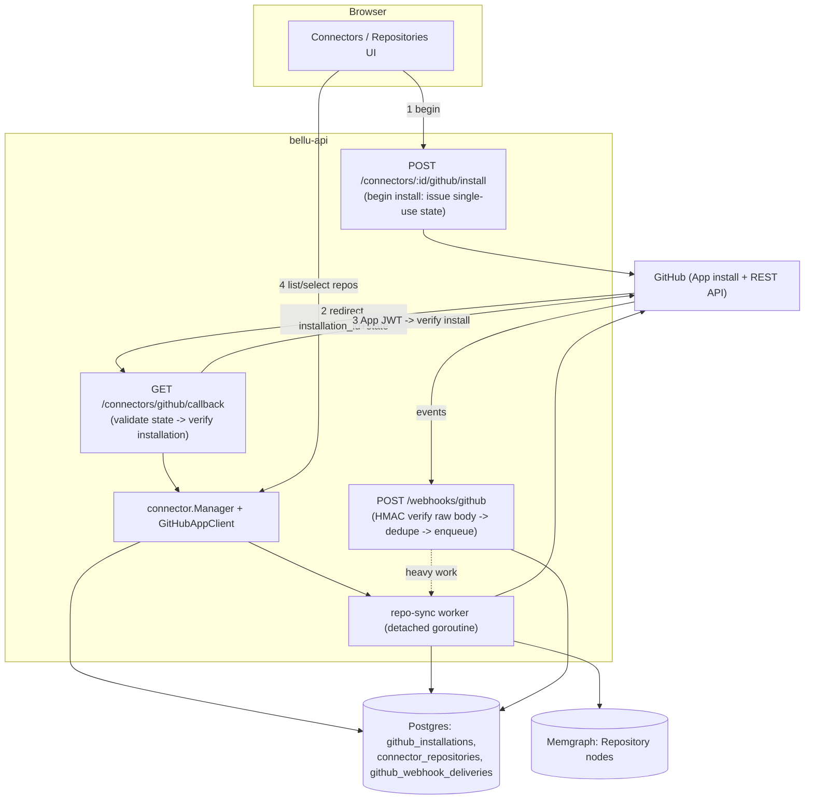

# Design: GitHub App Integration

## Overview

A production GitHub App integration that lets a tenant connect a GitHub account/org, approve
permissions, select repositories, and let Bellu collect repository metadata within the authorized
scope. It **extends the existing connector subsystem** (`internal/connector`) rather than forking
it: a GitHub connection is a `connector.Connection` with `provider = "github"`, and repository
selection reuses the existing `connector_repositories` table, `repo_selection_mode`, and the
frontend `GitRepoSelection` radio+checklist on the Repositories page.

This is a **customer-deployment** feature (bellu-api + customer Postgres + Memgraph). It does not
touch the separate global-intel deployment.

### What is NEW vs REUSED

| Concern | Reused | New |
|---|---|---|
| Tenant/auth | `auth.Principal` (User.OrgID), `RequirePermission`, `connectionForRequest` IDOR guard | — |
| Control plane | `connector.Manager`, FSM (`connection.go`), detached-goroutine background pattern | GitHub install-state store, repo-sync worker |
| Persistence | `*store.Store` pool, goose migrations, `connector_repositories` + `repo_selection_mode` | migration `00014`: `github_installations`, `github_webhook_deliveries`, delta columns on `connector_repositories` |
| Secrets | `internal/redact` for sanitizing logged errors | AES-GCM `CredentialStore` (GitLab/Bitbucket tokens); GitHub needs only `installation_id` + App private key from env |
| Routing | gin RBAC-gated group in `connector_handlers.go`, `connectorErrStatus` | begin-install, callback, webhook, status, disconnect handlers |
| Provider | `provider.CloudProvider` + `provider.RepoLister`, `ci` adapter package | real `GitHubAppClient` wired into the ci GitHub adapter's `ListRepositories` |
| Graph | CycloneDX path, `model.KindRepository`, normalize→resolve→sync | evidence-gated Repository upsert from GitHub repo metadata |

### Known blocker (fixed)

`connector.Manager.Create` validated `account_id` against a 12-digit AWS regex for every
account-scope connection, rejecting GitHub orgs. Fixed: the check is now gated by `!isGit`
(provider implements `provider.RepoLister`), so git connections accept a free-form org login.

## Architecture



## Security Boundary

- **Install CSRF / state**: `state` is 32 random bytes, base64url, persisted server-side with the
  initiating `org_id`, `user_id`, `connection_id`, an expiry (<=10 min), and a `used` flag.
  Single-use: the callback marks it used in the same transaction it validates it. Reject
  missing/expired/replayed/mismatched state.
- **No trust in browser**: `installation_id` and tenant are verified server-side. The connection's
  tenant comes from the authenticated Principal that began the install (via the bound state), never
  from the callback query string.
- **Webhook HMAC**: verify `X-Hub-Signature-256` with HMAC-SHA256 over the **exact raw body** using
  `crypto/hmac` + `hmac.Equal` (constant time). Reject before parsing. Dedupe on the GitHub delivery
  id via a UNIQUE constraint.
- **Credential at rest**: GitLab/Bitbucket tokens are AES-GCM encrypted (`CredentialStore`, key from
  `BELLU_CREDENTIAL_KEY`, base64 32 bytes). The GitHub App **private key** is read from a file path
  in env and never stored in the DB or sent to the browser. No secret (private key, App JWT,
  installation token, webhook secret, access token) is ever logged (sanitize via `internal/redact`)
  or returned by the API.
- **No SSRF**: the server builds all GitHub URLs from `BELLU_GITHUB_API_BASE` + validated path
  params. It never fetches a client-supplied URL.
- **Tenant isolation / IDOR**: every installation/repository/webhook query is scoped by `org_id`
  derived from the Principal; the existing `connectionForRequest` guard is reused for all
  connection-targeting handlers.
- **Repo selection within access**: a selection request is validated against the installation's
  actual repo set (stored `github_repo_id`s); selecting an out-of-scope repo is rejected.
- **Idempotency**: installation processing and webhook delivery are idempotent (UNIQUE on
  `github_installation_id` and `delivery_id`; upserts elsewhere).

## Components and Interfaces

### GitHubAppClient (new: internal/connector/provider/ci/github)

```go
type GitHubAppClient struct {
    appID      int64
    privateKey *rsa.PrivateKey // loaded from BELLU_GITHUB_APP_PRIVATE_KEY_PATH
    apiBase    string          // BELLU_GITHUB_API_BASE
    http       *http.Client
}

// AppJWT returns a short-lived (<=10m) RS256 JWT: iss=appID, iat, exp.
func (c *GitHubAppClient) AppJWT(now time.Time) (string, error)

// InstallationToken exchanges the App JWT for an installation access token,
// optionally scoped to repository ids + permissions. Respects expiry.
func (c *GitHubAppClient) InstallationToken(ctx, installationID int64, repoIDs []int64) (Token, error)

// VerifyInstallation confirms the installation exists and returns its account
// (login, id, type) and granted permissions — used by the callback.
func (c *GitHubAppClient) VerifyInstallation(ctx, installationID int64) (Installation, error)

// ListInstallationRepos pages through the installation's accessible repos.
func (c *GitHubAppClient) ListInstallationRepos(ctx, installationID int64) ([]provider.Repo, error)
```

The `ci` GitHub adapter's `ListRepositories` delegates to `GitHubAppClient.ListInstallationRepos`
using the connection's stored `installation_id`.

### CredentialStore (new: internal/connector/secret)

```go
type CredentialStore interface {
    Encrypt(plaintext []byte) ([]byte, error) // AES-256-GCM, random nonce prepended
    Decrypt(ciphertext []byte) ([]byte, error)
}
```

GitHub does not use it (no stored token); GitLab/Bitbucket store their encrypted token.

### Install-state store + handlers (new, in connector + server)

- `BeginInstall(ctx, orgID, userID, connID) (state string, url string)` — persists state, returns
  `https://github.com/apps/<slug>/installations/new?state=<state>`.
- `CompleteInstall(ctx, state, installationID)` — validates+consumes state, verifies installation,
  binds to tenant, upserts `github_installations`, marks the connection CONNECTED, triggers repo
  refresh.
- Webhook: `VerifySignature(raw, sig) bool`; `RecordDelivery` (dedupe); dispatch on event type.

### Repo-sync worker (new)

Reuses the detached-goroutine + throttled-progress pattern from `Manager.runDiscovery`. On select
or webhook, it lists installation repos, upserts `connector_repositories` (new repos selected per
mode), and for selected repos upserts a `Repository` graph node with provenance. Startup
reconciliation marks orphaned syncs interrupted (like `ReconcileInterrupted`).

## Data Models — migration 00014_github_app.sql

```sql
CREATE TABLE github_installations (
    id                   BIGSERIAL PRIMARY KEY,
    org_id               BIGINT NOT NULL,
    connection_id        BIGINT NOT NULL REFERENCES connector_connections(id) ON DELETE CASCADE,
    github_installation_id BIGINT NOT NULL,
    github_account_id    BIGINT NOT NULL,
    github_account_login TEXT NOT NULL,
    github_account_type  TEXT NOT NULL,              -- User | Organization
    status               TEXT NOT NULL DEFAULT 'active', -- active|suspended|deleted|pending
    repo_selection_mode  TEXT NOT NULL DEFAULT 'all',
    granted_permissions  JSONB NOT NULL DEFAULT '{}',
    created_at           TIMESTAMPTZ NOT NULL DEFAULT now(),
    updated_at           TIMESTAMPTZ NOT NULL DEFAULT now(),
    last_verified_at     TIMESTAMPTZ,
    CONSTRAINT github_installations_inst_uniq UNIQUE (github_installation_id)
);
CREATE INDEX github_installations_org_idx ON github_installations (org_id);
CREATE INDEX github_installations_conn_idx ON github_installations (connection_id);

-- github install state (CSRF-safe, single-use)
CREATE TABLE github_install_states (
    state         TEXT PRIMARY KEY,
    org_id        BIGINT NOT NULL,
    user_id       BIGINT NOT NULL,
    connection_id BIGINT NOT NULL REFERENCES connector_connections(id) ON DELETE CASCADE,
    used          BOOLEAN NOT NULL DEFAULT false,
    created_at    TIMESTAMPTZ NOT NULL DEFAULT now(),
    expires_at    TIMESTAMPTZ NOT NULL
);

-- delta columns on the existing connector_repositories
ALTER TABLE connector_repositories ADD COLUMN github_repo_id BIGINT;
ALTER TABLE connector_repositories ADD COLUMN owner TEXT NOT NULL DEFAULT '';
ALTER TABLE connector_repositories ADD COLUMN visibility TEXT NOT NULL DEFAULT '';
ALTER TABLE connector_repositories ADD COLUMN sync_status TEXT NOT NULL DEFAULT 'pending';
ALTER TABLE connector_repositories ADD COLUMN last_synced_at TIMESTAMPTZ;
ALTER TABLE connector_repositories ADD COLUMN last_error TEXT NOT NULL DEFAULT '';

CREATE TABLE github_webhook_deliveries (
    delivery_id   TEXT PRIMARY KEY,          -- X-GitHub-Delivery, dedupe/idempotency
    installation_id BIGINT NOT NULL,
    event_type    TEXT NOT NULL,
    status        TEXT NOT NULL DEFAULT 'received', -- received|processed|failed|ignored
    received_at   TIMESTAMPTZ NOT NULL DEFAULT now(),
    processed_at  TIMESTAMPTZ,
    error         TEXT NOT NULL DEFAULT ''   -- sanitized
);
CREATE INDEX github_webhook_deliveries_inst_idx ON github_webhook_deliveries (installation_id);

-- (optional, for GitLab/Bitbucket) encrypted credentials, not used by GitHub
CREATE TABLE connector_credentials (
    connection_id BIGINT PRIMARY KEY REFERENCES connector_connections(id) ON DELETE CASCADE,
    ciphertext    BYTEA NOT NULL,
    created_at    TIMESTAMPTZ NOT NULL DEFAULT now()
);
```

## API Contract (gin, under the RBAC-gated connectors group unless noted)

- `POST /api/connectors/:id/github/install` → `{ install_url }` (integrations:manage)
- `GET  /api/connectors/github/callback?state&installation_id&setup_action` → redirect to UI
- `GET  /api/connectors/:id/github/status` → connection+permissions+sync+sanitized errors
- `POST /api/connectors/:id/github/sync` → enqueue scoped background sync
- `POST /api/connectors/:id/disconnect` → stop collection, mark disconnected
- `POST /api/webhooks/github` → signed webhook receiver (NOT auth-gated; HMAC is the auth). Raw body.
- Repository list/select/mode reuse the existing `/:id/repositories*` endpoints.

Every endpoint derives tenant from the Principal; no client-supplied GitHub URL is ever fetched.

## Correctness Properties

### Property 1: Install state is single-use and tenant-bound
**Validates: Requirements (to be linked)** — A `state` validates at most once; after the callback it
is `used` and cannot be replayed; the resulting installation is bound to the `org_id` recorded at
begin-install, never a browser-supplied tenant.

### Property 2: Webhook signature is verified in constant time before parsing
**Validates: Requirements (to be linked)** — For any body+signature, the receiver accepts iff
HMAC-SHA256(secret, rawBody) equals the header via `hmac.Equal`; an invalid/missing signature is
rejected before the payload is parsed or any state changes.

### Property 3: Webhook delivery is idempotent under concurrency
**Validates: Requirements (to be linked)** — Two concurrent deliveries with the same
`X-GitHub-Delivery` id result in exactly one processed record (DB UNIQUE on `delivery_id`).

### Property 4: Every installation/repo/webhook query is tenant-scoped (no IDOR)
**Validates: Requirements (to be linked)** — No handler returns or mutates an installation/repo of
another `org_id`; cross-tenant access returns not-found/forbidden with no data.

### Property 5: Repo selection is within installation access
**Validates: Requirements (to be linked)** — A selection containing a repo id not in the
installation's stored accessible set is rejected; no out-of-scope repo is ever synced.

### Property 6: Secrets never leak
**Validates: Requirements (to be linked)** — The App private key, App JWT, installation token,
webhook secret, and any stored token never appear in an API response or a log line.

### Property 7: Stable GitHub id dedup
**Validates: Requirements (to be linked)** — Repositories dedupe on `github_repo_id`; a rename or
URL change updates the same row rather than creating a duplicate.

## Error Handling

Map GitHub API errors to connector sentinels (`ErrConflict`, `ErrInvalidValue`, `ErrNotFound`);
surface actionable UI for pending-approval, denied, and missing-permission; sanitize all stored
`last_error`/delivery `error` via `internal/redact`; fail safe (never partial-trust) on missing key
or token.

## Testing Strategy

Mocked GitHub API via `httptest` + fixtures; no real credentials. Cover: valid install; invalid/
expired/replayed state; cross-tenant; missing/insufficient permissions; out-of-scope repo selection;
pagination + duplicate repos; valid webhook signature; invalid signature; duplicate delivery under
concurrency; unknown installation; installation deletion + repo-access removal; expired installation
token; rate-limit/transient errors; secret redaction; and the frontend states (loading/pending/
success/failure/revoked).

## Design Decisions

1. **Extend the connector subsystem** (connection + connector_repositories) rather than a parallel
   GitHub store — reuses tenant scoping, FSM, repo selection UI, and the registry; GitHub-specific
   facts go in `github_installations`.
2. **AES-GCM credentials in Postgres** (not a new secrets manager) — minimal, fits the single
   customer Postgres; only GitLab/Bitbucket need it. GitHub stores no token (App JWT → short-lived
   installation token minted on demand).
3. **Detached-goroutine sync** (not a job queue) — matches the existing discovery pattern; startup
   reconciliation handles crashes. A real queue is a future scaling step.
4. **GitHub App (not OAuth token from user)** — least privilege, per-repo scoping, short-lived
   tokens, no customer PAT.
5. **Raw-body webhook handling** — the gin handler reads `c.Request.Body` raw for HMAC before any
   JSON binding; a size limit + timeout bound it.
```
