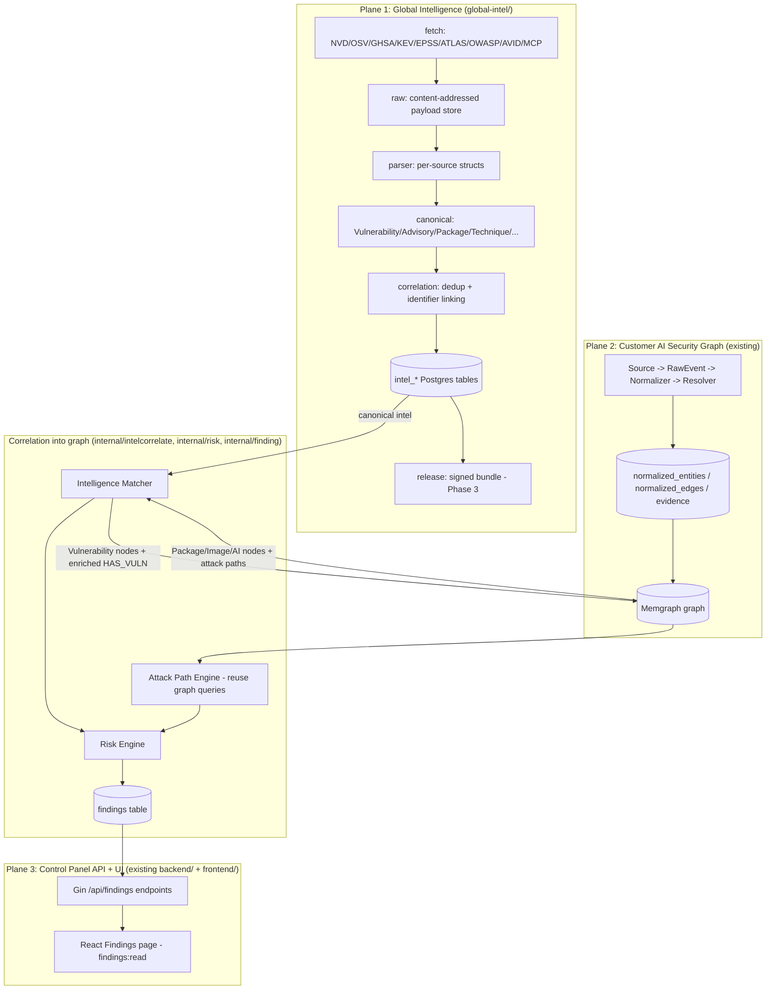
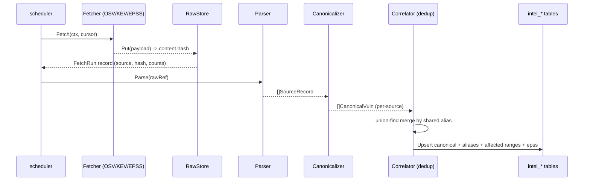
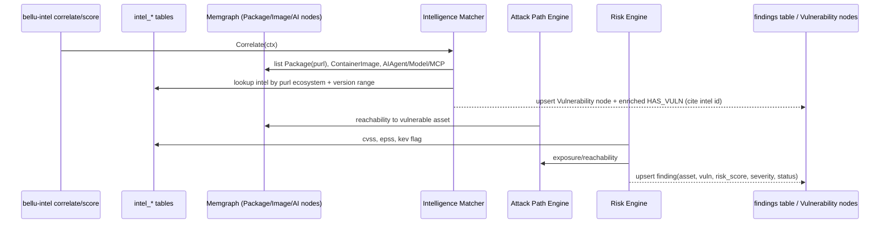

# Design Document: Global Intelligence

## Overview

The **Global Intelligence** plane gives Bellu its own curated, deduplicated,
provider-independent corpus of security intelligence — vulnerabilities,
advisories, exploited-in-the-wild signals, exploit-prediction scores, and
(later) AI-specific threat knowledge — and correlates that corpus into each
customer's existing AI Security Graph so that assets light up with
risk-scored, evidence-backed findings.

Today the platform already runs an evidence-first ingestion pipeline
(`Source -> RawEvent -> Normalizer -> Resolver -> GraphWriter`) that builds a
Memgraph graph of 17 node kinds (including `Package` keyed by purl,
`Vulnerability` keyed by `cve:ID`, `ContainerImage` by digest, and the AI
kinds `AIAgent`/`AIModel`/`MCPServer`/`AIService`) with every element backed by
a row in the Postgres `evidence` table. What is missing is the *authoritative
knowledge* about which packages are vulnerable, how severe each vulnerability
is, and whether it is being exploited. Global Intelligence supplies that
knowledge, and a correlation layer joins it to the graph without ever
weakening the "every graph element traces to a raw event" invariant.

This feature is additive and lives entirely inside the existing Go module
`github.com/bellu/bellu-ai-cyber` (Go 1.27). All new intelligence code goes
under a new sibling folder `global-intel/`; correlation,
findings, and the risk engine go under `internal/` next to the existing
pipeline packages; a new `bellu-intel` CLI sits beside `cmd/bellu`; and the
new API/UI reuse the existing Gin server and RBAC (the `findings:read`
permission already exists). Delivery is phased: Phase 1 is intelligence
ingestion (OSV + KEV + EPSS), Phase 2 is correlation + risk + findings +
API/UI, Phase 3 is AI-specific intelligence + signed release bundles +
OpenSearch.

---

## Architecture

### Three-Plane Architecture



Data flows in one direction per plane: intelligence is ingested and
canonicalized independently of any customer, then the matcher reads canonical
intel plus graph assets and writes findings and graph enrichments. The intel
plane never reads customer graph data; the correlation layer is the only place
the two planes meet.

---

## Data Flow

### Intelligence ingestion flow (Phase 1)



### Source-aware scheduling, sync modes, and failure handling

The scheduler (`global-intel/scheduler`) is **source-aware**: it is
not a single global cron that runs every source at once. Each row in
`intel_sources` carries its own cadence (`schedule`), current `sync_mode`, and
incremental state (`last_cursor`, `last_etag`, `last_modified`,
`last_checksum`), plus backoff state (`last_started_at`, `last_success_at`,
`last_error`, `retry_count`). The scheduler evaluates each enabled source
independently, so sources run on their own schedules and a problem with one
source never blocks or corrupts another.

For incremental fetches the scheduler hands the stored `last_etag` /
`last_modified` to the Fetcher for conditional HTTP requests (`If-None-Match`,
`If-Modified-Since`) and the stored `last_cursor` as the resume marker; an
unchanged upstream (HTTP 304 or an identical `last_checksum`) is a cheap no-op.
On a successful run the scheduler advances `last_cursor`, refreshes
`last_etag` / `last_modified` / `last_checksum`, sets `last_success_at`, and
resets `retry_count` to 0.

**Sync modes.** The scheduler distinguishes three modes, recorded per source in
`intel_sources.sync_mode`:

- **bootstrap** — import the full historical dataset into an empty (or newly
  enabled) store. Runs with an empty cursor and performs a complete fetch.
- **incremental** — fetch only new/changed records using the stored
  `last_cursor` / `last_etag` / `last_modified`. This is the steady-state mode.
- **reconciliation** — periodically re-verify that the local `intel_*` state
  still matches upstream (catching missed deletions or drift), reconciling
  differences without discarding valid local intelligence.

These map onto the CLI: `bellu-intel run --mode daily|incremental` already
exists (daily = full-schedule run, incremental = cursor-based). `bootstrap` and
`reconciliation` are additional modes the scheduler and CLI support, selecting
the fetch behavior and the `sync_mode` recorded for the source. This is
consistent with Requirement 7.

**Failure handling.** Every run ends in exactly one state, stored in
`intel_fetch_runs.status` (with detail in `intel_fetch_runs.error`):

| State | Stage that failed |
|-------|-------------------|
| `FETCH_FAILED`      | upstream fetch / transport |
| `PARSE_FAILED`      | decoding raw payloads into source records |
| `NORMALIZE_FAILED`  | canonicalization / validation of source records |
| `VALIDATION_FAILED` | canonical-model validation rejected the record set |
| `INDEX_FAILED`      | persistence / upsert into `intel_*` |
| `SUCCESS`           | the run completed and persisted cleanly |

Failed runs remain **auditable and are never deleted** — each failed run keeps
its own `intel_fetch_runs` row with the stage, counts, cursors, and error. A
failure in one source does not affect other sources (independent scheduling and
state). Transient failures (network blips, 5xx, rate limiting) use
**exponential backoff** driven by `intel_sources.retry_count`, which increments
on failure and resets on success. Critically, a failed run **must never replace
valid existing intelligence with an empty result**: persistence only applies
successfully fetched/parsed/validated records, so an empty or partial fetch
leaves the existing `intel_*` corpus intact rather than wiping it.

### Correlation flow (Phase 2)



---

## Components and Interfaces

### Component: Fetcher (`global-intel/fetch`)

**Purpose**: pull raw intelligence from an upstream source. Phase 1 implements
OSV (purl ecosystems, PyPI first), CISA KEV, and FIRST EPSS; NVD, GHSA, ATLAS,
OWASP GenAI, AVID, MCP intelligence, and vendor advisories are interfaces/stubs
for later phases.

```go
// Fetcher pulls raw payloads from one upstream intelligence source.
type Fetcher interface {
    // Source returns a stable source key, e.g. "osv", "kev", "epss".
    Source() string
    // Fetch retrieves payloads since the given cursor. It streams raw bytes to
    // the RawStore and returns a result describing what was fetched plus the
    // next cursor for incremental runs. Fetch MUST NOT parse or mutate payloads.
    Fetch(ctx context.Context, raw RawStore, cur Cursor) (FetchResult, error)
}

// Cursor is an opaque incremental marker (e.g. OSV page token, EPSS date,
// KEV catalogVersion). Empty cursor means a full fetch.
type Cursor string

type FetchResult struct {
    Source    string
    RawRefs   []RawRef // content-addressed references just stored
    Next      Cursor
    FetchedAt time.Time
}
```

**Responsibilities**: HTTP/transport concerns, pagination, incremental cursors,
rate limiting. Never interprets payload contents beyond what is needed to page.

The `FetchResult` above describes the raw fetch (refs stored + next cursor); the
pipeline records the fuller per-run accounting — `records_added`,
`records_updated`, `records_deleted`, `cursor_before`, `cursor_after`, and
`status`/`error` — into `intel_fetch_runs` as the run progresses (see
"Source-aware scheduling, sync modes, and failure handling"), satisfying
Requirement 6.4 without changing the `Fetcher` interface signature.

### Component: RawStore (`global-intel/raw`)

**Purpose**: content-addressed storage of unmodified fetched payloads.
Filesystem for dev; an S3-compatible interface is defined for later.

```go
// RawStore stores unmodified fetched payloads addressed by content hash.
type RawStore interface {
    // Put stores bytes and returns a reference keyed by sha256 of the content.
    // Storing identical bytes twice yields the same RawRef and is a no-op.
    Put(ctx context.Context, source string, payload []byte) (RawRef, error)
    // Get returns the bytes for a reference.
    Get(ctx context.Context, ref RawRef) ([]byte, error)
}

type RawRef struct {
    Source string // "osv"
    Hash   string // "sha256:..."
    Size   int64
}
```

**Responsibilities**: durable, deduplicated, immutable payload storage. The
hash is the identity; re-fetching unchanged data does not duplicate storage.

### Component: Parser (`global-intel/parser`)

**Purpose**: turn raw payloads for one source into typed source structs.
Subpackages: `osv`, `kev`, `epss`, `nvd`, `ghsa`, `atlas`, `avid`, `mcp`.

```go
// Parser decodes raw payloads of one source into typed source records.
type Parser interface {
    Source() string
    // Parse decodes a raw payload into zero or more source records. It is a
    // pure function of its input: same bytes -> same records.
    Parse(ref RawRef, payload []byte) ([]SourceRecord, error)
}

// SourceRecord is the loosely-typed per-source intermediate. Concrete source
// packages define their own structs (osv.Record, kev.Entry, epss.Row) that
// satisfy this via a small adapter.
type SourceRecord interface {
    // Aliases returns every external identifier this record carries
    // (CVE-..., GHSA-..., OSV id, etc.) used for dedup.
    Aliases() []string
    // SourceKey returns the stable per-source id of this record.
    SourceKey() string
}
```

### Component: Canonicalizer (`global-intel/canonical`)

**Purpose**: normalize source records into Bellu's canonical intelligence
model: `Vulnerability`, `Advisory`, `Package`, `Technique`, `AIVulnerability`,
`MCPVulnerability`, `Incident`.

```go
// Canonicalizer maps source records of its source into canonical intel objects.
type Canonicalizer interface {
    Source() string
    Canonicalize(recs []SourceRecord) ([]CanonicalVuln, error)
}
```

The canonical `Vulnerability` is the heart of the model (see Data Models). It
carries alias identifiers, affected package ranges (purl + semver ranges),
CVSS, severity, the KEV known-exploited flag, and the EPSS score.

### Component: Correlator / Dedup (`global-intel/correlation`)

**Purpose**: identifier linking, package-version matching, CPE, model, MCP, and
AI-agent correlation. Within the intel plane its first job is **dedup**: merge
canonical records that share any alias into one canonical vulnerability using an
identifier graph (union-find), mirroring the deterministic alias merging the
customer-side `internal/resolve` already does for graph entities.

```go
// Deduper merges canonical vulnerabilities that share any alias into one
// record. The merge is a deterministic, order-independent function of the
// input alias sets (connected components of the identifier graph).
type Deduper interface {
    Dedup(in []CanonicalVuln) ([]CanonicalVuln, error)
}
```

### Component: Intelligence Matcher (`internal/intelcorrelate`)

**Purpose**: the bridge into the customer graph. Join canonical intel
vulnerabilities to graph `Package` nodes (by purl + affected version range) and
`ContainerImage`; join AI intel to `AIAgent`/`AIModel`/`MCPServer`. Produces or
updates `Vulnerability` nodes and `HAS_VULN` edges enriched with `cvss`,
`epss`, `known_exploited`, `severity`, and a citation to the intel record id.

```go
// Matcher correlates canonical intel against the customer graph and emits
// candidate findings plus graph enrichments. It never fabricates evidence:
// every enrichment cites the intel record id it came from.
type Matcher interface {
    Correlate(ctx context.Context) ([]Candidate, error)
}

// Candidate is a (asset, vulnerability) pairing with the matched intel.
type Candidate struct {
    AssetID    string // graph canonical_id (Package/ContainerImage/AIAgent/...)
    AssetKind  model.Kind
    VulnID     string // canonical intel vulnerability id
    IntelRef   string // cited intel record id (never a raw_event id)
    MatchBasis string // "purl+range" | "cpe" | "image-digest" | "ai-model"
}
```

### Component: Risk Engine (`internal/risk`)

**Purpose**: compute a risk score per finding from CVSS, EPSS, the KEV
exploited flag, exposure/reachability (does an attack path reach the vulnerable
asset?), and AI-asset criticality; bucket into severities.

```go
// RiskScorer turns a candidate finding plus context into a risk score.
type RiskScorer interface {
    Score(ctx context.Context, c Candidate, ctx RiskContext) (RiskResult, error)
}

type RiskContext struct {
    CVSS           float64 // base score 0..10
    EPSS           float64 // exploit probability 0..1
    KnownExploited bool    // KEV
    Reachable      bool    // attack path reaches the asset
    AICriticality  float64 // 0..1, higher for agents/models with broad access
}

type RiskResult struct {
    Score    float64 // 0..100
    Severity Severity // Critical/High/Medium/Low/Info
}
```

### Component: Attack Path Engine (`internal/graph` extension)

**Purpose**: reuse and extend the existing attack-path Cypher queries
(`Writer.AttackPaths`) so reachability to a vulnerable asset feeds the risk
score. New read-only method `ReachesAsset(ctx, canonicalID) (bool, error)` runs
a vetted Cypher query; no schema changes to the graph writer path.

### Component: Findings (`internal/finding`)

**Purpose**: the durable record surfaced to users. A `findings` table and model
(asset, vulnerability/intel, risk score, severity, status open/resolved,
first/last seen, evidence), deduped per `(asset, vuln)`.

### Component: Findings API + UI (`backend/server`, `frontend/`)

**Purpose**: new `/api/findings` endpoints gated by the existing
`findings:read` permission, and a React Findings page following the existing
ChatGPT-dark shadcn theme.

---

## Data Models

### Canonical intelligence model (`global-intel/canonical`)

```go
// CanonicalVuln is Bellu's provider-independent view of one vulnerability,
// merged from every source that references it.
type CanonicalVuln struct {
    // ID is the stable canonical id, derived deterministically from the
    // preferred alias (CVE if present, else GHSA, else OSV id).
    ID string
    // Aliases are all external identifiers that resolve to this vuln.
    Aliases []string // ["CVE-2024-1234", "GHSA-xxxx", "PYSEC-2024-1"]
    Summary string
    // Affected package ranges: purl ecosystem + version ranges.
    Affected []AffectedPackage
    CVSS     CVSS
    Severity Severity
    // KnownExploited is true if present in CISA KEV.
    KnownExploited bool
    // EPSS is the latest exploit-prediction score in [0,1].
    EPSS      float64
    Published time.Time
    Modified  time.Time
    // Sources lists which intel sources contributed, for provenance.
    Sources []string
}

type AffectedPackage struct {
    Purl       string   // "pkg:pypi/requests" (name without version)
    Ecosystem  string   // "PyPI", "npm", "Go", ...
    Ranges     []SemverRange
    FixedIn    []string // explicit fixed versions when provided
}

type SemverRange struct {
    Introduced string // inclusive lower bound ("0" means from the start)
    Fixed      string // exclusive upper bound ("" means unbounded)
}

type CVSS struct {
    Vector  string
    Score   float64 // 0..10
    Version string  // "3.1", "4.0"
}

type Severity string

const (
    SevCritical Severity = "critical"
    SevHigh     Severity = "high"
    SevMedium   Severity = "medium"
    SevLow      Severity = "low"
    SevInfo     Severity = "info"
)
```

**Validation rules**:
- `ID` is non-empty and is one of the `Aliases`.
- `Aliases` is non-empty and de-duplicated; alias strings are normalized
  (uppercased CVE/GHSA, trimmed) before comparison.
- `EPSS` in `[0,1]`; `CVSS.Score` in `[0,10]`.
- Every `AffectedPackage.Purl` is a valid purl *without* a version qualifier
  (version lives in `Ranges`).

**EPSS percentile (schema vs. model reconciliation).** `CanonicalVuln`
intentionally carries only the latest EPSS *probability* (`EPSS`, in `[0,1]`),
since the canonical model is the single current view of a vulnerability. The
EPSS **percentile** is a per-day series attribute and is therefore persisted
**only** in the `intel_epss_history.percentile` column (alongside the daily
`epss` value), not on `CanonicalVuln`. This keeps the canonical model focused on
the current state while preserving full percentile history for trend queries.
Consequently there is no `EPSSPercentile` field on `CanonicalVuln` and no
percentile validation rule in the list above; percentile is validated at the
history-persistence layer when a daily `intel_epss_history` row is written.

### Finding model (`internal/finding`)

```go
type Finding struct {
    ID         int64
    AssetID    string       // graph canonical_id
    AssetKind  model.Kind
    VulnID     string       // canonical intel vulnerability id
    IntelRef   string       // cited intel record id
    RiskScore  float64      // 0..100
    Severity   Severity
    Status     Status       // open | resolved
    FirstSeen  time.Time
    LastSeen   time.Time
}

type Status string
const (
    StatusOpen     Status = "open"
    StatusResolved Status = "resolved"
)
```

**Validation rules**: unique per `(AssetID, VulnID)`; `Status` transitions
`open -> resolved` when a later correlation run no longer matches the asset.

---

## Canonical Intelligence Schema (new migration `00005_intel.sql`)

Added as the next goose migration in `internal/store/migrations/` (current head
is `00004_rbac`). Reuses the existing embedded-goose mechanism — no change to
`store.Migrate`, which runs `goose.UpContext` over `MigrationsFS`. Intel tables
share the dev Postgres instance but are namespaced `intel_*` so they could move
to a separate database later.

```sql
-- +goose Up
-- One row per source fetch, for provenance, incremental cursors, and audit.
CREATE TABLE intel_fetch_runs (
    id              BIGSERIAL PRIMARY KEY,
    source          TEXT NOT NULL,              -- 'osv' | 'kev' | 'epss' | ...
    cursor          TEXT NOT NULL DEFAULT '',   -- next incremental cursor
    raw_count       INT  NOT NULL DEFAULT 0,
    records_added   INT  NOT NULL DEFAULT 0,    -- canonical rows inserted this run
    records_updated INT  NOT NULL DEFAULT 0,    -- canonical rows updated this run
    records_deleted INT  NOT NULL DEFAULT 0,    -- canonical rows removed this run
    cursor_before   TEXT NOT NULL DEFAULT '',   -- cursor at run start
    cursor_after    TEXT NOT NULL DEFAULT '',   -- cursor at run end (== cursor)
    status          TEXT NOT NULL DEFAULT 'running', -- see pipeline failure states
    error           TEXT NOT NULL DEFAULT '',   -- failure detail; '' when SUCCESS
    started_at      TIMESTAMPTZ NOT NULL DEFAULT now(),
    finished_at     TIMESTAMPTZ
);

-- Canonical, deduplicated vulnerabilities.
CREATE TABLE intel_vulnerabilities (
    id              TEXT PRIMARY KEY,        -- canonical id (preferred alias)
    summary         TEXT NOT NULL DEFAULT '',
    cvss_score      DOUBLE PRECISION,
    cvss_vector     TEXT NOT NULL DEFAULT '',
    cvss_version    TEXT NOT NULL DEFAULT '',
    severity        TEXT NOT NULL DEFAULT 'info',
    known_exploited BOOLEAN NOT NULL DEFAULT false,  -- KEV
    epss            DOUBLE PRECISION,                -- latest EPSS
    published       TIMESTAMPTZ,
    modified        TIMESTAMPTZ,
    sources         TEXT[] NOT NULL DEFAULT '{}',
    first_seen      TIMESTAMPTZ NOT NULL DEFAULT now(),
    last_seen       TIMESTAMPTZ NOT NULL DEFAULT now()
);
CREATE INDEX intel_vuln_severity_idx ON intel_vulnerabilities (severity);
CREATE INDEX intel_vuln_kev_idx ON intel_vulnerabilities (known_exploited);

-- Alias -> canonical id. Enables identifier linking and dedup lookups.
CREATE TABLE intel_aliases (
    alias   TEXT PRIMARY KEY,               -- normalized "CVE-...", "GHSA-..."
    vuln_id TEXT NOT NULL REFERENCES intel_vulnerabilities(id) ON DELETE CASCADE
);
CREATE INDEX intel_aliases_vuln_idx ON intel_aliases (vuln_id);

-- Affected package ranges, one row per (vuln, purl, range).
CREATE TABLE intel_affected_packages (
    id         BIGSERIAL PRIMARY KEY,
    vuln_id    TEXT NOT NULL REFERENCES intel_vulnerabilities(id) ON DELETE CASCADE,
    purl       TEXT NOT NULL,               -- name only, no version
    ecosystem  TEXT NOT NULL,
    introduced TEXT NOT NULL DEFAULT '',    -- inclusive lower bound
    fixed      TEXT NOT NULL DEFAULT '',    -- exclusive upper bound ('' = open)
    CONSTRAINT intel_affected_uniq UNIQUE (vuln_id, purl, introduced, fixed)
);
CREATE INDEX intel_affected_purl_idx ON intel_affected_packages (purl);

-- EPSS history (daily series) so trends are available later.
CREATE TABLE intel_epss_history (
    vuln_id    TEXT NOT NULL REFERENCES intel_vulnerabilities(id) ON DELETE CASCADE,
    scored_on  DATE NOT NULL,
    epss       DOUBLE PRECISION NOT NULL,
    percentile DOUBLE PRECISION,
    PRIMARY KEY (vuln_id, scored_on)
);

-- Source catalog + per-source scheduler state. Each source is scheduled and
-- recovered independently (not one global cron), carrying its own cadence,
-- sync mode, incremental markers (cursor/etag/last-modified/checksum), and
-- backoff state so a transient upstream outage never affects other sources.
CREATE TABLE intel_sources (
    source          TEXT PRIMARY KEY,
    kind            TEXT NOT NULL DEFAULT 'vuln',  -- 'vuln' | 'exploit' | 'ai'
    enabled         BOOLEAN NOT NULL DEFAULT true,
    schedule        TEXT,                          -- cron-like cadence; NULL = use default/config
    sync_mode       TEXT NOT NULL DEFAULT 'incremental', -- 'bootstrap' | 'incremental' | 'reconciliation'
    last_started_at TIMESTAMPTZ,                   -- when the most recent run began
    last_success_at TIMESTAMPTZ,                   -- when the most recent run succeeded
    last_cursor     TEXT,                          -- stored incremental cursor
    last_etag       TEXT,                          -- HTTP ETag for conditional GET
    last_modified   TEXT,                          -- HTTP Last-Modified for conditional GET
    last_checksum   TEXT,                          -- content checksum of last payload
    last_error      TEXT,                          -- last failure detail (NULL when healthy)
    retry_count     INT NOT NULL DEFAULT 0         -- consecutive failures; drives exponential backoff
);

-- +goose Down
DROP TABLE intel_sources;
DROP TABLE intel_epss_history;
DROP TABLE intel_affected_packages;
DROP TABLE intel_aliases;
DROP TABLE intel_vulnerabilities;
DROP TABLE intel_fetch_runs;
```

### Findings schema (same migration or `00006_findings.sql`, Phase 2)

```sql
CREATE TABLE findings (
    id         BIGSERIAL PRIMARY KEY,
    asset_id   TEXT NOT NULL,               -- graph canonical_id
    asset_kind TEXT NOT NULL,
    vuln_id    TEXT NOT NULL,               -- intel_vulnerabilities.id
    intel_ref  TEXT NOT NULL,               -- cited intel record id
    risk_score DOUBLE PRECISION NOT NULL DEFAULT 0,
    severity   TEXT NOT NULL DEFAULT 'info',
    status     TEXT NOT NULL DEFAULT 'open',
    first_seen TIMESTAMPTZ NOT NULL DEFAULT now(),
    last_seen  TIMESTAMPTZ NOT NULL DEFAULT now(),
    CONSTRAINT findings_uniq UNIQUE (asset_id, vuln_id)
);
CREATE INDEX findings_severity_idx ON findings (severity);
CREATE INDEX findings_status_idx ON findings (status);
```

Upserts follow the existing `normalized_entities` pattern: `INSERT ... ON
CONFLICT (asset_id, vuln_id) DO UPDATE SET last_seen = now(), risk_score =
EXCLUDED.risk_score, severity = EXCLUDED.severity, status = EXCLUDED.status`,
preserving `first_seen`.

---

## Correlation Flow (Detail)

The matcher is deterministic and additive:

1. Enumerate candidate assets from the graph: `Package` nodes (purl),
   `ContainerImage` (digest + embedded packages), and AI nodes.
2. For each `Package`, split its purl into name + version. Look up
   `intel_affected_packages` by purl name, then test whether the package
   version falls inside any `SemverRange` (introduced ≤ v < fixed).
3. For each match, resolve the canonical `intel_vulnerabilities` row and emit a
   `Candidate` carrying the `IntelRef` (the intel vuln id). The matcher writes:
   - a `Vulnerability` graph node keyed `cve:ID` (reusing the existing kind),
   - a `HAS_VULN` edge from the asset to the vuln with attributes
     `cvss`, `epss`, `known_exploited`, `severity`, and `intel_ref`.
4. These graph writes go through the existing `graph.Writer.SyncEntities` /
   `SyncEdges` allow-list path — `Vulnerability` and `HAS_VULN` are already in
   the model allow-lists, so no model change is required.

**Evidence rule**: intel enrichment is a *source of attributes*, not a source
of graph existence. The matcher cites the intel record id in edge attributes
and in `findings.intel_ref`; it never writes rows into the `evidence` table
(which references `raw_events`). The existing evidence-backed invariant is
untouched — graph nodes still exist only because a customer `raw_event`
justified them; intel only annotates them.

---

## Risk Scoring Model

A transparent, bounded, monotonic function so scores are explainable and
re-runs are stable:

```
base      = (CVSS / 10) * 100                      // 0..100
exploit   = max(EPSS, KnownExploited ? 0.95 : 0)   // 0..1, KEV floors it high
exposure  = Reachable ? 1.0 : 0.4                   // reachable assets weigh more
aiBoost   = 1 + 0.25 * AICriticality               // up to +25% for critical AI assets

score = clamp( base * (0.5 + 0.5*exploit) * exposure * aiBoost , 0, 100 )
```

Severity buckets from the final score: `>=90 critical`, `>=70 high`,
`>=40 medium`, `>=10 low`, else `info`. KEV-known-exploited vulnerabilities are
additionally floored at `high` regardless of score.

**Properties**: the function is deterministic (same inputs -> same score),
monotonic in each risk factor (raising CVSS/EPSS/reachability/criticality never
lowers the score), and bounded to `[0,100]`.

---

## Error Handling

Error handling for the intelligence pipeline is covered in detail under
"### Source-aware scheduling, sync modes, and failure handling"; this section
summarizes the key guarantees.

- **Explicit per-run terminal states.** Every fetch run ends in exactly one
  state recorded in `intel_fetch_runs.status`: `FETCH_FAILED`, `PARSE_FAILED`,
  `NORMALIZE_FAILED`, `VALIDATION_FAILED`, `INDEX_FAILED`, or `SUCCESS`, with
  the failing-stage detail captured in `intel_fetch_runs.error`.
- **Auditability.** Failed runs are never deleted — each keeps its own
  `intel_fetch_runs` row (stage, counts, cursors, error) for audit.
- **Exponential backoff.** Transient failures (network blips, 5xx, rate
  limiting) back off exponentially, driven by `intel_sources.retry_count`,
  which increments on failure and resets to 0 on success.
- **Per-source isolation.** Sources are scheduled and recovered independently,
  so a failure in one source never blocks or corrupts another.
- **Never replace valid intelligence with an empty result.** Persistence
  applies only successfully fetched/parsed/validated records, so an empty or
  partial fetch leaves the existing `intel_*` corpus intact rather than wiping
  it.

## Release / Signing Approach (Phase 3)

The `release/` builder produces an air-gapped, verifiable intelligence bundle:

1. Snapshot the `intel_*` tables to a canonical JSON lines export (stable key
   ordering so the same data yields byte-identical output).
2. Compute a SHA-256 checksum per file and a manifest listing files, sizes, and
   checksums.
3. Sign the manifest with an ed25519 private key (Go `crypto/ed25519`).
4. Package manifest + signature + data files into a `.tar.zst` bundle.

Customer deployments import the bundle via `bellu-intel release import`, which
verifies the ed25519 signature against a pinned public key and the per-file
checksums before upserting into the local `intel_*` tables. This lets
disconnected customers receive signed intelligence without direct internet
access.

---

## Deferred Items

- **OpenSearch (`search/`)**: Phase 1 relies on Postgres B-tree + optional
  full-text search, which is sufficient for purl/alias lookups. The `search/`
  package is defined as an interface only and documented as future work; no
  OpenSearch dependency is added now.
- **AI-specific intelligence** (MITRE ATLAS, OWASP GenAI, AVID, MCP): fetchers,
  parsers, and canonical kinds (`Technique`, `AIVulnerability`,
  `MCPVulnerability`) are stubs/interfaces in Phase 1, implemented in Phase 3.
- **Signed release bundle** and the `bellu-intel` docker-compose service:
  Phase 3.
- **Separate intel database**: tables are namespaced to allow a future split;
  Phase 1 keeps them in the dev Postgres instance.

---

## Low-Level Design

### Go package layout

Everything stays in module `github.com/bellu/bellu-ai-cyber`.

```
global-intel/            # new sibling folder (NOT a new module)
  fetch/                              # Fetcher interface + per-source fetchers
    fetch.go                          #   Fetcher, Cursor, FetchResult
    osv/osv.go                        #   Phase 1 (PyPI first)
    kev/kev.go                        #   Phase 1
    epss/epss.go                      #   Phase 1
    nvd/, ghsa/, atlas/, owasp/, avid/, mcp/, vendor/   # stubs/interfaces
  raw/                               # RawStore interface
    raw.go                           #   RawStore, RawRef
    fsstore.go                       #   filesystem impl (dev)
    s3store.go                       #   S3-compatible impl (stub for later)
  parser/                            # Parser interface + per-source parsers
    parser.go                        #   Parser, SourceRecord
    osv/, kev/, epss/, nvd/, ghsa/, atlas/, avid/, mcp/
  canonical/                         # Canonicalizer + canonical model
    model.go                         #   CanonicalVuln, AffectedPackage, CVSS, Severity
    canonical.go                     #   Canonicalizer interface + per-source impls
  correlation/                       # dedup + identifier linking (intel-internal)
    dedup.go                         #   Deduper (union-find over aliases)
    match.go                         #   purl/version/cpe/model/mcp matching helpers
  database/                          # intel Postgres access
    intel_store.go                   #   Upsert/dedup against intel_* tables
  search/                            # OpenSearch interface (DEFERRED, interface only)
    search.go
  release/                           # release builder (Phase 3)
    release.go                       #   manifest + checksum + ed25519 + bundle
  scheduler/                         # daily / incremental / release schedules
    scheduler.go

internal/
  intelcorrelate/                    # Intelligence Matcher (bridge into graph)
    matcher.go                       #   Matcher, Candidate
  risk/                              # Risk Engine
    score.go                         #   RiskScorer, RiskContext, RiskResult
  finding/                           # Findings model + store access
    finding.go                       #   Finding, Status
    store.go                         #   upsert/list findings
  store/migrations/00005_intel.sql   # intel tables (reuses embedded goose)
  store/migrations/00006_findings.sql# findings table (Phase 2)
  graph/query.go                     # + ReachesAsset(ctx, canonicalID)

cmd/bellu-intel/                     # new CLI sibling to cmd/bellu
  main.go                            #   fetch|parse|normalize|correlate|score|release|run
```

### Key interfaces/types

All five core interfaces (`Fetcher`, `RawStore`, `Parser`, `Canonicalizer`,
`Correlator`/`Deduper`, `Matcher`, `RiskScorer`) are defined above in
Components and Interfaces and Data Models. They are small, source-agnostic, and
mirror the existing pipeline's shape (`internal/source` ↔ `fetch`,
`internal/normalize` ↔ `canonical`, `internal/resolve` ↔ `correlation` dedup).

### Reuse of existing types

- Canonical intel maps onto the **existing** `model.Kind` values
  (`KindPackage`, `KindVulnerability`, `KindContainerImage`, `KindAIAgent`,
  `KindAIModel`, `KindMCPServer`) and relations (`RelHasVuln`, `RelDependsOn`).
  No new kinds or relations are added to `internal/model`, so the graph writer
  allow-lists need no change.
- `intel_store` and `finding/store` take `*store.Store` and use its exposed
  `Pool()` (`*pgxpool.Pool`) for queries — same pattern as `normalized.go`.
- Upserts use `INSERT ... ON CONFLICT DO UPDATE` with `jsonb ||` merge, matching
  the established `SaveEntity`/`SaveEdge` idioms.

### New Postgres tables

See "Canonical Intelligence Schema" and "Findings schema" above. Column lists
and constraints are given in full there. Both are new goose migrations appended
after `00004_rbac`; `store.Migrate` picks them up automatically via the
`//go:embed migrations/*.sql` directive — no code change in `migrations.go`.

### CLI subcommands (`cmd/bellu-intel`)

Follows the existing `cmd/bellu` dispatch style (switch on `os.Args[1]`):

| Subcommand  | Action |
|-------------|--------|
| `fetch`     | run enabled fetchers -> RawStore, record `intel_fetch_runs` |
| `parse`     | parse stored raw payloads into source records |
| `normalize` | canonicalize source records into `CanonicalVuln` |
| `correlate` | dedup + upsert into `intel_*` (intel side); Phase 2 also runs the Matcher into the graph |
| `score`     | run the Risk Engine and upsert `findings` (Phase 2) |
| `release`   | build/sign/import a release bundle (Phase 3) |
| `run`       | `fetch -> parse -> normalize -> correlate` (`--mode daily|incremental`) |

Config is read from the same `bellu.yaml` (`internal/config`) as `bellu`,
reusing `Postgres.DSN` and `Memgraph.*`, plus a new optional
`intel:` block (raw store path, enabled sources, schedule).

### API endpoints (`backend/server`)

New routes registered under the authenticated group, gated by the **existing**
`auth.PermFindingsRead` (`findings:read`) permission — the same group pattern
already used for `graph:read`:

```
GET /api/findings                 -> list findings (filters: severity, status, asset_kind, limit)
GET /api/findings/:id             -> one finding + cited intel + evidence trail
GET /api/intel/vulnerabilities    -> browse canonical intel (filters: severity, kev, purl)
GET /api/intel/vulnerabilities/:id-> one canonical vuln with aliases + affected ranges
```

Handlers follow the existing `handleEntities`/`handleStats` shape (context
timeout, store call, JSON response). Wiring adds a findings group inside
`Server.Handler()`:

```go
fr := authed.Group("")
fr.Use(s.auth.RequirePermission(auth.PermFindingsRead))
{
    fr.GET("/findings", s.handleFindings)
    fr.GET("/findings/:id", s.handleFinding)
    fr.GET("/intel/vulnerabilities", s.handleIntelVulns)
    fr.GET("/intel/vulnerabilities/:id", s.handleIntelVuln)
}
```

`Server.Options` gains no new required dependency: findings/intel reads go
through the existing `*store.Store`.

### Frontend (`frontend/`)

A new `src/pages/Findings.jsx` page plus a nav entry in `src/config/nav.js`,
using the existing shadcn `card`/`button`/`misc` components and the ChatGPT
dark theme. It calls the new endpoints via `src/api.js`. The nav item is shown
only when the principal has `findings:read` (the UI already reads permissions
from `/api/auth/me`).

### How it plugs in without breaking existing behavior

- **Model**: no new kinds/relations; intel reuses `Vulnerability` + `HAS_VULN`.
- **Store**: additive migrations only; existing tables and upserts untouched.
- **Graph**: writes go through the existing allow-list-validated
  `SyncEntities`/`SyncEdges`; one new read-only query method is added.
- **Auth**: reuses the pre-existing `findings:read` permission already granted
  to Global Admin/Reader, Project Admin, Security Analyst, Developer roles.
- **CLI/API/UI**: new sibling command, new route group, new page — no changes
  to existing commands, routes, or pages.

---

## Correctness Properties

### Property 1: Dedup is deterministic and idempotent

**Validates: Requirements 5.1, 5.2, 5.3**

For any multiset of canonical
   records, `Dedup` produces the same set of merged vulnerabilities regardless
   of input order, and `Dedup(Dedup(x)) == Dedup(x)`. Merging is the connected
   components of the alias identifier graph (union-find).

   ```
   ∀ records r, permutation π:  Dedup(r) ≡ Dedup(π(r))
   ∀ records r:                 Dedup(Dedup(r)) = Dedup(r)
   ```

### Property 2: Correlation never fabricates evidence

**Validates: Requirements 9.4, 9.5, 9.6, 18.5**

The matcher writes no rows to the
   `evidence` table and creates no graph node that lacks a prior customer
   `raw_event` justification. It only annotates existing nodes/edges and cites
   an intel record id.

   ```
   ∀ enrichment e:  e.evidence_rows_written = 0  ∧  e.cites(intel_record_id)
   ```

### Property 3: Re-runs are idempotent

**Validates: Requirements 2.2, 6.2, 18.4**

Running `fetch -> parse -> normalize ->
   correlate -> score` twice over unchanged upstream data leaves `intel_*`,
   graph enrichments, and `findings` in the same state (bar `last_seen`
   timestamps). Guaranteed by content-addressed raw storage, `ON CONFLICT`
   upserts, and `MERGE` graph writes.

### Property 4: Risk scoring is deterministic, monotonic, and bounded

**Validates: Requirements 11.1, 11.2, 11.3**

Same
   `RiskContext` yields the same score; increasing any risk factor never
   decreases the score; the score is always in `[0,100]`.

### Property 5: Version matching is sound

**Validates: Requirements 8.1, 8.5**

A `Package` is matched to a vulnerability only
   when its version lies in an affected `SemverRange`
   (`introduced ≤ version < fixed`), so no package outside a declared affected
   range is ever reported.

   **Caveat (honest scope).** The current `compareVersions` implementation
   (`global-intel/canonical/version.go`) is a *pragmatic*
   comparator: it handles semver and common PyPI/npm version forms, but it does
   **not** implement exact PEP 440 / semver pre-release ordering (e.g. the full
   ordering of `rc`, `beta`, `dev`, epoch, and local-version segments).
   Soundness therefore holds for **release versions**, and exact pre-release
   ordering is a documented future refinement. Property 5 is stated with
   respect to the release-version comparator; we do not claim exact pre-release
   precedence today.

---

## Testing Strategy

### Unit testing
- Parsers: golden-file tests from recorded OSV/KEV/EPSS payloads -> expected
  source records (pure functions, easy to pin).
- Dedup: table-driven tests over alias sets, including shuffled inputs to assert
  order-independence and idempotence (property 1).
- Risk engine: table tests across CVSS/EPSS/KEV/reachability/criticality
  combinations asserting monotonicity and bounds (property 4).
- Version matching: boundary tests on `introduced`/`fixed` edges (property 5).

### Property-based testing
- **Library**: a Go generative approach (`testing/quick` or `pgregory.net/rapid`).
- Generate random alias graphs and assert dedup = connected components, and
  `Dedup∘Dedup = Dedup`.
- Generate random `RiskContext`s and assert bounds + monotonicity.

### Integration testing
- Reuse the existing `testcontainers-go` Postgres harness
  (`internal/store/store_integration_test.go` pattern) to apply `00005`/`00006`
  migrations and exercise upserts/dedup against real Postgres.
- Correlation integration against a seeded Memgraph fixture (mirroring
  `internal/graph/graph_integration_test.go`): seed `Package` nodes, run the
  matcher, assert `HAS_VULN` edges and `findings` rows, and assert the
  `evidence` table is unchanged (property 2).

## Dependencies

- Existing: `pgx/v5`, `goose/v3`, `neo4j-go-driver/v5`, `gin`, `gin-contrib/cors`,
  `golang-jwt/v5`, `testcontainers-go` — all reused.
- New (standard library preferred): `crypto/ed25519`, `crypto/sha256`,
  `archive/tar` + a zstd writer for release bundles (Phase 3).
- Optional for PBT: `pgregory.net/rapid` (dev/test only).
- Deferred: OpenSearch client (not added in Phase 1).
