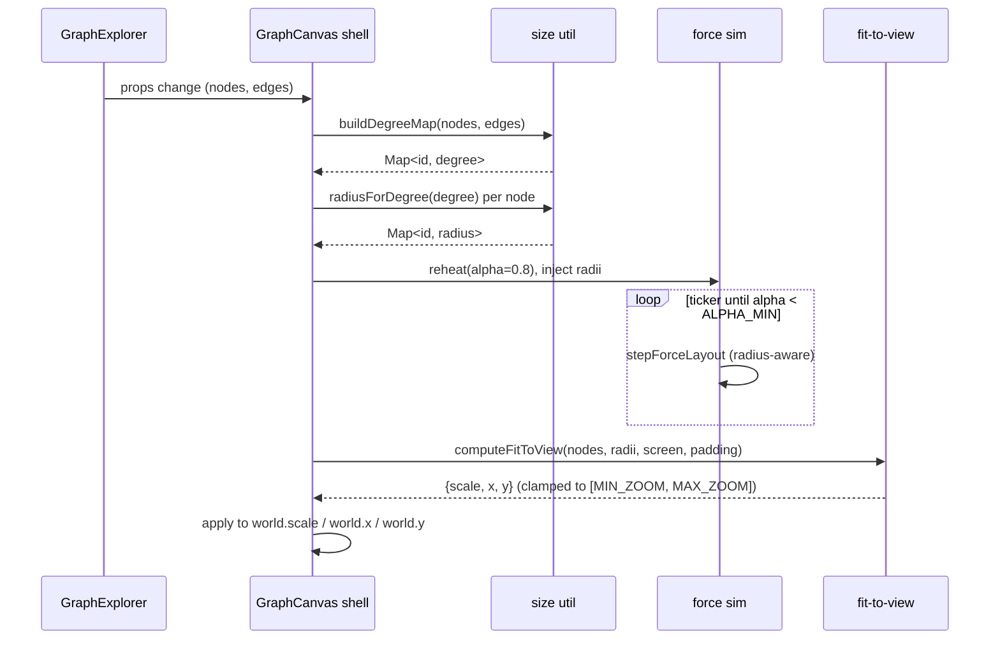

# Design Document: Graph Explorer Visualization

## Overview

The Graph Explorer already renders the filtered working set on a pixi.js v8 WebGL canvas (`GraphCanvas.tsx`) driven by a custom spatial-grid force simulation (`forceLayout.ts`). In its current form the graph collapses into a cloud of tiny, identically sized particles: nodes have a fixed `DISC_RADIUS` of 14 world units, there are no labels, icons are resolved from a parallel-but-divergent icon map, and there is no fit-to-view. It does not read as an explorable knowledge graph.

This spec is a **visual and interaction overhaul of the existing rendering layer only**. It does not change the backend endpoint, the filter/facet system, the table view, saved views, or the `GraphNode`/`GraphEdge` persisted contracts (those are delivered in the base `graph-explorer` spec). It evolves five concerns inside the frontend feature: (1) **spacing** — link distance and repulsion scale with a per-node radius so icons and labels have room and the dense-core "hairball" never forms; (2) **variable node size** — radius derives from node degree (an importance proxy) so hubs look bigger; (3) **shared icons** — a single icon/color registry is the source of truth for the canvas, the inventory table, and the trace graph, so the graph looks like the same product; (4) **labels with semantic zoom** — resource-name labels appear below nodes, revealed progressively by zoom level with collision culling so they never overlap; (5) **fit-to-view** — the whole laid-out graph fits the viewport on load and after every filter/data change, alongside the existing zoom in/out/reset controls.

The design is grounded in established large-graph visualization practice: semantic zoom / level-of-detail (show dots far out, reveal icons then labels as you zoom in), label de-overlap by importance ranking, node sizing by centrality, spacing proportional to node size, edge de-emphasis with selection-based fading, fit-to-view on data change, and GPU-batched rendering with pooled/culled label text so it all holds at ~4k nodes. Each choice below is justified against these principles.

## Architecture

The canvas is decomposed into cooperating sub-systems so that each concern (layout, sizing, icon resolution, LOD, labels, fit-to-view) is pure and independently testable, while `GraphCanvas` remains the thin imperative shell that owns the pixi `Application`, the `world` container, and the ticker.

```mermaid
graph TD
    GE[GraphExplorer page] -->|nodes, edges, selectedId| GC[GraphCanvas shell]

    subgraph Canvas["GraphCanvas sub-systems"]
        GC --> SIZE[degree/size util<br/>degreeMap + radiusForDegree]
        GC --> SIM[force layout sim<br/>radius-aware spacing]
        GC --> REND[renderer<br/>node-container pool: disc+icon+label]
        GC --> LOD[LOD controller<br/>keyed on world.scale]
        GC --> LBL[label manager<br/>collision culling by importance]
        GC --> FIT[fit-to-view util<br/>bbox -> scale+translate]
        REND --> ICONS[shared icon/color registry<br/>kind->icon+color, provider->SVG]
        LBL --> ICONS
    end

    ICONS -. same source of truth .-> INV[ai-inventory KindIcon/ProviderIcon]
    ICONS -. same source of truth .-> TG[graph/GraphNode KIND_STYLE]

    SIZE --> SIM
    SIZE --> REND
    SIM -->|node.x,node.y,radius| REND
    LOD -->|dots | icons | labels| REND
    LOD --> LBL
    FIT -->|world.scale, world.x/y| GC
```

Data and control flow per frame:

1. On data change (`nodes`/`edges` prop change), the shell recomputes a **degree map** and a **radius map**, reconciles the pooled node containers, reheats the simulation, and schedules a **fit-to-view** once the layout has cooled (or immediately with current positions on the first settled frame).
2. Each ticker frame: the **sim** advances positions using radius-aware repulsion/separation; the shell reads `world.scale` and asks the **LOD controller** which visual tier to render; the **renderer** positions pooled disc/icon/label objects and sizes them by radius; the **label manager** culls overlapping labels greedily by importance before any label text is shown.
3. Zoom controls call into the shell's imperative handles (`zoomBy`, `resetView` which now delegates to fit-to-view); the wheel handler keeps focal-point zoom.

### Why these sub-systems

- **Separation of pure utils from the pixi shell** keeps the math (fit-to-view, LOD thresholds, collision culling, degree→radius) unit-testable under Vitest with no WebGL, which is where the correctness properties live.
- **Single icon/color registry** is the only way to guarantee icon/color parity across three renderers (canvas, inventory table, trace graph) — today those are three divergent maps, which is exactly why the graph looks "off-brand".
- **LOD controller keyed on zoom** is the standard answer to clutter and label overlap in graphs of thousands of nodes: far out you draw cheap dots and only top-ranked labels; zooming in progressively reveals icons, then more labels.

## Sequence Diagrams

### Data change → layout → fit-to-view



### Per-frame render with LOD and label culling

```mermaid
sequenceDiagram
    participant TK as pixi ticker
    participant GC as GraphCanvas shell
    participant LOD as LOD controller
    participant REND as renderer (pool)
    participant LBL as label manager

    TK->>GC: renderFrame()
    GC->>GC: stepForceLayout if alpha >= ALPHA_MIN
    GC->>LOD: tierForZoom(world.scale)
    LOD-->>GC: { showIcons, labelMode }
    GC->>REND: draw edges (faded if selection active)
    GC->>REND: position discs + icons by radius, tier
    alt labelMode != none
        GC->>LBL: selectVisibleLabels(nodes, radii, viewport, world, budget, importance)
        LBL-->>GC: ordered non-overlapping label set
        GC->>REND: position pooled Text for selected labels; hide rest
    else labelMode == none
        GC->>REND: hide all labels
    end
    alt tier.showEdgeLabels (top tier only)
        GC->>GC: build midpoint boxes for edges w/ non-empty relation + both endpoints on-screen
        GC->>LBL: selectVisibleEdgeLabels(boxes, viewport, EDGE_LABEL_BUDGET)
        LBL-->>GC: ordered non-overlapping edge-label set
        GC->>REND: position pooled edge Text for selected edges; hide rest
    else not top tier
        GC->>REND: hide all edge labels
    end
```

## Components and Interfaces

### Component 1: Shared icon/color registry — `lib/iconRegistry.ts` (NEW)

**Purpose**: The single source of truth mapping an entity `kind` to a Lucide icon + accent color, and a `provider` key to a bundled brand SVG. Consumed by the canvas (as pixi `Texture`s), and re-exported for the inventory `KindIcon`/`ProviderIcon` and the trace-graph `KIND_STYLE` so all three stay visually identical.

**Rationale**: Requirement #3 and the icon/color parity correctness property require one map, not three. Centralizing also lets the canvas rasterize the exact same Lucide glyph the React UI renders, rather than the hand-rolled SVG paths currently in `nodeIcons.ts`.

```typescript
import type { LucideIcon } from 'lucide-react'
import type { Texture } from 'pixi.js'

/** Accent color + icon for one canonical entity kind. Hex is 0xRRGGBB. */
export interface KindStyle {
  icon: LucideIcon
  colorHex: number          // 0xRRGGBB, for pixi tint
  colorCss: string          // '#rrggbb', for React/style consumers
  label: string             // human sub-label, e.g. 'Data Store'
}

/** The authoritative kind -> style map (keys match graph builder kinds). */
export const KIND_STYLE: Readonly<Record<string, KindStyle>>

/** Neutral fallback for unknown kinds. */
export const KIND_FALLBACK: KindStyle

/** Resolve a kind to its style, never throwing (falls back on unknown). */
export function styleForKind(kind: string): KindStyle

/** provider key (lowercased) -> bundled brand SVG asset URL, or undefined. */
export function providerLogoUrl(provider: string | undefined): string | undefined

/**
 * Returns a cached pixi Texture for a node's visual mark: the provider brand
 * SVG when known, else the kind's Lucide glyph rasterized and tinted with the
 * kind color. Async-decodes; onReady fires when the GPU texture is ready.
 */
export function iconTexture(
  provider: string,
  kind: string,
  onReady: () => void,
): Texture

/** Frees all cached textures (teardown). */
export function clearIconCache(): void
```

**Responsibilities**:
- Own `KIND_STYLE` and `PROVIDER_LOGO` as the single definition.
- Rasterize a Lucide icon React component to an SVG data URI → `Image` → pixi `Texture`, cached by `(provider | kind, colorHex)`.
- Provide plain-React consumers (`KindIcon`, `ProviderIcon`, trace `GraphNode`) their icon + color from the same map (those components import from here instead of defining their own).

### Component 2: Degree / size util — `lib/nodeSize.ts` (NEW)

**Purpose**: Compute node degree from the edge list and map degree → world-unit radius, with a monotonic, clamped scale so hubs are visibly larger but never dominate.

```typescript
import type { GraphEdge, GraphNode } from '@/types/graphExplorer'

export const MIN_NODE_RADIUS = 10   // leaf nodes
export const MAX_NODE_RADIUS = 34   // largest hubs
export const ICON_RADIUS_RATIO = 0.78 // icon size relative to disc radius

/** Undirected degree (incident edge count) per node id. Nodes with no edges => 0. */
export function buildDegreeMap(nodes: GraphNode[], edges: GraphEdge[]): Map<string, number>

/**
 * Monotonic non-decreasing mapping degree -> radius in [MIN, MAX].
 * Uses sqrt compression so a 100x degree difference is ~10x radius, keeping
 * hubs prominent without swamping the layout (area ~ degree reads naturally).
 */
export function radiusForDegree(degree: number, maxDegree: number): number

/** Convenience: id -> radius for a whole working set. */
export function buildRadiusMap(
  nodes: GraphNode[],
  edges: GraphEdge[],
): Map<string, number>
```

**Responsibilities**:
- Pure, no pixi dependency.
- Degree is derived, never written back to the `GraphNode` persisted type (we hold a side Map), per the contract-preservation note.

### Component 3: LOD controller — `lib/lod.ts` (NEW)

**Purpose**: Map the current `world.scale` (zoom) to a discrete visual tier describing what to render. Monotonic: zooming in never hides a tier that was shown further out.

```typescript
/** What the renderer should show at a given zoom. */
export interface LodTier {
  showIcons: boolean          // false => cheap dots only
  labelMode: 'none' | 'top' | 'all'
  /** Max labels to attempt when labelMode==='top' (ranked subset). */
  topLabelBudget: number
  /** true only at the deepest tier => draw edge-relation labels near midpoints. */
  showEdgeLabels: boolean
}

/** Zoom thresholds (world.scale). Below ICONS_AT => dots only, etc. */
export const DOTS_ONLY_BELOW = 0.35
export const ICONS_AT = 0.35
export const TOP_LABELS_AT = 0.7
export const ALL_LABELS_AT = 1.6
export const EDGE_LABELS_AT = 2.4   // deepest tier: reveal edge-relation labels
export const TOP_LABEL_BUDGET = 40
export const EDGE_LABEL_BUDGET = 30

/**
 * Pure: zoom -> tier. Monotonic in zoom (higher zoom is a superset of detail).
 * Precondition: zoom > 0. Postcondition: tiers are ordered
 * dots < icons+topLabels < icons+allLabels < icons+allLabels+edgeLabels
 * as zoom increases. showEdgeLabels is true only at/above EDGE_LABELS_AT (the
 * most-detailed tier), where labelMode==='all' and showIcons===true.
 */
export function tierForZoom(zoom: number): LodTier
```

**Rationale**: Multi-level semantic zoom is the canonical fix for label overlap and clutter at scale. Dots-far / icons-near / labels-nearest keeps the far view cheap (GPU sprites only) and legible, and only reveals the expensive text when there is screen room for it. Edge-relation labels extend the same idea one tier deeper: they are the finest detail and surface only at the deepest zoom (`EDGE_LABELS_AT`), once node labels are already fully shown, so the relationship text never competes with node names until there is ample room.

### Component 4: Label manager — `lib/labelCulling.ts` (NEW)

**Purpose**: Given the laid-out nodes, the viewport, the current world transform, an importance ranking, and a budget, return the ordered subset of node ids whose labels should be drawn such that no two label boxes overlap in screen space and off-screen labels are excluded.

```typescript
import type { GraphNode } from '@/types/graphExplorer'

/** Screen-space axis-aligned box for a candidate label. */
export interface LabelBox {
  id: string
  x: number; y: number; w: number; h: number  // screen px
  importance: number
}

export interface LabelCullInput {
  nodes: GraphNode[]
  radii: Map<string, number>
  importance: Map<string, number>   // e.g. degree; higher = kept first
  /** world -> screen: (wx,wy) => {sx,sy}. */
  toScreen: (wx: number, wy: number) => { x: number; y: number }
  /** Measured label box size in screen px for a node's name at current zoom. */
  measure: (node: GraphNode) => { w: number; h: number }
  viewport: { width: number; height: number }
  budget: number        // max labels to emit (LOD-dependent)
  labelMode: 'top' | 'all'
}

/**
 * Greedy, importance-first collision culling using a screen-space uniform grid
 * for O(n) overlap checks. Returns ids to label, highest importance first,
 * guaranteeing no two emitted label boxes overlap and all are within viewport.
 */
export function selectVisibleLabels(input: LabelCullInput): string[]

/** Screen-space candidate box for an edge-relation label, keyed by edge. */
export interface EdgeLabelBox {
  edgeId: string            // stable edge key (e.g. `${source}->${target}`)
  x: number; y: number; w: number; h: number  // screen px (centered at midpoint)
  importance: number        // max(degree(source), degree(target))
}

export interface EdgeLabelCullInput {
  boxes: EdgeLabelBox[]      // pre-built: only edges with non-empty relation,
                             // both endpoints on-screen, box centered at the
                             // edge midpoint in screen space
  viewport: { width: number; height: number }
  budget: number            // EDGE_LABEL_BUDGET
}

/**
 * Thin sibling of selectVisibleLabels for edge labels. Reuses the identical
 * greedy, importance-first, screen-space-grid culling machinery, but takes
 * pre-built midpoint candidate boxes (the caller already filtered to edges with
 * a non-empty relation and both endpoints on-screen). Returns the edgeIds to
 * label, highest importance first, with pairwise non-overlapping screen boxes,
 * all within the viewport, and |result| <= budget.
 */
export function selectVisibleEdgeLabels(input: EdgeLabelCullInput): string[]
```

**Rationale**: The core large-graph rule is *never draw overlapping labels*. Ranking by importance (degree) and placing greedily means the most significant labels survive at every zoom (tile-pyramid-style ranking), and a screen-space grid keeps the overlap test near-linear so it holds at 4k nodes. Edge labels reuse the exact same collision-culling machinery: `selectVisibleEdgeLabels` is a thin sibling that accepts pre-built candidate boxes centered at each edge's screen-space midpoint, with `importance = max(degree(source), degree(target))`, an on-screen test that requires *both* endpoints on-screen, and an `EDGE_LABEL_BUDGET`. Adding a sibling (rather than reshaping the existing `selectVisibleLabels` signature its node-label callers and tests depend on) is the lower-churn option; both funnel into the same internal greedy grid placement.

### Component 5: Fit-to-view util — `lib/fitToView.ts` (NEW)

**Purpose**: Compute the `world` transform (uniform scale + translation) that places the bounding box of all laid-out nodes — expanded by each node's radius — inside the viewport with padding, clamped to the zoom range.

```typescript
import type { GraphNode } from '@/types/graphExplorer'

export interface Viewport { width: number; height: number }
export interface WorldTransform { scale: number; x: number; y: number }

export interface FitOptions {
  padding: number       // screen px kept clear on all sides
  minZoom: number       // MIN_ZOOM (0.05)
  maxZoom: number       // MAX_ZOOM (12)
}

/**
 * Compute scale+translate so every node (expanded by its radius) fits inside
 * the viewport with padding, centered. Empty input => identity-ish centered
 * transform at scale 1. Scale is clamped to [minZoom, maxZoom].
 */
export function computeFitToView(
  nodes: GraphNode[],
  radii: Map<string, number>,
  viewport: Viewport,
  opts: FitOptions,
): WorldTransform
```

**Rationale**: Fit-to-view is the expected behavior on load and on filter/data change so the user never has to hunt for the graph. Expanding the bbox by node radius ensures the largest hubs (and their discs) aren't clipped at the edges.

### Component 6: Evolved `GraphCanvas` — `components/GraphCanvas.tsx` (MODIFIED)

**Purpose**: Thin pixi shell. Keeps its current responsibilities (init, pan, wheel-zoom, zoom buttons, hit-test, WebGL fallback) and gains: a **node-container pool** (disc + icon + label per node), radius-driven sizing, LOD-driven visibility, fit-to-view wired to load/data-change and the reset button, and selection-based edge fading.

`GraphCanvasProps` is unchanged on the outside (no page rewiring needed):

```typescript
export interface GraphCanvasProps {
  nodes: GraphNode[]
  edges: GraphEdge[]
  selectedId: string | null
  onSelect: (id: string | null) => void
  colorForCategory: (category: string) => number
  onSwitchToTable?: () => void
}
```

Internal per-node pooled group (replaces the separate `discsById`/`iconsById` maps):

```typescript
import { Container, Sprite, Text } from 'pixi.js'

interface NodeView {
  group: Container     // positioned at node.x/node.y
  disc: Sprite         // backing disc, scaled by radius
  icon: Sprite         // provider/kind texture, scaled by radius*ICON_RADIUS_RATIO
  label: Text          // pooled; visible only when label manager selects it
}
```

Edge labels get their own pooled `Text` objects in a separate `edgeLabelLayer`, reused frame-to-frame exactly like node labels (never destroyed per frame; hidden with `visible = false` when not selected):

```typescript
// Pooled edge-label text, reused across frames and reassigned to whichever
// edges the culler selects at the top tier. Keyed loosely by pool index.
const edgeLabelPool: Text[]   // grown on demand, capped by EDGE_LABEL_BUDGET
```

**Responsibilities**:
- Maintain `Map<string, NodeView>` reconciled against the working set (create/destroy on add/remove; reuse on update).
- Maintain a pooled `edgeLabelPool: Text[]` reused frame-to-frame; grow on demand up to the edge-label budget and never destroy per frame.
- Each frame: step sim (while hot), compute `tierForZoom(world.scale)`, position groups by `node.x/y`, scale disc/icon by the node's radius, and either hide labels or feed the label manager and show the returned subset.
- Each frame, when `tier.showEdgeLabels === true`: build midpoint candidate boxes (screen space) for every edge whose `relation` is non-empty and whose *both* endpoints are on-screen, with `importance = max(degree(source), degree(target))`; run `selectVisibleEdgeLabels(...)` with `EDGE_LABEL_BUDGET`; assign the selected subset to pooled `Text` objects (text = `GraphEdge.relation`, positioned at the edge midpoint) and set `visible = true`, hiding all other pooled edge labels (`visible = false`). When `tier.showEdgeLabels === false`, hide every pooled edge label. An edge with an empty `relation` never produces a label. Existing node-label behavior is unchanged.
- On selection, fade edges not incident to the selected node (lower alpha) and keep incident edges bright; de-emphasize non-incident discs slightly.
- `resetView()` now calls `computeFitToView` and applies the transform; a new internal `fitToView()` runs on first settle after a data change.
- Preserve the WebGL fallback and the accessible `role="img"`/controls markup verbatim.

### Consumers updated for parity (MODIFIED, not re-specced)

- `features/ai-inventory/components/category.tsx` — `KindIcon`/`ProviderIcon` import `KIND_STYLE`/`providerLogoUrl` from `lib/iconRegistry` instead of defining local maps.
- `components/graph/GraphNode.tsx` — `KIND_STYLE` is imported from `lib/iconRegistry` (the trace graph keeps its own layout, only the icon+color source changes).
- `features/graph-explorer/lib/nodeIcons.ts` — superseded by `iconRegistry.iconTexture`; kept as a thin re-export shim or removed once callers migrate.

## Data Models

### Model 1: `LodTier` (see Component 3)

```typescript
interface LodTier {
  showIcons: boolean
  labelMode: 'none' | 'top' | 'all'
  topLabelBudget: number
  showEdgeLabels: boolean
}
```

**Validation / invariants**:
- `labelMode === 'none'` whenever `showIcons === false` is permitted (dots-only), but `labelMode !== 'none'` implies `showIcons === true` (we never label a dot-only view).
- `showEdgeLabels === true` implies `labelMode === 'all'` and `showIcons === true` (edge labels are the deepest, most-detailed tier; they never appear while node labels are partial or hidden).
- Monotonic in zoom: for `z1 < z2`, `tierForZoom(z1)` is never more detailed than `tierForZoom(z2)`; in particular `showEdgeLabels` turns on only at the top tier and never turns off as zoom increases.

### Model 2: Size scale from degree

```typescript
// radius = MIN + (MAX - MIN) * sqrt(degree / maxDegree), clamped.
interface SizeScale {
  minRadius: number   // MIN_NODE_RADIUS = 10
  maxRadius: number   // MAX_NODE_RADIUS = 34
}
```

**Validation / invariants**:
- `radiusForDegree` is non-decreasing in `degree`.
- Range is always `[MIN_NODE_RADIUS, MAX_NODE_RADIUS]`.
- `maxDegree === 0` (edgeless set) ⇒ every node gets `MIN_NODE_RADIUS`.

### Model 3: Label record

```typescript
interface LabelBox {
  id: string
  x: number; y: number; w: number; h: number  // screen-space AABB, px
  importance: number                           // degree (tie-break by id)
}
```

**Validation**: `w > 0`, `h > 0`; `importance >= 0`. Boxes are positioned directly below the node (centered horizontally, offset by radius + gap).

### Model 4: Shared `KindStyle` (see Component 1)

```typescript
interface KindStyle { icon: LucideIcon; colorHex: number; colorCss: string; label: string }
```

**Validation**: every kind the graph builder can emit has an entry; `styleForKind` returns `KIND_FALLBACK` otherwise. `colorHex` and `colorCss` encode the same color.

## Algorithmic Pseudocode

### Fit-to-view

```typescript
function computeFitToView(nodes, radii, viewport, opts): WorldTransform {
  // Preconditions:
  //   viewport.width > 0 && viewport.height > 0
  //   opts.minZoom > 0 && opts.minZoom <= opts.maxZoom
  //   padding >= 0 and 2*padding < min(viewport dims)
  // Postconditions:
  //   returned scale in [minZoom, maxZoom]
  //   for every node with finite x/y: its disc (center +/- radius*scale) lies
  //     within [padding, width-padding] x [padding, height-padding], UNLESS the
  //     bbox needs a scale below minZoom to fit (then scale is clamped to minZoom
  //     and the graph is centered, possibly overflowing — documented limit).

  const placed = nodes.filter(n => isFinite(n.x) && isFinite(n.y))
  if (placed.length === 0)
    return { scale: 1, x: viewport.width / 2, y: viewport.height / 2 }

  // 1. World-space bounding box, expanded by each node's radius.
  let minX = +Inf, minY = +Inf, maxX = -Inf, maxY = -Inf
  for (const n of placed) {
    const r = radii.get(n.id) ?? MIN_NODE_RADIUS
    minX = min(minX, n.x - r); maxX = max(maxX, n.x + r)
    minY = min(minY, n.y - r); maxY = max(maxY, n.y + r)
  }
  const bboxW = max(maxX - minX, EPSILON)   // guard single-node / collinear
  const bboxH = max(maxY - minY, EPSILON)

  // 2. Scale so the bbox fits inside the padded viewport; clamp to zoom range.
  const availW = viewport.width  - 2 * opts.padding
  const availH = viewport.height - 2 * opts.padding
  let scale = min(availW / bboxW, availH / bboxH)
  scale = clamp(scale, opts.minZoom, opts.maxZoom)

  // 3. Center the bbox center at the viewport center at that scale.
  const cxWorld = (minX + maxX) / 2
  const cyWorld = (minY + maxY) / 2
  const x = viewport.width  / 2 - cxWorld * scale
  const y = viewport.height / 2 - cyWorld * scale

  return { scale, x, y }
}
```

**Loop invariant** (bbox pass): after processing the first `k` placed nodes, `[minX,maxX]x[minY,maxY]` is the tightest AABB containing those `k` nodes' discs.

### Semantic-zoom LOD selection

```typescript
function tierForZoom(zoom): LodTier {
  // Precondition: zoom > 0.
  // Postcondition: monotonic — detail only increases with zoom.
  if (zoom < ICONS_AT)        return { showIcons: false, labelMode: 'none', topLabelBudget: 0,                showEdgeLabels: false }
  if (zoom < TOP_LABELS_AT)   return { showIcons: true,  labelMode: 'none', topLabelBudget: 0,                showEdgeLabels: false }
  if (zoom < ALL_LABELS_AT)   return { showIcons: true,  labelMode: 'top',  topLabelBudget: TOP_LABEL_BUDGET, showEdgeLabels: false }
  if (zoom < EDGE_LABELS_AT)  return { showIcons: true,  labelMode: 'all',  topLabelBudget: Infinity,         showEdgeLabels: false }
  return                               { showIcons: true,  labelMode: 'all',  topLabelBudget: Infinity,         showEdgeLabels: true }
}
// Tiers in increasing zoom:
//   dots -> icons -> icons+topLabels -> icons+allLabels -> icons+allLabels+edgeLabels.
// Each tier is a strict superset of the previous in what it reveals (monotone).
// Edge labels are the most-detailed tier: they turn on only at/above
// EDGE_LABELS_AT, where labelMode is already 'all' and showIcons is already true.
```

### Label collision culling (greedy, importance-first, screen-space grid)

```typescript
function selectVisibleLabels(input): string[] {
  // Precondition: budget >= 0; measure returns positive w,h.
  // Postcondition: returned ids, ordered by descending importance, have
  //   pairwise non-overlapping screen boxes, each fully inside the viewport,
  //   and |result| <= budget.

  // 1. Build candidate boxes for on-screen nodes only (cull off-screen).
  const candidates: LabelBox[] = []
  for (const n of input.nodes) {
    const s = input.toScreen(n.x, n.y)
    const r = input.radii.get(n.id) ?? MIN_NODE_RADIUS
    const { w, h } = input.measure(n)
    const box = { id: n.id, x: s.x - w/2, y: s.y + r + LABEL_GAP, w, h,
                  importance: input.importance.get(n.id) ?? 0 }
    if (boxIntersectsViewport(box, input.viewport))
      candidates.push(box)
  }

  // 2. Sort by importance desc, then id asc for determinism.
  candidates.sort((a,b) => b.importance - a.importance || (a.id < b.id ? -1 : 1))

  // 3. Greedy placement with a uniform spatial grid (cell ~ typical label size)
  //    so each acceptance test touches only neighboring cells (near-O(1)).
  const grid = new ScreenGrid(cellSize = LABEL_CELL)
  const result: string[] = []
  for (const box of candidates) {
    if (result.length >= input.budget) break
    if (!grid.overlapsAny(box)) {      // checks only boxes in nearby cells
      grid.insert(box)
      result.push(box.id)
    }
  }
  return result
}
```

**Loop invariant** (step 3): after each iteration the set of inserted boxes is pairwise non-overlapping and every id in `result` corresponds to an inserted box; because candidates are processed in importance order, no lower-importance label can displace a higher-importance one.

### Edge-label collision culling (reuses the same greedy grid)

```typescript
function selectVisibleEdgeLabels(input): string[] {
  // Precondition: budget >= 0; every box has positive w,h and is already
  //   centered at its edge's screen-space midpoint, built only for edges whose
  //   relation is non-empty and whose BOTH endpoints are on-screen.
  // Postcondition: returned edgeIds, ordered by descending importance, have
  //   pairwise non-overlapping screen boxes, each fully inside the viewport,
  //   and |result| <= budget. (Identical guarantees to selectVisibleLabels.)

  // 1. Keep only boxes within the viewport (endpoint on-screen test is the
  //    caller's responsibility; this guards the midpoint box itself).
  const candidates = input.boxes.filter(b => boxIntersectsViewport(b, input.viewport))

  // 2. Sort by importance desc, then edgeId asc for determinism.
  candidates.sort((a,b) => b.importance - a.importance || (a.edgeId < b.edgeId ? -1 : 1))

  // 3. Same greedy placement + screen-space grid as selectVisibleLabels.
  const grid = new ScreenGrid(cellSize = LABEL_CELL)
  const result: string[] = []
  for (const box of candidates) {
    if (result.length >= input.budget) break
    if (!grid.overlapsAny(box)) {
      grid.insert(box)
      result.push(box.edgeId)
    }
  }
  return result
}
```

**Loop invariant** (step 3): identical to node-label culling — inserted boxes stay pairwise non-overlapping and higher-importance edge labels are never displaced by lower-importance ones.

### Degree-based radius

```typescript
function buildDegreeMap(nodes, edges): Map<string, number> {
  const deg = new Map<string, number>()
  for (const n of nodes) deg.set(n.id, 0)
  for (const e of edges) {
    if (deg.has(e.source)) deg.set(e.source, deg.get(e.source) + 1)
    if (deg.has(e.target)) deg.set(e.target, deg.get(e.target) + 1)
  }
  return deg
  // Postcondition: deg[id] == number of edges with source==id or target==id
  //   whose endpoint exists in nodes (dangling endpoints ignored).
}

function radiusForDegree(degree, maxDegree): number {
  // Preconditions: degree >= 0, maxDegree >= 0.
  // Postconditions: result in [MIN_NODE_RADIUS, MAX_NODE_RADIUS];
  //   non-decreasing in degree; maxDegree==0 => MIN_NODE_RADIUS.
  if (maxDegree <= 0) return MIN_NODE_RADIUS
  const t = Math.sqrt(clamp(degree, 0, maxDegree) / maxDegree)  // 0..1
  return MIN_NODE_RADIUS + (MAX_NODE_RADIUS - MIN_NODE_RADIUS) * t
}
```

### Radius-aware spacing in the force sim (evolution of `forceLayout.ts`)

```typescript
// stepForceLayout gains a radius lookup so bigger nodes claim more space.
// New/changed constants (raised to spread the graph and make room for labels):
//   REPULSION:        9000  -> 16000
//   LINK_DISTANCE:    90     -> 150   (base; see per-edge below)
//   MIN_SEPARATION:   const  -> dynamic: radius(a) + radius(b) + SEPARATION_PAD

function separationFloor(a, b, radii): number {
  // Postcondition: >= MIN_SEPARATION and grows with the two node radii so
  //   discs + labels never overlap.
  return radii.get(a.id) + radii.get(b.id) + SEPARATION_PAD
}

// In the repulsion phase, replace the constant MIN_SEPARATION test with
// `const floor = separationFloor(n, m, radii)` and push apart within `floor`.
// In the edge-spring phase, the rest length becomes
//   LINK_DISTANCE + radii.get(s.id) + radii.get(t.id)
// so hubs sit farther from their neighbors. CENTER_GRAVITY stays tiny.
// Radii are injected once per data change (not recomputed per tick).
```

### Lucide-to-texture rasterization + cache

```typescript
function iconTexture(provider, kind, onReady): Texture {
  const providerKey = provider?.toLowerCase() ?? ''
  const brand = providerLogoUrl(providerKey)
  const style = styleForKind(kind)
  const cacheKey = brand ? `p:${providerKey}` : `k:${kind}:${style.colorHex}`

  const hit = cache.get(cacheKey)
  if (hit) return hit                 // one decode per distinct mark

  let src: string
  if (brand) {
    src = brand                       // provider brand SVG asset URL
  } else {
    // Rasterize the actual Lucide React icon so canvas == inventory.
    //   renderToStaticMarkup(createElement(style.icon, { color, strokeWidth }))
    //   -> inner SVG markup -> wrap on a white rounded tile -> data URI.
    const inner = renderToStaticMarkup(createElement(style.icon, {
      color: style.colorCss, width: 24, height: 24, strokeWidth: 1.8,
    }))
    src = svgTileDataUri(inner, style.colorCss)   // '#fff' tile + colored glyph
  }

  const img = new Image(); img.decoding = 'async'; img.src = src
  const tex = Texture.from(img)
  cache.set(cacheKey, tex)
  const finish = () => { try { tex.source.update() } catch {} ; onReady() }
  if (img.complete && img.naturalWidth > 0) finish()
  else img.onload = finish
  return tex
  // Postcondition: identical (provider|kind,color) inputs return the same
  //   cached Texture instance; onReady fires exactly once per created texture.
}
```

## Correctness Properties

Stated as universally-quantified assertions over valid inputs; the ones marked *(unit)* are directly tested under Vitest.

### Property 1: Labels never overlap *(unit)*
For all zoom levels and working sets, `∀ a,b ∈ selectVisibleLabels(...), a ≠ b ⇒ screenBox(a) ∩ screenBox(b) = ∅`.

**Validates: Requirements 4.9**

### Property 2: Labels are on-screen *(unit)*
`∀ id ∈ selectVisibleLabels(...)`, its screen box is fully inside the viewport.

**Validates: Requirements 4.10**

### Property 3: Label budget honored *(unit)*
`|selectVisibleLabels(..., budget)| ≤ budget`.

**Validates: Requirements 4.11**

### Property 4: Importance priority *(unit)*
If label `a` is culled and `b` is kept while `a` and `b` overlap, then `importance(a) ≤ importance(b)`.

**Validates: Requirements 4.12, 4.13**

### Property 5: Fit-to-view contains all nodes with padding *(unit)*
When the natural fit scale is within `[minZoom, maxZoom]`, `∀ node`, its disc (center ± radius·scale) lies within the padded viewport rectangle.

**Validates: Requirements 5.3, 5.5**

### Property 6: Fit-to-view scale clamped *(unit)*
`computeFitToView(...).scale ∈ [minZoom, maxZoom]` for every input.

**Validates: Requirements 5.4, 5.8**

### Property 7: LOD monotonic in zoom *(unit)*
`∀ z1 < z2`, the tier at `z2` reveals a superset of what the tier at `z1` reveals (icons once on stay on; label mode `none ≤ top ≤ all`).

**Validates: Requirements 4.7**

### Property 8: No labels on dot-only tier *(unit)*
`tierForZoom(z).showIcons === false ⇒ labelMode === 'none'`.

**Validates: Requirements 4.8**

### Property 9: Radius monotonic in degree *(unit)*
`∀ d1 ≤ d2`, `radiusForDegree(d1) ≤ radiusForDegree(d2)`, and the result is always in `[MIN_NODE_RADIUS, MAX_NODE_RADIUS]`.

**Validates: Requirements 2.2, 2.3, 2.4**

### Property 10: Degree correctness *(unit)*
`buildDegreeMap` yields, for each node, the count of incident edges with existing endpoints.

**Validates: Requirements 2.1**

### Property 11: Icon/color parity with inventory *(unit)*
`∀ kind`, the canvas's resolved style and the inventory `KindIcon`'s style come from the same `KIND_STYLE` entry (same icon component, same color); `∀ provider`, the canvas and `ProviderIcon` resolve the same brand SVG URL.

**Validates: Requirements 3.5, 3.6, 3.7, 3.8**

### Property 12: Texture cache identity *(unit)*
Identical `(provider|kind, color)` inputs to `iconTexture` return the same `Texture` instance.

**Validates: Requirements 7.5**

### Property 13: Spacing floor respects radius
In the settled layout, for near neighbors `a,b`, world distance `≥ radius(a) + radius(b)` (no disc overlap) — asserted on the pure `separationFloor`.

**Validates: Requirements 1.1, 1.2**

### Property 14: Edge labels only at deepest zoom *(unit)*
`∀ z`, `tierForZoom(z).showEdgeLabels === true ⇒ labelMode === 'all' ∧ showIcons === true`; and edge labels are monotonic — `showEdgeLabels` is never true below `EDGE_LABELS_AT` and, once true, stays true as zoom increases (never shown below the deepest tier).

**Validates: Requirements 4.14, 4.16** (edge-label only-at-top-zoom monotonicity and empty-relation ⇒ no label are the new edge-label acceptance criteria appended to Requirement 4; if the exact numbers differ, this validates Requirement 4's "edge labels appear only at the deepest zoom tier" and "edge labels never shown below that tier" behaviors.)

### Property 15: Edge labels never overlap *(unit)*
`∀ a,b ∈ selectVisibleEdgeLabels(...), a ≠ b ⇒ screenBox(a) ∩ screenBox(b) = ∅`; every selected edge label is fully inside the viewport, every candidate had *both* endpoints on-screen, and `|selectVisibleEdgeLabels(..., budget)| ≤ budget`.

**Validates: Requirements 4.15** (edge-label non-overlap is the new edge-label acceptance criterion appended to Requirement 4; if the exact number differs, this validates Requirement 4's "edge labels never overlap, honor a budget, and require both endpoints on-screen" behavior.)

## Error Handling

### Scenario 1: Missing / unknown icon
**Condition**: node `kind` not in `KIND_STYLE`, or `provider` not in `PROVIDER_LOGO`.
**Response**: `styleForKind` returns `KIND_FALLBACK` (neutral box + muted color); provider resolution returns `undefined` and the renderer falls back to the kind glyph. The disc still renders, so the node is never invisible.
**Recovery**: none needed; purely visual fallback, consistent with the inventory's existing `KIND_FALLBACK`.

### Scenario 2: Text measurement before web fonts load
**Condition**: label widths measured before the UI font finishes loading, giving wrong box sizes and thus wrong culling.
**Response**: measure with the pixi `Text`'s resolved style (which uses the loaded canvas font metrics); on `document.fonts.ready`, invalidate the measurement cache and reheat one frame so labels re-cull with correct widths. Until then, use a conservative width estimate (over-estimate) so early labels err toward *not* overlapping.
**Recovery**: automatic on font-ready.

### Scenario 3: Huge graph exceeds label budget
**Condition**: thousands of on-screen nodes at a labeled zoom tier.
**Response**: the LOD `topLabelBudget` caps attempted labels; the greedy culler stops at `budget`. At the `all` tier the screen-space grid still guarantees no overlap, so excess labels are simply culled by collision. Label `Text` objects are pooled and reused frame-to-frame; off-screen and unselected labels are hidden (`visible = false`), never destroyed per frame.
**Recovery**: as the user zooms/pans, the visible subset re-selects; pooled objects are reassigned.

### Scenario 4: WebGL unavailable / init failure
**Condition**: no WebGL context (existing behavior).
**Response**: unchanged — the accessible fallback panel with the Table-view switch is preserved.

### Scenario 5: Empty or unplaced working set
**Condition**: zero nodes, or nodes without `x/y` before the first sim tick.
**Response**: `computeFitToView` returns a centered identity transform (scale 1); fit-to-view is deferred until at least one node has finite coordinates.

## Testing Strategy

### Unit Testing (Vitest) — the pure utils carry the correctness load
- `fitToView.test.ts`: all-nodes-in-viewport-with-padding (property 5), scale clamping (6), empty-input centering, single-node/collinear degenerate bbox, largest-hub-radius not clipped.
- `lod.test.ts`: monotonicity across a sweep of zoom values (7), dot-only implies no labels (8), threshold boundaries, edge labels only at/above `EDGE_LABELS_AT` and the `showEdgeLabels ⇒ labelMode==='all' ∧ showIcons` invariant (14).
- `labelCulling.test.ts`: pairwise non-overlap on dense random layouts (1), on-screen only (2), budget honored (3), importance priority on forced overlaps (4), determinism (stable tie-break); and the same guarantees for `selectVisibleEdgeLabels` on random midpoint boxes — pairwise non-overlap, viewport containment, budget honored (15).
- `nodeSize.test.ts`: degree correctness incl. dangling endpoints (10), radius monotonicity and range, `maxDegree===0` ⇒ min radius (9).
- `iconRegistry.test.ts`: parity — every `KIND_STYLE` key resolves the same icon+color the inventory uses (11); `providerLogoUrl` parity; `iconTexture` returns a cached instance for repeated inputs (12); fallback on unknown kind/provider.

Property-style tests (via `fast-check` where available, else randomized loops) are a good fit for the overlap and monotonicity properties since they must hold over arbitrary layouts and zoom values.

### Component / interaction
- The pixi canvas itself is not unit-rendered (no WebGL in jsdom); its logic is exercised through the pure utils above. A light smoke test asserts `GraphCanvas` mounts, shows the fallback when WebGL is absent, and wires the zoom/reset buttons.

### Accessibility
- `vitest-axe` continues to apply to the surrounding controls (zoom in/out/reset buttons, the `role="img"` canvas description, and the Table-view fallback). The canvas remains a visual aid; the Table view stays the accessible equivalent, so no new a11y surface is introduced by this overhaul.

## Performance Considerations

- **Scale target ~4k nodes** on pixi v8: discs and icons are GPU sprites in a single `nodeLayer`; edges are batched into one `Graphics`. Icon textures are decoded once and shared via the registry cache.
- **LOD keeps the far view cheap**: below `ICONS_AT` only discs draw (no icon sprites swapped in, no text), which is the frame-budget win that makes large graphs smooth.
- **Label text is the expensive part** and is strictly bounded: pooled pixi `Text` objects, only the culled on-screen subset is `visible`, and the `topLabelBudget` caps work at mid zoom. Consider `BitmapText` if profiling shows `Text` upload cost dominating.
- **Edge labels are bounded the same way and only at the deepest tier**: a separate pooled `Text` pool reused frame-to-frame, candidate boxes built only for edges with a non-empty relation and both endpoints on-screen, and `EDGE_LABEL_BUDGET` caps the attempted set — so the extra work exists only when the user has zoomed all the way in.
- **Radii computed once per data change**, not per tick; the sim reads an injected `Map`.
- **Fit-to-view** runs on data change and reset only, not per frame.

## Security Considerations

Strictly frontend and client-only. Icon rasterization uses bundled, open-source brand SVGs and locally-rendered Lucide markup — no runtime third-party fetches and no user-controlled SVG injected into the DOM as markup (the data URI is applied to an `Image.src`, not `innerHTML`). Node names rendered as labels are drawn as pixi `Text` (canvas glyphs), not HTML, so there is no XSS surface from resource names on the canvas.

## Dependencies

- Existing: `pixi.js` v8, `lucide-react`, React 18, Vite, TailwindCSS, Radix/shadcn, Vitest, `vitest-axe`.
- Rasterizing Lucide to SVG markup uses `react-dom/server`'s `renderToStaticMarkup` (already available with React) — no new runtime dependency.
- Optional dev dependency for property tests: `fast-check` (only if not already present; tests degrade to randomized loops otherwise).
- No backend, network, or data-contract changes. `GraphNode`/`GraphEdge` types are unchanged; degree/radius are held in side Maps.
