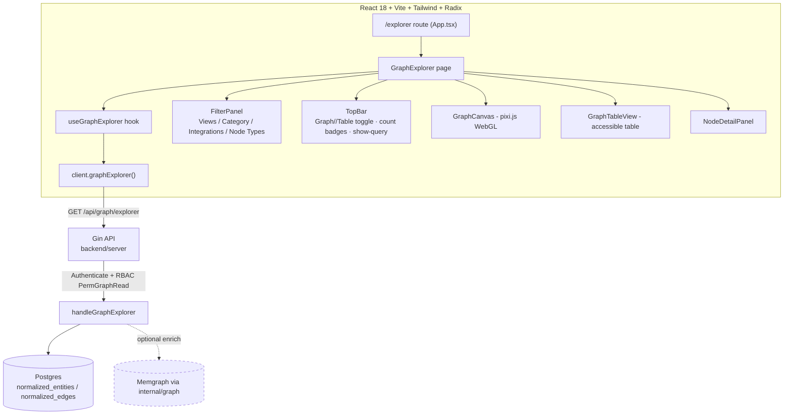
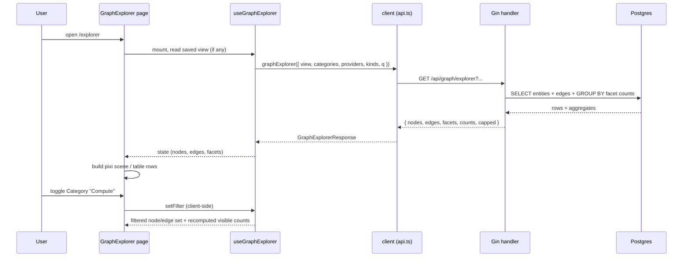

# Design Document: Graph Explorer

## Overview

The Graph Explorer is a new frontend feature (`src/features/graph-explorer/`) that renders Bellu's
canonical security graph — the normalized `entities` and `edges` of the AI/cloud environment — as an
interactive, force-directed canvas scaling to ~4,000+ nodes and ~4,000+ edges. It is the Bellu
analogue of the reference "Explorer" page: a large graph canvas with live node/edge count badges, a
left filter panel (category, integration/provider, and node-type facets with per-facet counts, plus
free-text type search), a saved-views vs new-view toggle, a Graph/Table view switch, and
selection-driven detail on click.

The feature builds strictly on the existing stack. Rendering uses **pixi.js (WebGL)** for the large
canvas — the only library in `package.json` that handles thousands of simultaneously drawn nodes at
interactive frame rates — with a custom lightweight force simulation. The smaller, structured
subgraph that opens when a user drills into a single node reuses **reactflow + dagre** for a clean
layered layout. Data is served by one new, read-only, RBAC-gated backend endpoint
(`GET /api/graph/explorer`) that aggregates nodes, edges, and facet counts from the existing
Postgres `normalized_entities` / `normalized_edges` tables, so the explorer works even when Memgraph
is down (graceful degradation, mirroring the existing `graph: false` health behavior).

Accessibility is a first-class concern (the repo tests with `vitest-axe`): the WebGL canvas is a
visual aid, but all data — counts, filters, selection, and the full node/edge set — is reachable
through the accessible Table view and keyboard-operable filter controls.

---

## Architecture



Key architectural decisions:

- **Postgres as the primary source, Memgraph optional.** The explorer's node/edge/facet data comes
  from the normalized SQL tables that are always present. Memgraph is used only for optional
  relationship-expansion (neighbors-of-a-node) and is allowed to be `nil`; when it is, those optional
  enrichments degrade to the SQL `normalized_edges` adjacency instead of returning a 5xx.
- **Server computes facets and counts; client filters the rendered set.** The endpoint returns the
  working node/edge set (bounded by a cap) plus full facet count maps computed over the whole graph,
  so badge counts are accurate even when the rendered set is capped. Category/provider/type toggles
  then filter client-side for instant interaction without refetching.
- **Single data seam.** The page calls `client.graphExplorer(...)` following the existing
  `src/lib/client.ts` → `src/lib/api.ts` pattern (real backend, typed against `src/types/`).



---

## Components and Interfaces

All UI components live under `src/features/graph-explorer/`, split into `components/`, `hooks/`,
and `lib/` subfolders following the `dashboard` feature convention. Shared Radix/shadcn primitives
(`Switch`, `Tabs`, `Checkbox`, `Select`, `Popover`, `Table`, `Badge`, `Card`) come from
`@/components/ui/*` and are already installed.

### Component: GraphExplorer (page)

**Purpose**: Top-level page composed into the `/explorer` route. Orchestrates data fetch, filter
state, and view mode; lays out the filter panel, top bar, canvas/table, and detail panel.

```typescript
export default function GraphExplorer(): JSX.Element
```

**Responsibilities**:
- Mount `useGraphExplorer` and pass state down.
- Render `FilterPanel`, `TopBar`, and either `GraphCanvas` or `GraphTableView` by `viewMode`.
- Show loading, error, and graph-unavailable (degraded) states.

### Component: FilterPanel

**Purpose**: Left panel with the Views toggle, View selector, type search, and the collapsible
Category / Integrations / Node Types facet sections.

```typescript
interface FilterPanelProps {
  facets: GraphFacets
  filter: GraphFilter
  onFilterChange: (next: GraphFilter) => void
  views: SavedView[]
  activeViewId: string | null
  onSelectView: (id: string | null) => void
  onSaveView: (name: string) => void
}
export function FilterPanel(props: FilterPanelProps): JSX.Element
```

**Responsibilities**:
- `Tabs` (Radix) for "New View" / "Saved Views".
- `Select` (Radix) for the current View with name + description.
- Free-text "Filter types…" input that narrows the Node Types list.
- `FacetSection` instances for Category, Integrations, Node Types, each a collapsible list of
  `Checkbox` + label + count badge.

### Component: FacetSection

**Purpose**: One collapsible, keyboard-operable group of checkbox facet rows with counts.

```typescript
interface FacetRow {
  key: string
  label: string
  count: number
}
interface FacetSectionProps {
  title: string
  rows: FacetRow[]
  selected: Set<string>
  onToggle: (key: string) => void
  collapsible?: boolean
  searchTerm?: string
}
export function FacetSection(props: FacetSectionProps): JSX.Element
```

### Component: TopBar

**Purpose**: Top controls — "Show generated query" `Switch`, "Visualize as" Graph/Table toggle, node
and edge count `Badge`s, and a history button.

```typescript
interface TopBarProps {
  viewMode: 'graph' | 'table'
  onViewModeChange: (m: 'graph' | 'table') => void
  nodeCount: number
  edgeCount: number
  showQuery: boolean
  onToggleQuery: (v: boolean) => void
  generatedQuery: string
}
export function TopBar(props: TopBarProps): JSX.Element
```

### Component: GraphCanvas (pixi.js)

**Purpose**: WebGL force-directed rendering of the filtered node/edge set; handles pan, zoom, hover,
and click-to-select. This is the performance-critical component.

```typescript
interface GraphCanvasProps {
  nodes: GraphNode[]
  edges: GraphEdge[]
  selectedId: string | null
  onSelect: (id: string | null) => void
  colorForCategory: (category: string) => number // 0xRRGGBB for pixi tint
}
export function GraphCanvas(props: GraphCanvasProps): JSX.Element
```

**Responsibilities**:
- Own a `PIXI.Application` in a container ref; create it once, destroy on unmount.
- Draw edges in a single batched `PIXI.Graphics`, nodes as sprites from a shared circle texture
  (instancing keeps draw calls low at 4k nodes).
- Run the force simulation (see `ForceLayout` below) on a decoupled ticker; sync positions each frame.
- Hit-test pointer events to the nearest node for hover/selection.
- Pause the simulation when the tab is hidden or after the layout cools (alpha threshold).

**Responsibility it does NOT own**: data semantics. It receives already-filtered, already-colored
data and reports selection by id; it has no knowledge of facets or the API.

### Component: GraphTableView

**Purpose**: Accessible, virtualized table of the same filtered node set (and an edges tab), serving
as the data-equivalent of the canvas for screen readers and keyboard users.

```typescript
interface GraphTableViewProps {
  nodes: GraphNode[]
  edges: GraphEdge[]
  selectedId: string | null
  onSelect: (id: string | null) => void
}
export function GraphTableView(props: GraphTableViewProps): JSX.Element
```

### Component: NodeDetailPanel

**Purpose**: Slide-over panel shown on node selection: kind/provider/name/canonical_id, attributes,
evidence/source refs, and immediate neighbors (relations in/out).

```typescript
interface NodeDetailPanelProps {
  node: GraphNode | null
  neighbors: GraphEdge[]
  onClose: () => void
  onFocusNeighbor: (id: string) => void
}
export function NodeDetailPanel(props: NodeDetailPanelProps): JSX.Element
```

### Hook: useGraphExplorer

**Purpose**: Encapsulates fetching, filter state, saved views, derived counts, and client-side
filtering so the page stays presentational.

```typescript
interface UseGraphExplorer {
  loading: boolean
  error: string | null
  graphAvailable: boolean       // false => degraded banner, canvas disabled, table still works
  facets: GraphFacets
  filter: GraphFilter
  setFilter: (next: Partial<GraphFilter>) => void
  visibleNodes: GraphNode[]     // after client-side filter
  visibleEdges: GraphEdge[]
  visibleNodeCount: number
  visibleEdgeCount: number
  capped: boolean
  views: SavedView[]
  activeViewId: string | null
  selectView: (id: string | null) => void
  saveView: (name: string) => void
  selectedId: string | null
  select: (id: string | null) => void
}
export function useGraphExplorer(): UseGraphExplorer
```

---

## Data Models

### Domain mapping (reference screenshot → Bellu canonical model)

| Screenshot facet      | Bellu source field                                   | Notes |
|-----------------------|------------------------------------------------------|-------|
| Node Types            | `entity.kind` (`Compute`, `DataStore`, `Identity`, …)| Direct from `ENTITY_KINDS`. |
| Integrations          | `entity.provider` (`aws`, `github`, `cloudflare`, …) | Direct from `provider`. |
| Category              | derived grouping of `kind` (see `CATEGORY_FOR_KIND`) | Server-computed category label. |
| Node count badge      | count of entities in working set                     | |
| Edge count badge      | count of edges in working set                        | |
| "All Resources" View  | a built-in `SavedView` with empty filter             | |

Category is a presentation grouping over `kind`, defined once and shared (server authoritative,
client mirror for labels):

```typescript
// src/features/graph-explorer/lib/categories.ts
export const CATEGORY_FOR_KIND: Record<string, string> = {
  Compute: 'Compute',
  Cluster: 'Compute',
  Workload: 'Compute',
  ContainerImage: 'Compute',
  DataStore: 'Storage',
  Identity: 'IAM',
  CloudAccount: 'IAM',
  Repository: 'Source Control',
  Package: 'Supply Chain',
  Vulnerability: 'Vulnerabilities',
  AIAgent: 'AI',
  AIModel: 'AI',
  Prompt: 'AI',
  MCPServer: 'AI',
  AIService: 'AI',
  NetworkEndpoint: 'Networking',
  ExternalService: 'Networking',
}
export const DEFAULT_CATEGORY = 'Other'
```

### Frontend types (`src/types/graphExplorer.ts`)

```typescript
export interface GraphNode {
  id: string            // canonical_id
  kind: string          // entity kind -> Node Type facet
  provider: string      // provider -> Integration facet
  category: string      // derived -> Category facet
  name: string
  stale: boolean
  // layout fields are mutated by the force sim, kept out of equality checks
  x?: number
  y?: number
}

export interface GraphEdge {
  id: string
  source: string        // src canonical_id
  target: string        // dst canonical_id
  relation: string      // e.g. RUNS_IN, CAN_READ
  confidence: number
}

export interface FacetCount {
  key: string
  label: string
  count: number
}

export interface GraphFacets {
  categories: FacetCount[]
  providers: FacetCount[]
  kinds: FacetCount[]
}

export interface GraphFilter {
  view: string              // view key, e.g. 'all'
  categories: string[]      // selected category keys (empty = all)
  providers: string[]
  kinds: string[]
  typeSearch: string        // free-text narrowing of the Node Types list
}

export interface SavedView {
  id: string
  name: string
  description: string
  filter: GraphFilter
  builtin: boolean
}

export interface GraphExplorerResponse {
  nodes: GraphNode[]
  edges: GraphEdge[]
  facets: GraphFacets
  nodeCount: number    // total matching server-side (may exceed returned nodes)
  edgeCount: number
  capped: boolean      // true when the working set hit the server cap
  graphAvailable: boolean
}
```

**Validation rules**:
- `GraphFilter` arrays empty ⇒ "no filter on this facet" (show all), matching the screenshot where
  nothing checked means everything is shown.
- `nodeCount`/`edgeCount` are the authoritative badge values; the client never infers them from a
  capped `nodes` array.
- Saved views are persisted in `localStorage` keyed by user id (no new backend table in v1); the
  built-in "All Resources" view is always present and non-deletable.

### Backend response contract (Go, `backend/server`)

```go
// explorerNode mirrors src/types GraphNode (snake_case json, matching existing
// entity serialization).
type explorerNode struct {
    ID       string `json:"id"`
    Kind     string `json:"kind"`
    Provider string `json:"provider"`
    Category string `json:"category"`
    Name     string `json:"name"`
    Stale    bool   `json:"stale"`
}

type explorerEdge struct {
    ID         string  `json:"id"`
    Source     string  `json:"source"`
    Target     string  `json:"target"`
    Relation   string  `json:"relation"`
    Confidence float64 `json:"confidence"`
}

type facetCount struct {
    Key   string `json:"key"`
    Label string `json:"label"`
    Count int64  `json:"count"`
}

type explorerResponse struct {
    Nodes          []explorerNode `json:"nodes"`
    Edges          []explorerEdge `json:"edges"`
    Facets         facets         `json:"facets"`
    NodeCount      int64          `json:"nodeCount"`
    EdgeCount      int64          `json:"edgeCount"`
    Capped         bool           `json:"capped"`
    GraphAvailable bool           `json:"graphAvailable"`
}

type facets struct {
    Categories []facetCount `json:"categories"`
    Providers  []facetCount `json:"providers"`
    Kinds      []facetCount `json:"kinds"`
}
```

---

## Rendering Choice Justification (~4k nodes)

| Option | Draw model | ~4k nodes + ~4k edges | Verdict |
|--------|-----------|------------------------|---------|
| **pixi.js (WebGL)** | GPU, batched sprites + one Graphics for edges | Smooth pan/zoom, 60fps achievable with instancing | **Chosen for the main canvas.** Already in deps; the only option built for this scale. |
| reactflow | React-reconciled DOM/SVG nodes | Hundreds of nodes fine; thousands cause reconciliation + DOM-node overhead | Used only for the **drill-in neighborhood view** (small, structured). |
| recharts | SVG charts | Not a node-graph renderer | Not applicable. |

`dagre` is used with reactflow to lay out the small neighborhood subgraph (layered DAG). The main
canvas uses the custom `ForceLayout` below because a generic React graph library cannot keep 4k
animated nodes at interactive rates.

---

## Algorithmic Pseudocode

### Force layout (frontend, runs on pixi ticker)

A Barnes-Hut-free, O(n) per-tick approximation is insufficient at 4k nodes if done naively (O(n²)
repulsion). We use a **spatial grid** to bound repulsion to nearby nodes, giving ~O(n) per tick.

```typescript
// src/features/graph-explorer/lib/forceLayout.ts
function stepForceLayout(
  nodes: GraphNode[],
  edges: GraphEdge[],
  alpha: number,
  grid: SpatialGrid,
): number
```

**Preconditions**:
- Every `edge.source`/`edge.target` references an `id` present in `nodes`.
- Each node has numeric `x`, `y` (seeded on first tick from a circle/phyllotaxis spread).
- `alpha` in `(0, 1]`; `grid` cell size ≈ desired node spacing.

**Postconditions**:
- Node `x`/`y` are updated in place toward a lower-energy configuration.
- Returns the next `alpha` = `alpha * ALPHA_DECAY`; simulation is considered cooled when the return
  value `< ALPHA_MIN`.
- No nodes are added or removed; `nodes.length` and `edges.length` are unchanged.

**Loop invariants**:
- The spatial grid, after `rebuild`, contains exactly the current nodes bucketed by cell — every node
  appears in exactly one cell at the point repulsion is computed.
- Repulsion is applied only between node pairs sharing a cell or adjacent cells, so each pair is
  considered at most once per tick.

```pascal
ALGORITHM stepForceLayout(nodes, edges, alpha, grid)
BEGIN
  ASSERT alpha > 0 AND alpha <= 1

  grid.rebuild(nodes)                      // bucket nodes into cells

  // 1. Repulsion (bounded to neighboring cells → ~O(n))
  FOR each node n IN nodes DO
    FOR each m IN grid.neighbors(n) DO     // m shares or borders n's cell
      IF m.id <> n.id THEN
        d ← distance(n, m)
        force ← REPULSION / max(d*d, EPSILON)
        applyPush(n, m, force * alpha)
      END IF
    END FOR
  END FOR

  // 2. Attraction along edges (spring)
  FOR each e IN edges DO
    s ← nodes[e.source]; t ← nodes[e.target]
    d ← distance(s, t)
    force ← (d - LINK_DISTANCE) * LINK_STRENGTH
    applyPull(s, t, force * alpha)
  END FOR

  // 3. Weak centering so disconnected components stay on screen
  FOR each node n IN nodes DO
    n.vx ← (n.vx + (CENTER_X - n.x) * CENTER_GRAVITY) * VELOCITY_DECAY
    n.vy ← (n.vy + (CENTER_Y - n.y) * CENTER_GRAVITY) * VELOCITY_DECAY
    n.x ← n.x + n.vx
    n.y ← n.y + n.vy
  END FOR

  ASSERT count(nodes) unchanged AND count(edges) unchanged
  RETURN alpha * ALPHA_DECAY
END
```

### Client-side filtering (frontend)

```typescript
function applyFilter(
  nodes: GraphNode[],
  edges: GraphEdge[],
  filter: GraphFilter,
): { nodes: GraphNode[]; edges: GraphEdge[] }
```

**Preconditions**: `nodes`/`edges` are the full fetched working set; `filter` arrays may be empty.

**Postconditions**:
- A node is included iff it matches every *active* facet (empty facet array ⇒ matches all).
- An edge is included iff both endpoints are in the included node set.
- Result node/edge arrays are subsets of the inputs (no new objects synthesized), preserving identity
  for memoized pixi sprites.

**Loop invariant**: at every step the `included` node-id set contains exactly the nodes examined so
far that passed all active facet predicates.

```pascal
ALGORITHM applyFilter(nodes, edges, filter)
BEGIN
  included ← empty Set

  FOR each n IN nodes DO
    ASSERT included contains only previously-passing nodes
    keep ← true
    IF filter.categories nonempty AND n.category NOT IN filter.categories THEN keep ← false
    IF filter.providers  nonempty AND n.provider NOT IN filter.providers  THEN keep ← false
    IF filter.kinds      nonempty AND n.kind     NOT IN filter.kinds      THEN keep ← false
    IF keep THEN included.add(n.id)
  END FOR

  outNodes ← [ n IN nodes WHERE n.id IN included ]
  outEdges ← [ e IN edges WHERE e.source IN included AND e.target IN included ]

  RETURN { nodes: outNodes, edges: outEdges }
END
```

Note: `filter.typeSearch` only narrows the **Node Types list in the panel** (which facet rows are
shown), not the rendered graph; selecting a kind from the narrowed list is what filters the graph.

### Backend aggregation (Go)

```go
func (s *Store) GraphExplorer(ctx context.Context, f ExplorerFilter) (*ExplorerData, error)
```

**Preconditions**:
- `ctx` carries the request deadline; `f.Limit > 0` (handler supplies a default cap, e.g. 5000).
- Caller has already passed `Authenticate` + `RequirePermission(PermGraphRead)` and resolved any
  `project_id` scoping (reuse `CanAccessProject`, as `handleEntities` does).

**Postconditions**:
- Returns up to `f.Limit` entities (as nodes) and the edges among the returned node set.
- `NodeCount`/`EdgeCount` reflect totals matching the filter across the whole graph (not the capped
  slice), computed with `count(*)`.
- Facet maps cover the whole filtered graph via `GROUP BY`, independent of the cap.
- `Capped = NodeCount > len(nodes)`.
- Read-only: only `SELECT` statements are issued; no writes.

```pascal
ALGORITHM GraphExplorer(ctx, f)
BEGIN
  ASSERT f.Limit > 0

  // 1. Bounded node working set (parameterized; f.* never concatenated)
  nodes ← SELECT canonical_id, kind, provider, name, stale
          FROM normalized_entities
          WHERE (f.kinds empty OR kind = ANY($kinds))
            AND (f.providers empty OR provider = ANY($providers))
          ORDER BY kind, canonical_id
          LIMIT f.Limit

  // 2. Edges strictly among the returned nodes
  ids ← collect(nodes.canonical_id)
  edges ← SELECT id, src_id, relation, dst_id, confidence
          FROM normalized_edges
          WHERE src_id = ANY($ids) AND dst_id = ANY($ids)

  // 3. Authoritative counts + facet aggregates over the whole filtered graph
  nodeCount ← SELECT count(*) FROM normalized_entities WHERE <same predicates>
  edgeCount ← SELECT count(*) FROM normalized_edges e
              WHERE e.src_id IN (matching) AND e.dst_id IN (matching)
  kindFacet     ← SELECT kind, count(*) ... GROUP BY kind
  providerFacet ← SELECT provider, count(*) ... GROUP BY provider
  categoryFacet ← fold kindFacet through CATEGORY_FOR_KIND, summing counts

  RETURN { nodes, edges, categoryFacet, providerFacet, kindFacet,
           nodeCount, edgeCount, capped: nodeCount > len(nodes) }
END
```

---

## Key Functions with Formal Specifications

### `handleGraphExplorer` (Gin handler, `backend/server`)

```go
func (s *Server) handleGraphExplorer(c *gin.Context)
```

**Preconditions**: mounted under the `gr` group (Authenticate + `PermGraphRead`). Query params:
`kinds`, `providers`, `categories` (CSV), `project_id` (optional), `limit` (optional).

**Postconditions**:
- `200` with `explorerResponse` on success.
- `GraphAvailable = s.graph != nil` — **never** returns 5xx merely because Memgraph is down, because
  the data is sourced from Postgres (graceful degradation per the existing `graph: false` pattern).
- `403` if `project_id` is supplied and the principal cannot access it (reuse `CanAccessProject`).
- `400` on malformed `project_id`/`limit`; `limit` is clamped to a server max (e.g. 5000) to protect
  the browser renderer and the DB.
- No side effects / no graph writes.

### `client.graphExplorer` (frontend, `src/lib/api.ts`)

```typescript
graphExplorer(filter?: Partial<GraphFilter> & { projectId?: number; limit?: number })
  : Promise<GraphExplorerResponse>
```

**Postconditions**: builds a `URLSearchParams` query (CSV for array facets), calls `get(...)`,
inherits the shared `request()` 401/`setToken(null)` behavior, and returns the typed response.
Registered in `realApi` and surfaced through `client` (foundation/real, not mock).

### `GraphCanvas` lifecycle

```typescript
useEffect(() => { /* create PIXI.Application + ticker */ return () => app.destroy(true) }, [])
```

**Preconditions**: a mounted container ref.
**Postconditions**: exactly one `PIXI.Application` per mount; it and all GPU textures/tickers are
destroyed on unmount (`app.destroy(true)`), preventing WebGL context leaks when navigating away.
**Loop invariant (ticker)**: on every frame, the number of node sprites equals `nodes.length` and
each sprite's position equals its node's `(x, y)` after `stepForceLayout`.

---

## Example Usage

```typescript
// Route registration (src/App.tsx) — RBAC-gated like the other graph pages.
import GraphExplorer from '@/features/graph-explorer/GraphExplorer'
// ...
<Route
  path="/explorer"
  element={
    <RequireAuth permission="graph:read">
      <GraphExplorer />
    </RequireAuth>
  }
/>
```

```typescript
// Page composition (abridged).
export default function GraphExplorer() {
  const g = useGraphExplorer()
  const [viewMode, setViewMode] = useState<'graph' | 'table'>('graph')

  if (g.loading) return <Spinner />
  return (
    <div className="flex h-full">
      <FilterPanel
        facets={g.facets}
        filter={g.filter}
        onFilterChange={(next) => g.setFilter(next)}
        views={g.views}
        activeViewId={g.activeViewId}
        onSelectView={g.selectView}
        onSaveView={g.saveView}
      />
      <div className="flex min-w-0 flex-1 flex-col">
        <TopBar
          viewMode={viewMode}
          onViewModeChange={setViewMode}
          nodeCount={g.visibleNodeCount}
          edgeCount={g.visibleEdgeCount}
          showQuery={false}
          onToggleQuery={() => {}}
          generatedQuery=""
        />
        {!g.graphAvailable && viewMode === 'graph' && (
          <DegradedBanner message="Live graph service is unavailable; showing stored graph data. Table view is fully available." />
        )}
        {viewMode === 'graph' ? (
          <GraphCanvas
            nodes={g.visibleNodes}
            edges={g.visibleEdges}
            selectedId={g.selectedId}
            onSelect={g.select}
            colorForCategory={colorForCategory}
          />
        ) : (
          <GraphTableView
            nodes={g.visibleNodes}
            edges={g.visibleEdges}
            selectedId={g.selectedId}
            onSelect={g.select}
          />
        )}
      </div>
      <NodeDetailPanel
        node={g.visibleNodes.find((n) => n.id === g.selectedId) ?? null}
        neighbors={g.visibleEdges.filter((e) => e.source === g.selectedId || e.target === g.selectedId)}
        onClose={() => g.select(null)}
        onFocusNeighbor={g.select}
      />
    </div>
  )
}
```

```go
// Backend route wiring (backend/server/server.go, inside the gr group).
gr.GET("/graph/explorer", s.handleGraphExplorer)
```

---

## Correctness Properties

### Property 1: Badge accuracy under capping

For any filter, the displayed node/edge badge values equal the server's `count(*)` totals,
independent of whether `nodes`/`edges` were capped:
`∀ filter: badge.nodes == response.nodeCount ∧ badge.edges == response.edgeCount`.

**Validates: Requirements 5.4, 5.5, 5.6, 8.4**

### Property 2: Edge closure

Every rendered edge has both endpoints rendered:
`∀ e ∈ visibleEdges: e.source ∈ ids(visibleNodes) ∧ e.target ∈ ids(visibleNodes)`.

**Validates: Requirements 4.6, 8.8**

### Property 3: Empty-facet semantics

An empty selection on a facet imposes no constraint:
`filter.kinds == [] ⇒ applyFilter keeps all kinds` (and likewise categories, providers).

**Validates: Requirements 4.4**

### Property 4: Facet-sum consistency

The sum of a facet's counts equals the total node count for that partition:
`Σ facets.kinds[*].count == nodeCount` (kinds partition the node set).

**Validates: Requirements 8.5**

### Property 5: Filter monotonicity

Adding a facet selection never increases the visible set:
`visible(filter ∪ {k}) ⊆ visible(filter)`.

**Validates: Requirements 4.7**

### Property 6: Graceful degradation

When `s.graph == nil`, `GET /api/graph/explorer` still returns `200` with
`graphAvailable == false` and a non-empty node set (from Postgres), never 5xx.

**Validates: Requirements 11.1, 11.2, 11.3**

### Property 7: Layout stability

`stepForceLayout` preserves node/edge counts every tick and the simulation cools
(`alpha` strictly decreases toward `ALPHA_MIN`), guaranteeing termination of animation.

**Validates: Requirements 2.1, 2.2, 2.4**

### Property 8: Table/canvas parity

The set of node ids shown in Table view equals the set rendered on the canvas for the
same filter (accessibility equivalence).

**Validates: Requirements 6.3**

---

## Error Handling

### Scenario: Memgraph unavailable (`s.graph == nil`)
**Condition**: Memgraph down at startup or during the request.
**Response**: endpoint serves Postgres-sourced data with `graphAvailable: false`.
**Recovery**: UI shows a non-blocking `DegradedBanner`; Table view and all SQL-backed facets remain
functional. Optional neighbor-expansion falls back to `normalized_edges` adjacency.

### Scenario: Result set exceeds the cap
**Condition**: filter matches more than the server `limit`.
**Response**: `capped: true`, `nodeCount`/`edgeCount` still exact; the canvas renders the capped slice.
**Recovery**: UI shows a "showing N of M — refine filters" hint so counts and rendering stay honest.

### Scenario: API/network error or 401
**Condition**: fetch fails or token expired.
**Response**: `request()` throws; 401 clears the token and the app redirects to `/login` (existing
behavior). Other errors surface an inline error state on the page.

### Scenario: WebGL unavailable
**Condition**: browser/GPU lacks a usable WebGL context.
**Response**: `GraphCanvas` detects the failed context and renders a fallback notice.
**Recovery**: the page auto-suggests Table view, which needs no GPU.

### Scenario: Invalid `project_id` / unauthorized project
**Response**: `400` (malformed) or `403` (not accessible), reusing the `handleEntities` checks.

---

## Testing Strategy

### Unit testing (Vitest + Testing Library)
- `applyFilter`: empty-facet = all; AND across facets; edge closure (property 2); monotonicity.
- `CATEGORY_FOR_KIND` folding: every `ENTITY_KINDS` member maps to a category or `DEFAULT_CATEGORY`.
- `useGraphExplorer`: derived counts, saved-view persistence (localStorage), degraded flag handling.
- `FacetSection` / `FilterPanel`: checkbox toggles call `onToggle`, `typeSearch` narrows the list.
- `TopBar`: Graph/Table toggle and badge rendering.
- Go: `handleGraphExplorer` with `graph == nil` returns 200 + `graphAvailable:false`; cap clamping;
  `403` on inaccessible `project_id`; facet-sum equals node count (property 4) on a seeded fixture.

### Accessibility testing (vitest-axe)
- `FilterPanel`, `TopBar`, `GraphTableView`, and `NodeDetailPanel` each assert `toHaveNoViolations()`.
- Keyboard: facet checkboxes and tabs are reachable and operable via keyboard; the canvas container
  has an accessible label and an explicit "switch to Table view" affordance for non-visual users.
- Table/canvas parity (property 8) asserted so screen-reader users get the same data set.

### Integration testing
- `client.graphExplorer` against a mocked `fetch` returning a fixture, asserting query-string
  construction (CSV facets, `project_id`, `limit`) and typed parsing.
- Go handler test wired to a test Postgres (mirroring `findings_handlers_integration_test.go`) to
  verify counts, capping, and facet aggregation end-to-end.

### Performance testing
- A seeded 4,000-node / 4,000-edge fixture; assert `applyFilter` runs within a frame budget and that
  `stepForceLayout` with the spatial grid stays ~O(n) (bounded pair comparisons per tick).

---

## Performance Considerations

- **WebGL batching**: shared circle texture + sprite instancing for nodes; one `PIXI.Graphics` for
  all edges, redrawn per frame only while the layout is hot. Target 60fps at 4k nodes.
- **Spatial-grid repulsion** bounds the force simulation to ~O(n) per tick (vs naive O(n²)).
- **Simulation cooling**: stop ticking below `ALPHA_MIN` and when the tab is hidden; resume on
  interaction, to avoid burning GPU/CPU on a settled graph.
- **Server cap** (`limit`, default 5000) protects both the DB query and the browser; counts stay exact
  via separate `count(*)` so capping never lies.
- **Client-side facet filtering** avoids refetching on every toggle; only the View selector (which may
  change scope/limit) triggers a new request.
- **Memoization**: `visibleNodes`/`visibleEdges` are referentially stable subsets so pixi sprite maps
  are reused rather than rebuilt on unrelated re-renders.

---

## Security Considerations

- **RBAC**: `/api/graph/explorer` is mounted in the `gr` group behind `Authenticate` +
  `RequirePermission(PermGraphRead)` — identical to `/api/entities` and `/api/stats`.
- **Project scoping**: when `project_id` is passed, authorization is enforced via `CanAccessProject`
  (reusing `handleEntities`' pattern); tenant/principal is resolved server-side, never from the client.
- **Query safety**: all SQL is parameterized (`$1`, `ANY($ids)`); facet CSV inputs are validated
  against the known `kind`/`provider`/`category` allow-lists before use — never concatenated into SQL.
- **No writes**: the endpoint and `Store.GraphExplorer` issue only `SELECT`s; no Cypher writes.
- **Input bounds**: `limit` is clamped server-side to prevent resource-exhaustion via large requests.
- **Untrusted attributes**: entity `name`/`attributes` originate from scanned environments and are
  treated as untrusted display data (rendered as text, never as HTML/markup).

---

## Dependencies

All already present in `frontend/package.json` — no new runtime dependencies are introduced:
- `pixi.js ^8` — WebGL canvas for the large force-directed graph.
- `reactflow ^11` + `dagre ^0.8` — layered layout for the small node-neighborhood drill-in view.
- `@radix-ui/*` (`tabs`, `switch`, `checkbox`, `select`, `popover`, `tooltip`, `separator`) — filter
  panel and top-bar controls (shadcn-style, via `@/components/ui/*`).
- `lucide-react`, `clsx`, `tailwind-merge`, `class-variance-authority` — icons and styling utilities.
- Testing: `vitest`, `@testing-library/react`, `vitest-axe`, `axe-core`.

Backend:
- `gin`, `internal/store` (Postgres), `internal/auth` (RBAC), and optionally `internal/graph`
  (Memgraph) — all existing. No new Go module dependencies.
