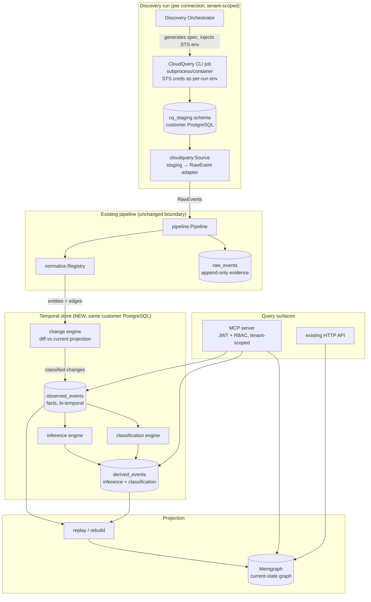
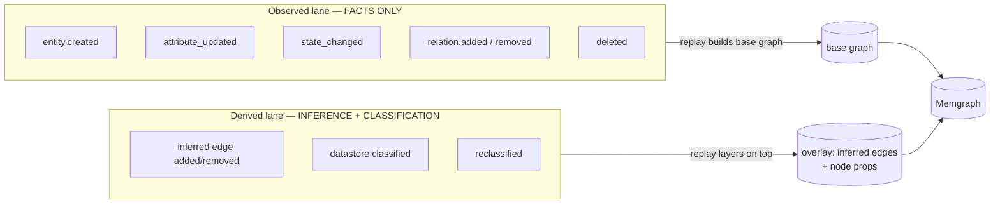
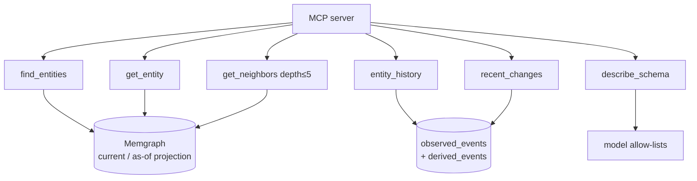
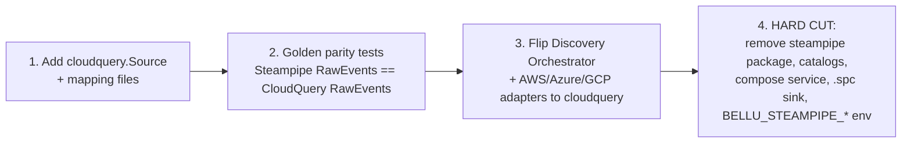

# Design Document: temporal-graph-cloudquery

## Overview

Bellu today collects cloud inventory with Steampipe and projects a *stateless*
graph: `normalized_entities` / `normalized_edges` keep only `first_seen`,
`last_seen`, `stale`, and overwrite attributes on every run. The graph can
answer "what exists now" but never "what did it look like last Tuesday" or
"when did this bucket become public".

This feature does four things, reusing the existing
`Source → rawevent.RawEvent → normalize.Normalizer → store → graph.Writer`
pipeline rather than replacing it:

1. **Replace Steampipe with CloudQuery.** CloudQuery runs as a per-discovery
   CLI job, syncing cloud inventory into a `cq_staging` schema in the *same*
   customer PostgreSQL. A CloudQuery→RawEvent adapter keeps every existing
   normalizer unchanged, so the hard cut of Steampipe is a swap at the Source
   boundary, not a rewrite of the pipeline.
2. **Add a Toise-inspired event-sourced temporal graph.** Two append-only logs
   in the customer PostgreSQL — `observed_events` (facts) and `derived_events`
   (inference/classification) — become the source of truth. Memgraph becomes a
   rebuildable projection. Bi-temporal columns (`event_time`, `recorded_at`)
   give time travel, history, and an audit view.
3. **Add cross-source inferred-dependency edges** (repo→workload, workload→
   identity, service→service, monitor→resource) in a *derived* layer, never
   mixed into the facts log.
4. **Add datastore classification** (rule-based first, a small model later)
   into the same derived layer, surfaced as namespaced Memgraph node properties.

The result mirrors the Tolmo "Internal Discovery Agent" feature set — full-stack
discovery, hidden dependencies, data classification, and a time machine — while
preserving Bellu's richer evidence model (every entity/edge carries raw-event
evidence, sources, and confidence; Toise's edges are bare).

**This design keeps two hard invariants from Toise:**

- **Facts-only log.** `observed_events` stores only asserted facts. Inference
  and classification are a separate derived lane. A replay never mixes lanes.
- **Projection, not truth.** Memgraph holds no state that cannot be rebuilt by
  replaying the two logs.

> **Scope note.** Toise's design ideas are reused; its Go lives under its own
> `internal/` and is **not** importable, and Pebble is **not** added. The two
> logs are plain PostgreSQL tables alongside the existing goose migrations.

---

## Architecture

### Architecture (ingestion pipeline)



Only the **Source** changes (Steampipe → CloudQuery adapter). `rawevent`,
`normalize`, `store.raw_events`, and the `graph.Writer` MERGE path are reused.
The change/inference/classification engines sit *after* normalization and
*before* the Memgraph projection.

### Two-log model (bi-temporal, two lanes)



Both lanes are bi-temporal:

| Column        | Meaning                                             | Default query use              |
|---------------|-----------------------------------------------------|--------------------------------|
| `event_time`  | when the fact became true in the world              | "reality view" (as-of ranges)  |
| `recorded_at` | when Bellu learned it (ingest time)                 | "audit view" (`asKnownAt`)     |

Default queries range over `event_time`. `asKnownAt(t)` adds
`recorded_at <= t` to reconstruct what Bellu *knew* at time `t`.

### Projection / rebuild

```mermaid
sequenceDiagram
    participant R as rebuild job
    participant OBS as observed_events
    participant DER as derived_events
    participant MG as Memgraph

    R->>MG: (optional) clear projection for tenant
    R->>OBS: stream events ORDER BY event_time, recorded_at, seq
    loop base graph
        OBS-->>R: observed event
        R->>MG: MERGE entity / MERGE edge (reuse graph.Writer)
    end
    R->>DER: stream events ORDER BY event_time, recorded_at, seq
    loop derived overlay
        DER-->>R: derived event
        R->>MG: SET node props (data_class...) / MERGE inferred=true edge
    end
    R->>MG: reference-counted deletion sweep
    Note over R,MG: Memgraph now equals the two logs replayed.<br/>Incremental ingest appends; full rebuild replays from scratch.
```

### Query surfaces



---

## Components and Interfaces

### Component overview

#### 1. `cloudquery.Source` (new, `internal/source/cloudquery`)
Replaces `internal/source/steampipe`. Implements the existing
`source.Source` interface. Runs a CloudQuery CLI job per discovery, then reads
the resulting `cq_staging` rows and emits one `rawevent.RawEvent` per row via a
table-mapping file (same shape as the Steampipe catalog YAML). Capability gating
and the `source.ProgressReporter` contract are preserved.

#### 2. CloudQuery job runner (new)
Generates a per-connection CloudQuery spec, launches the CLI as a subprocess or
container, injects STS session credentials as per-run environment variables
(never persisted), and reports table progress through the existing reporter.

#### 3. Change engine (new, `internal/temporal`)
Diffs the normalized result of a run against the current projection and writes
exactly-once-classified `observed_events`. Implements reference-counted
deletion, replacing `MarkStaleEntitiesBySource`.

#### 4. Inference engine (new, `internal/temporal/infer`)
Reads observed facts (env vars, event-source mappings, secret refs, IaC, repo/CI
metadata) and emits inferred edges into `derived_events`. Derived lane only.

#### 5. Classification engine (new, `internal/temporal/classify`)
Stage A rule-based, Stage B model-refined (later). Classifies each `DataStore`
by likely content + reader/writer sets without reading stored data. Same output
shape for both stages, written to `derived_events`.

#### 6. Replay / rebuild (new, `internal/temporal/replay`)
Rebuilds Memgraph from the two logs: observed first (base graph via the existing
`graph.Writer`), then derived (overlay).

#### 7. MCP server (new, in the Go API)
Behind the existing JWT + RBAC, tenant-scoped. Exposes the six read tools.

### CloudQuery Source + adapter interfaces (`internal/source/cloudquery`)

```go
package cloudquery

// Source implements source.Source. It runs a CloudQuery job, then reads the
// cq_staging rows and emits one rawevent.RawEvent per row using a TableMapping.
// It replaces internal/source/steampipe at the same pipeline boundary, so
// normalizers are unchanged.
type Source struct {
    dsn      string          // customer PostgreSQL DSN (reads cq_staging)
    schema   string          // staging schema name, default "cq_staging"
    mapping  *Catalog        // table-mapping file (see below)
    runner   JobRunner       // launches the CloudQuery CLI; nil in parity tests
    enabled  map[string]bool // capability gating, same semantics as steampipe
}

// Name returns "cloudquery".
func (s *Source) Name() string

// Collect runs the job (if a runner is wired), then streams RawEvents from the
// staging rows. Each row -> one RawEvent via mapRow. Progress is reported per
// table through run.Reporter (nil-safe), mirroring the Steampipe source.
func (s *Source) Collect(ctx context.Context, run source.Run) (<-chan rawevent.RawEvent, <-chan error)

// Factory builds a Source from the connector's config map. Required keys mirror
// steampipe.Factory: a DSN (or host/port/user/password/database), the mapping
// file (or a "connection" that resolves to <mapping_dir>/<conn>.yaml), and the
// optional "capabilities" gating list.
func Factory(cfg map[string]any) (source.Source, error)

// JobRunner launches the CloudQuery CLI for one discovery run. The spec is
// generated per connection; STS credentials are injected via Env and are never
// persisted. A nil JobRunner means "staging is already populated" (parity tests
// and the Steampipe->CloudQuery golden comparison).
type JobRunner interface {
    // Run executes `cloudquery sync <spec>` to completion. spec selects source
    // (aws/azure/gcp/k8s) + the postgresql destination into schema cq_staging.
    // env carries AWS_* session credentials for this run only.
    Run(ctx context.Context, spec Spec, env map[string]string, rep source.ProgressReporter) error
}

// Spec is the generated CloudQuery configuration for one run.
type Spec struct {
    Provider    string   // aws | azure | gcp | k8s
    Tables      []string // CloudQuery table/resource selectors (from the mapping)
    Regions     []string // optional region restriction
    DestSchema  string   // "cq_staging"
    DestDSN     string   // customer PostgreSQL (destination)
    WriteMode   string   // UNVERIFIED default; see spike
}

// mapRow turns one staging row (table + JSON object) into a RawEvent, selecting
// id/scope/region columns per the TableSpec, then calling ev.Finalize(). Source
// is always "cloudquery"; Provider comes from the mapping. This is the single
// place that produces the Source field normalizers key on.
func (s *Source) mapRow(run source.Run, provider, table string, spec TableSpec, obj map[string]any) rawevent.RawEvent
```

### Change engine: diff + classify (`internal/temporal`)

The engine runs once per ingest, after `normalize.Registry.Normalize` produces
the run's `Result`, and before the Memgraph projection. It diffs the run's
entities/edges against the current projection cache
(`normalized_entities`/`normalized_edges`, reused as a fast "last known state")
and emits exactly-once-classified `observed_events`.

```go
package temporal

// Change is one classified difference for the observed lane.
type Change struct {
    ElementKind string          // "entity" | "edge"
    ChangeType  string          // observed_events.change_type value
    CanonicalID string
    Relation    string          // edge only
    DstID       string          // edge only
    Attributes  map[string]any  // new full snapshot (empty for deleted)
    Diff        Diff            // added/removed/changed attribute keys
    EvidenceIDs []string
    EventTime   time.Time       // from the raw events' observed_at
}

type Diff struct {
    Added   []string
    Removed []string
    Changed []string
}

// Engine diffs a run against current state and appends observed_events.
type Engine struct {
    store *store.Store
}

// Apply classifies every element in res against current state for (org, source),
// writes the resulting observed_events in one transaction, and updates the
// entity_assertions reference counts. It returns the changes for the caller to
// hand to the replay step. Unchanged elements are coalesced (see Retention).
func (e *Engine) Apply(ctx context.Context, org int64, runID, source string, res normalize.Result, evidence map[string][]string) ([]Change, error)
```

**Diff / classify algorithm (per element, exactly one classification):**

```
ALGORITHM classifyChanges(org, source, res, current):
  changes ← []

  // ---- Entities ----
  FOR each entity e IN res.Entities:
      prev ← current.entity[e.CanonicalID]
      IF prev = NULL THEN
          emit(entity.created, e, diff=all keys added)
      ELSE IF stateField(e) ≠ stateField(prev) THEN
          emit(entity.state_changed, e, diff of changed keys)   // e.g. public/private
      ELSE IF attributes(e) ≠ attributes(prev) THEN
          emit(entity.attribute_updated, e, diff of changed keys)
      ELSE
          recordUnchanged(e)        // coalesced; no row unless heartbeat horizon
      END IF
      upsert entity_assertions(org, e.CanonicalID, source, runID)

  // ---- Edges ----
  FOR each edge g IN res.Edges:
      prev ← current.edge[(g.Src, g.Relation, g.Dst)]
      IF prev = NULL THEN emit(relation.added, g)
      ELSE IF attributes(g) ≠ attributes(prev) THEN emit(relation.attribute_changed, g)
      ELSE recordUnchanged(g)

  // ---- Deletions are reference-counted, handled separately ----
  changes ← changes ∪ referenceCountedDeletions(org, source, runID, res)
  RETURN changes
```

- `stateField` extracts the small set of lifecycle/exposure attributes
  (e.g. public access, enabled, status) so a meaningful toggle is classified as
  `state_changed`, not a generic `attribute_updated`.
- Exactly-once: the first matching branch wins; an element is never emitted
  under two change types in one run.
- The write path adds one diff pass per run. Cost is bounded by **actual change
  volume** (only changed/added/removed elements write rows), not inventory size.

### Reference-counted deletion (replaces `MarkStaleEntitiesBySource`)

An entity is deleted only when **no source** still asserts it. The current
`stale` flag is replaced by the `entity_assertions` reference set.

```go
// referenceCountedDeletions compares the entities this run (for this source)
// asserted against the entity_assertions this source held before the run. Any
// entity the source previously asserted but did not this run has its assertion
// row removed; if that leaves zero rows across ALL sources, an entity.deleted
// is emitted and the node is marked deleted in the projection.
func (e *Engine) referenceCountedDeletions(ctx context.Context, org int64, runID, source string, res normalize.Result) ([]Change, error)
```

```
ALGORITHM referenceCountedDeletions(org, source, runID, asserted):
  priorIDs  ← SELECT canonical_id FROM entity_assertions
                WHERE org_id=org AND source=source
  assertedIDs ← { e.CanonicalID : e ∈ asserted.Entities }
  dropped   ← priorIDs \ assertedIDs

  FOR each id IN dropped:
      DELETE entity_assertions WHERE org_id=org AND canonical_id=id AND source=source
      remaining ← COUNT(*) entity_assertions WHERE org_id=org AND canonical_id=id
      IF remaining = 0 THEN
          emit(entity.deleted, id, event_time = now)   // no source asserts it anymore
      END IF
  RETURN deletions
```

This is per-source and per-tenant: source B keeping a resource alive prevents
source A's absence from deleting it, which the single boolean `stale` could not
express.

### As-of / asKnownAt query interfaces

A point-in-time state for an element is the fold of its event stream up to a
cutoff. Two independent cutoffs give the four views:

| View              | Predicate                                            |
|-------------------|------------------------------------------------------|
| current (reality) | all events, `event_time <= now()`                    |
| as-of `T`         | `event_time <= T`                                    |
| audit `asKnownAt` | `event_time <= T_event AND recorded_at <= T_known`   |
| history           | the ordered event stream itself (no fold)            |

```go
// StateAt reconstructs an entity's attributes/liveness as of eventTime, as
// Bellu knew it at knownAt. Pass knownAt = time.Now() for the reality view.
func (q *Querier) StateAt(ctx context.Context, org int64, canonicalID string, eventTime, knownAt time.Time) (*EntityState, error)

// History returns the ordered change stream for an element (both lanes merged by
// time), newest or oldest first per opts. Powers the MCP entity_history tool.
func (q *Querier) History(ctx context.Context, org int64, canonicalID string, opts HistoryOpts) ([]ChangeRow, error)

// RecentChanges returns changes across the tenant since a cutoff, for the MCP
// recent_changes tool.
func (q *Querier) RecentChanges(ctx context.Context, org int64, since time.Time, limit int) ([]ChangeRow, error)
```

Fold query (entity state as-of), reality view:

```sql
-- Latest observed row per element wins; a terminal entity.deleted means absent.
SELECT DISTINCT ON (canonical_id) canonical_id, change_type, attributes, event_time
FROM observed_events
WHERE org_id = $1 AND canonical_id = $2
  AND event_time  <= $3            -- as-of cutoff
  AND recorded_at <= $4            -- asKnownAt cutoff (now() for reality)
ORDER BY canonical_id, event_time DESC, recorded_at DESC, seq DESC;
```

The derived lane folds the same way; a full point-in-time graph is: fold
observed to get base nodes/edges, then fold derived (inferred edges +
classification props) at the same cutoffs.

### Memgraph rebuild interfaces (base, then derived overlay)

Reuses `graph.Writer` for the base graph. The overlay adds node properties and
`inferred`-tagged edges without new allow-list entries beyond an `inferred` edge
property.

```go
package replay

// Rebuilder replays the two logs into Memgraph. For a full rebuild it folds
// both lanes to a point-in-time snapshot and writes it; for incremental ingest
// it applies only the current run's changes.
type Rebuilder struct {
    store  *store.Store
    writer *graph.Writer
}

// RebuildAsOf projects the two logs into Memgraph for a point in time. base
// first (observed fold -> graph.Writer.SyncEntities/SyncEdges), then overlay
// (derived fold -> SetDataClass + inferred edges). Reference-counted deletions
// become MarkStale/absence in the projection.
func (r *Rebuilder) RebuildAsOf(ctx context.Context, org int64, eventTime, knownAt time.Time) error

// ApplyRun is the incremental path used at the end of each ingest: it writes the
// run's observed changes (base) then derived changes (overlay). No full replay.
func (r *Rebuilder) ApplyRun(ctx context.Context, org int64, observed []temporal.Change, derived []DerivedChange) error
```

```
PROCEDURE RebuildAsOf(org, eventTime, knownAt):
  // --- base graph (observed lane) ---
  entities ← foldObservedEntities(org, eventTime, knownAt)   // excludes deleted
  edges    ← foldObservedEdges(org, eventTime, knownAt)
  writer.SyncEntities(entities)                               // existing MERGE path
  writer.SyncEdges(edges)                                     // existing MERGE path

  // --- derived overlay ---
  classes  ← foldClassifications(org, eventTime, knownAt)
  FOR each c IN classes:
      SET node props data_class, data_class_confidence, classified_by   // namespaced
  inferred ← foldInferredEdges(org, eventTime, knownAt)
  FOR each ie IN inferred:
      MERGE edge with property inferred=true, confidence, evidence_ids

  // --- liveness ---
  writer.MarkStale(idsWithNoRemainingAssertions)
```

Derived classification surfaces as namespaced node properties
(`data_class`, `data_class_confidence`, `classified_by`), and inferred edges
carry `inferred=true` + `confidence` + `evidence`, so a query can always
separate asserted facts from derivations.

### Inference engine (derived lane, `internal/temporal/infer`)

```go
// Rule maps observed facts to a candidate inferred edge. Each rule reads only
// observed_events / normalized attributes — never derived output — keeping the
// facts/inference separation. Providers add rules; the engine never branches on
// provider type.
type Rule interface {
    Name() string                                   // e.g. "env-var-dependency"
    Infer(ctx context.Context, in InferInput) ([]InferredEdge, error)
}

type InferredEdge struct {
    SrcID      string
    Relation   model.Relation   // reuse existing: BUILT_FROM, RUNS_IMAGE, AUTHENTICATES_AS, CALLS, DEPENDS_ON, USES
    DstID      string
    Confidence float64
    Evidence   []string
    Origin     string           // "rule"
    Producer   string
}
```

Rule set this phase (all emit into `derived_events`, relations reused from
`model`):

| Signal source                         | Edge                                   |
|---------------------------------------|----------------------------------------|
| env vars / secret references          | workload `DEPENDS_ON` datastore/service |
| event-source mappings                 | service `CALLS` service                 |
| IaC + repo/CI metadata                | repo `BUILT_FROM` / `RUNS_IMAGE` workload |
| workload execution role               | workload `AUTHENTICATES_AS` identity    |
| Datadog/Sentry monitor config (later) | monitor `USES` resource                 |

### Classification engine (derived lane, `internal/temporal/classify`)

```go
// Classifier labels a DataStore by likely content and reader/writer sets,
// WITHOUT reading stored data. Stage A (rules) and Stage B (model) produce the
// SAME DataClass shape, so the derived lane and Memgraph props are stage-agnostic.
type Classifier interface {
    Origin() string                              // "rule" | "model"
    Classify(ctx context.Context, in ClassifyInput) ([]DataClass, error)
}

type DataClass struct {
    CanonicalID string   // the DataStore
    Class       string   // e.g. "pii", "secrets", "logs", "public", "internal"
    Readers     []string // identity canonical_ids granted read
    Writers     []string // identity canonical_ids granted write
    Confidence  float64
    Evidence    []string
    ClassifiedBy string  // producer id -> Memgraph classified_by
}
```

Stage A rule inputs: naming conventions, IaC definitions, and IAM policy
reader/writer derivation. Stage B refines labels later into the same lane with
`origin="model"`; no projection or schema change is needed to adopt it.

### MCP tool signatures (`internal/mcp`, mounted in the Go API)

Behind the existing JWT + RBAC, tenant-scoped (every tool takes the org from the
authenticated context, never from the client). Outputs carry names alongside
ids; errors are plain messages. `get_neighbors` depth is capped at 5.

```go
// Each tool is a method on Server; Server holds the Querier (logs) and the
// graph.Writer.Driver() (projection). org is resolved from the JWT, not args.

// find_entities: search by kind/name/attribute; returns id + name + kind.
func (s *Server) FindEntities(ctx context.Context, org int64, in FindEntitiesInput) ([]EntityRef, error)

// get_entity: full current (or as-of) entity incl. derived classification props.
func (s *Server) GetEntity(ctx context.Context, org int64, in GetEntityInput) (*EntityDetail, error)

// get_neighbors: adjacency to depth N (1..5, capped). Mixes asserted + inferred
// edges, each tagged with its lane.
func (s *Server) GetNeighbors(ctx context.Context, org int64, in GetNeighborsInput) (*Neighbors, error)

// entity_history: ordered change stream (both lanes) for one entity.
func (s *Server) EntityHistory(ctx context.Context, org int64, in EntityHistoryInput) ([]ChangeRow, error)

// recent_changes: tenant-wide change feed since a cutoff.
func (s *Server) RecentChanges(ctx context.Context, org int64, in RecentChangesInput) ([]ChangeRow, error)

// describe_schema: the model allow-lists (kinds, relations) + derived props.
func (s *Server) DescribeSchema(ctx context.Context, org int64) (*SchemaDoc, error)

type GetNeighborsInput struct {
    CanonicalID string
    Depth       int    // clamped to [1,5]
    EventTime   time.Time // zero = now (reality view)
    KnownAt     time.Time // zero = now
}
```

---

## Data Models

### High-level data-model table

| Store | Table | Role |
|-------|-------|------|
| customer PG | `cq_staging.*` | CloudQuery sync target (ephemeral per run) |
| customer PG | `raw_events` *(existing)* | append-only evidence, unchanged |
| customer PG | `observed_events` *(new, 00015)* | facts, bi-temporal, change taxonomy |
| customer PG | `derived_events` *(new, 00016)* | inference + classification |
| customer PG | `normalized_entities/edges` *(existing)* | current projection cache (kept) |
| Memgraph | graph | rebuildable projection |

### Migration 00015: `observed_events` (goose style)

Follows the conventions of `00001_evidence.sql` / `00002_normalized.sql`:
`TEXT` ids, `JSONB` attribute bags, `TIMESTAMPTZ NOT NULL DEFAULT now()`,
explicit indexes, and a `-- +goose Up` / `-- +goose Down` pair.

```sql
-- +goose Up
-- observed_events is the append-only FACTS log. One row per classified change
-- a source asserted about an entity or edge during a run. It is the source of
-- truth for the base graph; Memgraph is a replayable projection of it.
--
-- Bi-temporal: event_time is when the fact became true in the world;
-- recorded_at is when Bellu learned it (ingest time). Default (reality) queries
-- range over event_time; asKnownAt(t) adds recorded_at <= t (audit view).
CREATE TABLE observed_events (
    seq           BIGSERIAL PRIMARY KEY,          -- total order tiebreak within a (event_time, recorded_at)
    org_id        BIGINT NOT NULL,                -- tenant scope (mirrors connector tables)
    run_id        TEXT NOT NULL REFERENCES collection_runs(run_id),
    source        TEXT NOT NULL,                  -- producing collector family: cloudquery, syft, zeek...
    element_kind  TEXT NOT NULL,                  -- 'entity' | 'edge'
    change_type   TEXT NOT NULL,                  -- see CHECK below
    -- Identity of the changed element.
    canonical_id  TEXT,                           -- entity canonical_id, or edge src for edge changes
    relation      TEXT,                           -- edge relation (edge changes only)
    dst_id        TEXT,                           -- edge dst (edge changes only)
    -- Payload of the change. For attribute_updated/attribute_changed this is the
    -- new attribute set (full snapshot) plus an optional diff; empty for deleted.
    attributes    JSONB NOT NULL DEFAULT '{}'::jsonb,
    diff          JSONB NOT NULL DEFAULT '{}'::jsonb,   -- {added,removed,changed} keys, informational
    confidence    DOUBLE PRECISION NOT NULL DEFAULT 1.0,
    -- Evidence linkage: the raw events that justify this change (ids into raw_events).
    evidence_ids  TEXT[] NOT NULL DEFAULT '{}',
    -- Bi-temporal.
    event_time    TIMESTAMPTZ NOT NULL,           -- when the fact became true (defaults to observed_at)
    recorded_at   TIMESTAMPTZ NOT NULL DEFAULT now(),
    CONSTRAINT observed_events_change_type_chk CHECK (change_type IN (
        'entity.created','entity.attribute_updated','entity.state_changed',
        'entity.deleted','entity.unchanged',
        'relation.added','relation.removed','relation.attribute_changed'
    )),
    CONSTRAINT observed_events_edge_shape_chk CHECK (
        (element_kind = 'entity' AND relation IS NULL AND dst_id IS NULL)
        OR (element_kind = 'edge' AND relation IS NOT NULL AND dst_id IS NOT NULL)
    )
);

-- Time-travel / history access paths.
CREATE INDEX observed_events_event_time_idx  ON observed_events (org_id, event_time);
CREATE INDEX observed_events_recorded_idx    ON observed_events (org_id, recorded_at);
CREATE INDEX observed_events_entity_idx      ON observed_events (org_id, canonical_id, event_time);
CREATE INDEX observed_events_edge_idx        ON observed_events (org_id, canonical_id, relation, dst_id, event_time);
CREATE INDEX observed_events_run_idx         ON observed_events (run_id);

-- Reference-counted liveness per source: who currently asserts an entity.
-- An entity is deleted (entity.deleted written) only when this set becomes empty.
CREATE TABLE entity_assertions (
    org_id       BIGINT NOT NULL,
    canonical_id TEXT NOT NULL,
    source       TEXT NOT NULL,
    last_run_id  TEXT NOT NULL,
    last_seen    TIMESTAMPTZ NOT NULL DEFAULT now(),
    PRIMARY KEY (org_id, canonical_id, source)
);
CREATE INDEX entity_assertions_entity_idx ON entity_assertions (org_id, canonical_id);

-- +goose Down
DROP TABLE entity_assertions;
DROP TABLE observed_events;
```

### Migration 00016: `derived_events` (goose style)

```sql
-- +goose Up
-- derived_events is the append-only DERIVED log: inference (cross-source edges)
-- and classification (datastore labels). It is NEVER mixed into observed_events.
-- Replay layers these over the base graph: inferred edges carry inferred=true;
-- classifications become namespaced node properties.
CREATE TABLE derived_events (
    seq           BIGSERIAL PRIMARY KEY,
    org_id        BIGINT NOT NULL,
    run_id        TEXT NOT NULL REFERENCES collection_runs(run_id),
    kind          TEXT NOT NULL,                  -- 'inferred_edge' | 'classification'
    change_type   TEXT NOT NULL,                  -- see CHECK below
    origin        TEXT NOT NULL,                  -- 'rule' | 'model'
    producer      TEXT NOT NULL DEFAULT '',       -- rule name or model id (e.g. 'rule:env-var-dependency')
    -- Target of the derivation.
    canonical_id  TEXT,                           -- classified entity, or inferred-edge src
    relation      TEXT,                           -- inferred edge relation (inferred_edge only)
    dst_id        TEXT,                           -- inferred edge dst (inferred_edge only)
    -- Derived payload: for classification -> {data_class, readers[], writers[]};
    -- for inferred_edge -> optional edge attributes.
    attributes    JSONB NOT NULL DEFAULT '{}'::jsonb,
    confidence    DOUBLE PRECISION NOT NULL DEFAULT 0.0,
    evidence_ids  TEXT[] NOT NULL DEFAULT '{}',   -- raw_event ids / observed_events seqs that justify it
    event_time    TIMESTAMPTZ NOT NULL,
    recorded_at   TIMESTAMPTZ NOT NULL DEFAULT now(),
    CONSTRAINT derived_events_change_type_chk CHECK (change_type IN (
        'inferred.added','inferred.removed','inferred.attribute_changed',
        'classified','reclassified','declassified'
    )),
    CONSTRAINT derived_events_shape_chk CHECK (
        (kind = 'inferred_edge' AND relation IS NOT NULL AND dst_id IS NOT NULL)
        OR (kind = 'classification' AND relation IS NULL AND dst_id IS NULL)
    )
);

CREATE INDEX derived_events_event_time_idx ON derived_events (org_id, event_time);
CREATE INDEX derived_events_recorded_idx   ON derived_events (org_id, recorded_at);
CREATE INDEX derived_events_target_idx     ON derived_events (org_id, canonical_id, event_time);
CREATE INDEX derived_events_run_idx        ON derived_events (run_id);

-- +goose Down
DROP TABLE derived_events;
```

> **Note on `_cq_*` columns and write modes.** CloudQuery's PostgreSQL
> destination adds `_cq_id`, `_cq_source_name`, `_cq_sync_time`, `_cq_parent_id`
> and uses an `overwrite` vs `append` write mode. The exact column set, the
> default write mode, and plugin licensing/cost are **UNVERIFIED** — see the
> Risks section for the required spike. The adapter isolates us from this:
> staging schema details stay inside `cloudquery.Source`.

### Table-mapping file shape (`internal/source/cloudquery/mapping/<provider>.yaml`)

Deliberately the same shape as the existing Steampipe catalog
(`TableSpec`: `table`, `id_column`, `scope_column`, `region_column`,
`capability`, `regions`, `where`), so the parity cut is a data migration, not a
schema change. One added field maps a Bellu table to its CloudQuery staging
table when the names differ.

```yaml
provider: aws
connection: aws
tables:
  - table: aws_iam_role          # Bellu resource_type (kept identical to Steampipe)
    cq_table: aws_iam_roles      # CloudQuery staging table name (NEW; defaults to table)
    id_column: arn
    scope_column: account_id
    region_column: ""            # IAM is global
    capability: core
  - table: aws_s3_bucket
    cq_table: aws_s3_buckets
    id_column: arn
    scope_column: account_id
    region_column: region
    capability: core
  - table: aws_bedrock_custom_model
    cq_table: aws_bedrock_custom_models
    id_column: model_arn
    scope_column: account_id
    region_column: region
    capability: ai
    regions: ["us-east-1","us-west-2","eu-central-1"]   # service not in every region
```

```go
// Catalog / TableSpec reuse the Steampipe field names; CQTable is the only
// addition. resourceType() still defaults to Table; cqTable() defaults to Table.
type TableSpec struct {
    Table        string   `yaml:"table"`
    CQTable      string   `yaml:"cq_table"`
    ResourceType string   `yaml:"resource_type"`
    IDColumn     string   `yaml:"id_column"`
    ScopeColumn  string   `yaml:"scope_column"`
    RegionColumn string   `yaml:"region_column"`
    Where        string   `yaml:"where"`
    Regions      []string `yaml:"regions"`
    Capability   string   `yaml:"capability"`
}
```

### Retention (heartbeat coalescing + baseline events)

```
- Consecutive `*.unchanged` observations are coalesced: no row is written while
  an element is unchanged. entity_assertions.last_seen is bumped instead.
- At the retention horizon, before pruning old rows, write a BASELINE event
  (full attribute snapshot, change_type attribute_updated, event_time = horizon)
  so as-of queries after the pruned window still resolve to correct state.
- Pruning deletes observed/derived rows older than the horizon EXCEPT baselines.
```

---

## Error Handling

### CloudQuery job failures

- **Per-run env, no persistence.** STS session credentials are injected into the
  job's environment only. On any failure path (crash, timeout, non-zero exit)
  the env map is discarded; nothing credential-bearing is written to the staging
  DB, the on-disk spec, logs, or the error returned to the API.
- **Non-zero exit.** `JobRunner.Run` returns a non-nil error when the CLI exits
  non-zero. `Source.Collect` surfaces it on the error channel and emits **no**
  partial RawEvents from an aborted sync, so the change engine never diffs
  against a half-synced inventory.
- **Partial sync.** If the sync fails after some tables completed, the run is
  treated as failed as a whole: the ingest transaction (below) is not committed,
  so no `observed_events` are written and `entity_assertions` are untouched. A
  partial table set must never trigger reference-counted deletions (an entity
  absent only because its table failed to sync must not be marked deleted).
- **Timeout / cancellation.** `ctx` cancellation propagates to the subprocess;
  the job is killed and the error channel receives `ctx.Err()`.

### Per-table error isolation (mirrors the Steampipe source)

Reading `cq_staging` is per-table, matching the Steampipe source's behavior: a
failure mapping or reading one table (missing column, malformed JSON, absent
staging table) is logged and reported through `source.ProgressReporter`, and
that table is skipped rather than aborting the whole `Collect`. The distinction
from a job failure: a *sync* failure fails the run (incomplete inventory); a
single *mapping* failure on an otherwise complete sync is isolated so one bad
table does not block the rest. Skipped tables are counted and surfaced so the
run is visibly degraded, not silently partial.

### Change-engine transaction rollback

`Engine.Apply` writes all `observed_events` rows and all `entity_assertions`
updates for a run inside **one transaction**. Any failure mid-write (constraint
violation, connection drop) rolls back the whole transaction: no partial change
set is ever persisted, and the reference counts stay consistent with the last
committed run. The caller receives the error and does not proceed to the replay
step.

### Reference-counted deletion safety

Deletion is only emitted when `entity_assertions` has zero rows for a
canonical_id across **all** sources. The guard holds under failure:

- A failed/aborted sync for source A does not drop A's assertions, so A's
  resources are not deleted on a failed run.
- Decrementing an assertion and checking the remaining count happen in the same
  transaction as the deletion emission, so a crash cannot leave an entity both
  un-asserted and un-deleted (or vice versa).
- A re-run after a transient failure re-asserts the same entities, restoring any
  assertion rows that a prior partial attempt might otherwise have questioned.

### Replay / rebuild failures and idempotent re-run

- **Idempotent writes.** Base graph writes reuse `graph.Writer`'s MERGE path and
  overlay writes use MERGE/SET, so re-running a rebuild or re-applying a run
  produces the same graph — a failed rebuild can simply be retried.
- **Full rebuild as recovery.** If incremental `ApplyRun` leaves Memgraph in a
  suspect state (e.g. the process died mid-overlay), `RebuildAsOf(now)` replays
  the two logs from scratch and is the authoritative recovery path, since the
  logs — not Memgraph — are the source of truth.
- **Projection-only failures do not lose facts.** A Memgraph outage fails the
  projection step but the committed `observed_events`/`derived_events` are
  intact; the projection is rebuilt when Memgraph returns.

### MCP tool errors (plain, user-friendly messages)

- Invalid input returns a plain message, not a stack trace or internal detail.
  `get_neighbors` with `depth > 5` is clamped to 5 (not an error); an explicitly
  rejected value returns e.g. "depth must be between 1 and 5".
- A missing entity returns "entity not found" rather than a null dereference.
- Tenant scoping is enforced from the JWT; a client-supplied org is ignored, and
  cross-tenant lookups simply return not-found rather than leaking existence.
- Backend errors (Memgraph/PostgreSQL unavailable) are mapped to a generic
  "temporarily unavailable" message; internal error text is logged, not returned.

### Unverified CloudQuery destination behavior (guarded path)

The exact `_cq_*` column set, the default write mode, and plugin licensing are
**UNVERIFIED** (see Risks). The adapter treats staging as untrusted shape:
`_cq_*` columns are explicitly ignored by `mapRow`, unknown columns are tolerated
(not fatal), and the staging-schema assumptions are isolated inside
`cloudquery.Source` so a destination-behavior surprise is contained to one
package and surfaced as a per-table skip, not a pipeline crash. The spike must
land before this path is relied upon in production.

---

## Testing Strategy

- **Parity (golden) tests** — the Steampipe→CloudQuery cut is gated on
  byte-identical `RawEvent` output from both sources over shared fixtures.
- **Change-engine unit tests** — each change type is produced exactly once;
  table-driven cases for created / attribute_updated / state_changed / deleted /
  unchanged and relation.added / removed / attribute_changed.
- **Reference-counted deletion tests** — two sources asserting one entity; drop
  one, assert no deletion; drop both, assert `entity.deleted` + projection
  marked absent.
- **Bi-temporal query tests** — reality vs as-of vs `asKnownAt` on a crafted log
  (fact backdated via `event_time`, learned later via `recorded_at`).
- **Replay/rebuild tests** — rebuild Memgraph from logs and assert it equals the
  incremental projection (property: `rebuild(logs) == applyRuns(logs)`).
- **Inference/classification tests** — rule inputs → expected derived edges /
  data classes; derived output never appears in `observed_events`.
- **MCP tests** — tenant isolation (org from JWT), depth cap at 5, names present
  in output, plain-message errors.

## Correctness Properties

### Property 1: Replay determinism

Rebuilding Memgraph from the two logs yields the same graph as incremental
application: for any sequence of runs, `RebuildAsOf(T)` produces a projection
equal to the one obtained by applying each run's changes with `ApplyRun` up to
`T`. Formally, `rebuild(logs ≤ T) == applyRuns(logs ≤ T)`, and Memgraph holds no
state that cannot be reconstructed by replaying the two logs.

### Property 2: Facts/derived separation

No `derived_events` content ever appears in the observed lane and no observed
fact ever appears in the derived lane. No row in `observed_events` has
`kind='inferred_edge'|'classification'`; no inferred edge or classification ever
writes to `observed_events`. Inference rules read only observed/normalized data,
never derived output.

### Property 3: Reference-counted deletion

An entity is marked deleted (an `entity.deleted` row is emitted and the node is
marked absent in the projection) **if and only if** it has zero rows in
`entity_assertions` across all sources. While any source still asserts the
entity, no deletion is produced.

### Property 4: As-of correctness and monotonicity

`StateAt(T_event, T_known)` reflects exactly the events with
`event_time <= T_event` and `recorded_at <= T_known`, folded in
`(event_time, recorded_at, seq)` order. For a fixed `T_event`, increasing
`T_known` is monotonic: it only adds information (a previously known fact is
never removed by learning more).

### Property 5: Steampipe/CloudQuery parity

For the same inventory fixture, the CloudQuery adapter produces the same
normalized entities and edges as the Steampipe source — the emitted `RawEvent`
sets are byte-identical after `Finalize`, so downstream normalization yields
identical `normalized_entities` / `normalized_edges`.

## Security Considerations

- STS session credentials for CloudQuery are injected as **per-run environment
  variables** and never written to the staging DB, the spec file on disk, logs,
  or the API. (Mirrors the existing `DiscoveryPlan.CredentialEnv` contract.)
- Classification reads **metadata only** (naming, IaC, IAM policy) — never the
  contents of a datastore.
- MCP is tenant-scoped by the authenticated org, behind the existing JWT + RBAC;
  no tool accepts a client-supplied org.
- `cq_staging` lives in the customer PostgreSQL only; the two-plane boundary
  (customer PG/Memgraph vs global-intel) is unchanged.

## Dependencies

- **CloudQuery CLI** (sync job) + its **PostgreSQL destination plugin**.
- Existing: `pgx`, `goose`, `neo4j-go-driver` (Bolt → Memgraph), the connector
  provider adapters, `rawevent`, `normalize`, `model`, `graph`, `store`.
- An MCP server library for the Go API (or a thin JSON-RPC handler behind the
  existing router).

## Risks / Unverified Items

| Item | Status | Action |
|------|--------|--------|
| CloudQuery PG destination write modes, `_cq_*` columns, plugin licensing/cost | **UNVERIFIED** | Dedicated spike before building the adapter; isolate inside `cloudquery.Source` |
| CloudQuery plugins for Datadog, Sentry, identity provider | **UNVERIFIED** | Verify availability before scheduling those config sources (later phase) |
| Steampipe is wired deep (api main, adapters, compose, env, `.spc` sink) | Known | Hard cut is a discrete task with broad blast radius; gated on parity tests |
| Change engine adds a diff pass to every ingest (write-path load) | Known | Cost bounded by actual change volume, not inventory size; benchmark at batch scale |
| Toise change-feed under-reports at thousands of events/min | Noted | Batch/pull collection stays well under this; documented, not a blocker |

## Steampipe cutover (hard cut after parity)



Parity is proven by feeding identical fixtures through both sources (CloudQuery
staging populated from a fixture, Steampipe via its recorder) and asserting the
emitted `RawEvent` sets are byte-identical after `Finalize`. Only then is the
removal (broad blast radius: `backend/cmd/bellu-api/main.go`, the connector
adapters, `DiscoveryPlan`, `deploy/docker-compose.yml`, ~8 `BELLU_STEAMPIPE_*`
env vars) performed.

## Out of Scope (this phase)

GraphQL surface; deeper tenant isolation beyond org-scoping; log-stream
ingestion (Datadog/Sentry are read for monitor→resource **config** only). An
OTLP exporter is optional/last.
